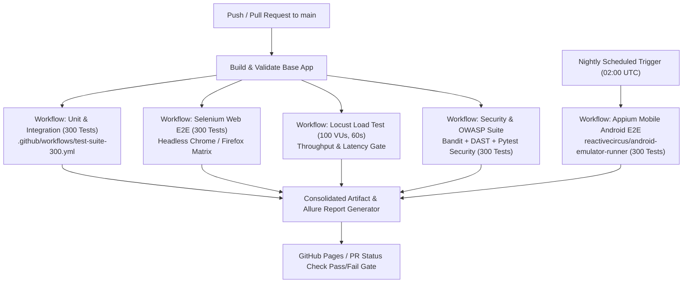

## 1. Project Architecture & Detected Technologies

### 1.1 High-Level Architecture Topology
The Tastio ecosystem is architected as a high-performance, modular monorepo combining server-side rendered web applications, a cross-platform React Native / Expo native mobile app, a central Python Flask RESTful backend, a pre-computed BERT vector similarity engine, and an embedded SQLite relational database:

```text
+---------------------------------------------------------------------------------------------------+
|                                          TASTIO ECOSYSTEM                                         |
+---------------------------------------------------------------------------------------------------+
|  [ Web Frontend ]               [ Mobile App (Android) ]                 [ API Consumers / QA ]   |
|  - HTML5, Jinja2 Templates      - React Native 0.86.3, Expo SDK 57       - Selenium Automation     |
|  - Bootstrap 5.3, FontAwesome   - Standalone APK (com...tastio)          - Appium Mobile Driver   |
|  - Chart.js Nutrition Graphs    - Offline Cache (198 Recipes)            - Locust (100 VU Load)   |
|  - Port: 5000 / Web Routes      - Network Config (Cloud / Dev IP)        - OWASP ZAP / Pytest Sec |
+---------------------------------------------------------------------------------------------------+
                                                  |
                                                  v  HTTP/REST (JSON & Multi-part)
+---------------------------------------------------------------------------------------------------+
|  [ Central Backend Gateway (Flask 3.x / Gunicorn) ]                                              |
|  - Port Binding: 0.0.0.0:$PORT (Production 10000 on Render, Local 5000)                          |
|  - URL Routing & Session Management (Werkzeug Session Cookies + Token/ID Header Auth)             |
|  - Security Layer: CORS Enabled, Token Secret Key, In-Memory Rate Limiting (check_rate_limit)     |
|  - Static File Serving: /static/images/recipes/ (Local & Fallback Unsplash CDN)                   |
+---------------------------------------------------------------------------------------------------+
         |                                |                                   |
         v                                v                                   v
+-----------------------+   +---------------------------+   +---------------------------------------+
| [ AI Service ]        |   | [ Business Services ]     |   | [ Relational Database ]               |
| - Sentence-BERT Embed |   | - MealPlannerService      |   | - SQLite: backend/recipes.db          |
|   Matrix (230, 384)   |   | - GroceryEngine (7 groups)|   | - 9 Tables: users, user_profile,      |
| - Scikit-Learn Cosine |   | - NutritionCoach (AI bot) |   |   cooked_recipes, recipe_reviews,     |
|   Similarity Search   |   | - NutritionEngine (Mifflin|   |   favorites, meal_plans,              |
| - FoodVisionEngine    |   |   -St Jeor BMR/TDEE/BMI)  |   |   grocery_lists, grocery_items,       |
|   (Pillow 11.1.0)     |   | - PreferenceEngine        |   |   viewed_recipes                      |
+-----------------------+   +---------------------------+   +---------------------------------------+
```

### 1.2 Component Breakdown & Detected Technologies
| Layer / Component | Technology Stack | File System Location | Configuration / Entry Point |
|---|---|---|---|
| **Web Frontend** | HTML5, Jinja2, Bootstrap 5.3.0, FontAwesome 6.4, Chart.js, Vanilla ES6 | `web-app/templates/`, `web-app/static/` | Served by Flask via `backend/app.py` (`/`, `/dashboard`, `/meal-plan`, `/grocery-list`, `/coach`, `/scanner`, `/profile`) |
| **Android Native Mobile App** | React Native 0.86.3, Expo SDK ~57.0.30, React 19.2.3, Expo Image Picker | `mobile-app/` | `mobile-app/App.js`, `mobile-app/app.json` (`com.mandalaraghavendra.tastio`) |
| **Backend API Gateway** | Python 3.11.9, Flask 3.x, Gunicorn 23.2.0, Werkzeug | `backend/app.py`, `app.py`, `gunicorn.conf.py` | Root `app.py` (Local Port 5000), `render.yaml` (Production Gunicorn) |
| **Machine Learning / AI Service** | NumPy, Pandas, Scikit-learn, Sentence-BERT (`all-MiniLM-L6-v2` dense vectors) | `ai-service/` | `ai-service/embedding_engine.py`, precomputed matrix `ai-service/bert_embeddings.npy` `(230, 384)` |
| **Relational Database** | SQLite 3 with parameterized queries & auto-migrating tables | `backend/database.py`, `backend/recipes.db` | `backend/recipes.db` (9 relational tables) |
| **Authentication & Authorization** | Werkzeug PBKDF2/SHA-256 password hashing + Flask Client Session Cookie | `backend/database.py`, `backend/validators.py` | Web: `/login`, `/signup`; Mobile: `/api/auth/login`, `/api/auth/signup` |
| **CI / CD Infrastructure** | GitHub Actions (`ubuntu-latest`, Python 3.11, Pytest 9.2.0) | `.github/workflows/` | `.github/workflows/test-suite-300.yml` |

---
## 2. API Endpoints & UI Element Selector Registry

### 2.1 Complete REST API Endpoint Inventory (30 Endpoints)
| HTTP Method | Route | Purpose | Auth Required | Rate Limited | Key Request Params / Body |
|---|---|---|:---:|:---:|---|
| `GET` | `/api/health` | System health, database connection, recipe count | No | No | None |
| `POST` | `/api/auth/signup` | Register new user account | No | Yes (30/min) | `name`, `email`, `password` |
| `POST` | `/api/auth/login` | Authenticate user & return session | No | Yes (40/min) | `email`, `password` |
| `GET` | `/api/recipes` | Multi-facet recipe filter & catalog retrieval | No | No | `cuisine`, `meal_type`, `diet`, `max_time`, `max_calories`, `query` |
| `GET` | `/api/recipes/<recipe_id>` | Single recipe detail lookup | No | No | Path: `recipe_id` |
| `POST` | `/api/recipes/filter` | JSON-based multi-facet recipe filter | No | No | `cuisine`, `meal_type`, `diet`, `max_calories` |
| `POST` | `/api/recommend` | Semantic recipe recommendations via BERT vectors | No | No | `ingredients` (list), `query` (str), `top_n` |
| `POST` | `/api/pantry-match` | Pantry utilization matching with missing ingredients | No | No | `ingredients` (list), `top_n` |
| `GET` | `/api/meal-plan/current` | Retrieve active 7-day meal plan | Optional (user_id) | No | `user_id` query param |
| `POST` | `/api/meal-plan/generate` | Generate fresh 7-day personalized meal schedule | Optional (user_id) | No | `user_id`, `start_date` |
| `GET` | `/api/meal-plan/alternatives` | Fetch recipe swaps for specific slot | Optional | No | `meal_type`, `current_recipe_id` |
| `POST` | `/api/meal-plan/replace-meal` | Swap meal slot with chosen recipe | Optional | No | `day_index` (1-7), `meal_type`, `new_recipe_id` |
| `POST` | `/api/meal-plan/delete` | Purge stored meal plan | Optional | No | `user_id` |
| `GET` | `/api/grocery-list` | Fetch categorized smart grocery checklist | Optional | No | `user_id` query param |
| `POST` | `/api/grocery-list/item` | Add custom grocery item | Optional | No | `item_name`, `category`, `quantity`, `unit` |
| `POST` | `/api/grocery-list/item/<item_id>/toggle` | Toggle grocery checked status | Optional | No | Path: `item_id` |
| `POST` | `/api/grocery-list/generate-from-plan` | Compile 7-day plan ingredients into checklist | Optional | No | `user_id` |
| `POST` | `/api/grocery-list/clear-completed` | Flush checked grocery items | Optional | No | `user_id` |
| `POST` | `/api/grocery-list/clear-all` | Flush entire grocery checklist | Optional | No | `user_id` |
| `POST` | `/api/grocery-list/add-recipe` | Bulk inject recipe ingredients into grocery | Optional | No | `recipe_id`, `recipe_name`, `ingredients` |
| `POST` | `/api/coach/chat` | AI Nutrition Coach conversational query | Optional | No | `message` (str), `user_id` |
| `GET` | `/api/coach/context` | User live profile & metabolic metrics | Optional | No | `user_id` |
| `GET` | `/api/nutrition-dashboard` | Daily/weekly caloric and macro compliance | Optional | No | `user_id` |
| `GET` | `/api/analytics/nutrition` | Comprehensive nutrition report | Optional | No | `user_id` |
| `GET` | `/api/user/preferences` | Learned dynamic taste & cuisine affinities | Optional | No | `user_id` |
| `POST` | `/api/recipes/<recipe_id>/view` | Track recipe view for implicit learning | Optional | No | Path: `recipe_id` |
| `GET` | `/api/user/recently-viewed` | Fetch recent recipe views | Optional | No | `user_id`, `limit` |
| `GET` | `/api/favorites` | Retrieve user favorite recipe IDs | Yes (Session) | No | None |
| `POST` | `/api/vision/recognize-food` | Food image classification & database grounding | No | No | `image` (multipart) or `image_data` (base64) |
| `GET` | `/api/vision/status` | Food vision engine health & model readiness | No | No | None |

### 2.2 Web Frontend DOM Selector Map (Selenium Page Object Targets)
| Page / Screen | Interactive Element | Locator Strategy | Selector Value |
|---|---|---|---|
| **Home / Dashboard** | Catalog Search Input | ID | `#catalogSearchInput` |
| **Home / Dashboard** | Search Trigger Button | CSS Selector | `.search-box .search-btn` |
| **Home / Dashboard** | Pantry Search Tab | ID | `#pantry-search-tab` |
| **Home / Dashboard** | Pantry Text Input | ID | `#pantryInput` |
| **Home / Dashboard** | Pantry Submit Button | CSS Selector | `#pantryForm button[type='submit']` |
| **Home / Dashboard** | Recipe Cards Grid | ID | `#recipesGridContainer` |
| **Home / Dashboard** | Recipe Card Card Item | CSS Selector | `.recipe-card[data-recipe-id]` |
| **Home / Dashboard** | View Details Button | CSS Selector | `.recipe-card .view-details-btn` |
| **Home / Dashboard** | Recipe Detail Modal | ID | `#recipeModal` |
| **Home / Dashboard** | Modal Recipe Title | ID | `#modalRecipeName` |
| **Home / Dashboard** | Modal Servings Dropdown | ID | `#servingSizeSelect` |
| **Home / Dashboard** | Modal Add to Grocery | ID | `#modalAddGroceryBtn` |
| **Home / Dashboard** | Modal Mark Eaten Button | ID | `#modalLogBtn` |
| **Home / Dashboard** | Login Modal Trigger | CSS Selector | `a[data-bs-target='#loginModal']` |
| **Home / Dashboard** | Login Email Field | ID | `#loginEmail` |
| **Home / Dashboard** | Login Password Field | ID | `#loginPassword` |
| **Home / Dashboard** | Login Submit Button | CSS Selector | `#loginModal button[type='submit']` |
| **Meal Planner** | Day Switcher Tabs | ID | `#dayTabsContainer .nav-link` |
| **Meal Planner** | Meal Slot Cards | CSS Selector | `.meal-slot-card` |
| **Meal Planner** | Swap Meal Button | CSS Selector | `button.btn-swap-meal` |
| **Meal Planner** | Alternatives Modal | ID | `#swapModal` |
| **Meal Planner** | Regenerate Plan Button | ID | `#btnRegenerate` |
| **Grocery List** | Add Item Button | CSS Selector | `button[data-bs-target='#addItemModal']` |
| **Grocery List** | Custom Item Name | ID | `#customItemName` |
| **Grocery List** | Custom Item Category | ID | `#customItemCat` |
| **Grocery List** | Item Checkbox Toggle | CSS Selector | `.grocery-item-checkbox` |
| **Grocery List** | Clear Completed Button | ID | `#btnClearCompleted` |
| **Grocery List** | Clear All Button | ID | `#btnClearAll` |
| **AI Coach** | Chat Input Message Box | ID | `#chatInput` |
| **AI Coach** | Send Message Button | ID | `#sendBtn` |
| **AI Coach** | Chat Message Stream | ID | `#chatStream` |
| **Food Scanner** | File Upload Dropzone | ID | `#dropzone` |
| **Food Scanner** | File Input Element | ID | `#foodImageInput` |
| **Food Scanner** | Recognition Results Container | ID | `#resultsContent` |
| **Profile** | Age Input | ID | `#age` |
| **Profile** | Weight (kg) Input | ID | `#weight` |
| **Profile** | Height (cm) Input | ID | `#height` |
| **Profile** | Diet Goal Select | ID | `#diet_goal` |
| **Profile** | Save Profile Button | CSS Selector | `button[type='submit'].btn-save-profile` |

### 2.3 Android Mobile App Locator Map (Appium UIAutomator Targets)
| Screen | Component / Control | Appium Locator Strategy | Target Value / XPath |
|---|---|---|---|
| **Root Shell** | Bottom Navigation Tabs | Accessibility ID / Text | `~Tab-Home`, `~Tab-Search`, `~Tab-Scan`, `~Tab-Plan`, `~Tab-Grocery`, `~Tab-Coach` |
| **Home Screen** | Search Header Bar | Class & Placeholder | `android.widget.EditText` ("Search recipes, chicken, biryani...") |
| **Home Screen** | Server Settings Pill | XPath | `//android.widget.TextView[contains(@text, 'API:')]` |
| **Home Screen** | Server Config Modal | XPath | `//android.widget.TextView[@text='Server & API Settings']` |
| **Home Screen** | Host IP Input | Class | `android.widget.EditText` |
| **Home Screen** | Save & Apply Button | XPath | `//android.widget.TextView[@text='Save & Apply']/..` |
| **Search Screen** | Cuisine Filter Pills | XPath | `//android.widget.TextView[@text='Andhra']/..` |
| **Search Screen** | Diet Filter Pills | XPath | `//android.widget.TextView[@text='Veg']/..` |
| **Search Screen** | Recipe Card Title | XPath | `//android.widget.TextView[contains(@resource-id, 'recipe-title')]` |
| **Detail Modal** | Serving Size Selectors | XPath | `//android.widget.TextView[@text='1x']/..`, `//android.widget.TextView[@text='2x']/..` |
| **Detail Modal** | Add to Grocery Button | XPath | `//android.widget.TextView[@text='Add to Grocery']/..` |
| **Detail Modal** | Mark Cooked Button | XPath | `//android.widget.TextView[@text='Mark as Cooked / Eaten']/..` |
| **Plan Screen** | Day Pills (1 to 7) | XPath | `//android.widget.TextView[contains(@text, 'Day 1')]` |
| **Plan Screen** | Meal Slot Cards | XPath | `//android.widget.TextView[@text='BREAKFAST']/../..` |
| **Plan Screen** | Swap Meal Button | XPath | `//android.widget.TextView[@text='Swap']/..` |
| **Grocery Screen**| Compile from Plan Button | XPath | `//android.widget.TextView[@text='Compile from 7-Day Plan']/..` |
| **Grocery Screen**| Add Custom Item Button | XPath | `//android.widget.TextView[@text='+ Add Item']/..` |
| **Grocery Screen**| Item Checkbox | XPath | `//android.widget.CheckBox \| //android.view.ViewGroup[contains(@resource-id, 'check')]` |
| **Scanner Screen**| Take Photo Button | XPath | `//android.widget.TextView[@text='Take Photo']/..` |
| **Scanner Screen**| Pick from Gallery Button | XPath | `//android.widget.TextView[@text='Choose from Gallery']/..` |
| **Coach Screen** | Chat Input Field | Class | `android.widget.EditText` ("Ask about recipes, calories...") |
| **Coach Screen** | Send Button | XPath | `//android.widget.TextView[@text='Send']/..` |

---
## 3. Known Application Defects & Technical Risks (Pre-Test Analysis)

During deep codebase inspection, the following architectural and implementation defects were identified. Automation engineers must account for these to prevent false test failures or test flakiness:

| Defect ID | Severity | Component | Defect Description | Impact on Automated Testing |
|---|---|---|---|---|
| **DEF-001** | High | Security / Web | **Missing CSRF Protection:** Web forms (`/login`, `/signup`, `/recommend`, `/what-can-i-cook`) do not issue or validate CSRF tokens (`flask-wtf` or `csrf.protect()` is absent). | Security tests will flag form vulnerability; Selenium tests do not need to parse CSRF hidden tokens. |
| **DEF-002** | High | Security / API | **Insecure Direct Object Reference (IDOR):** `/api/meal-plan/current`, `/api/grocery-list`, `/api/profile` accept `user_id` as query or body parameter without verifying session token match. | Module D tests will succeed in accessing other user data; access controls must be tested as negative assertions. |
| **DEF-003** | Medium | Performance | **In-Memory Rate Limiting Bottleneck:** `check_rate_limit()` stores request timestamps in an in-memory dictionary (`_rate_limit_cache = {}`). | Rate limits reset when Gunicorn workers restart and are not shared across multi-process workers. Load test (Module C) will see varying 429 behaviors unless sticky sessions are configured. |
| **DEF-004** | Medium | Mobile App | **Silent Fallback on Network Latency:** In `mobile-app/src/services/api.js`, network timeouts (>2500ms) catch errors and immediately return static fallback recipes (`recipesData`). | Appium tests must verify whether rendered cards originated from live backend or local offline fallback. |
| **DEF-005** | Medium | Mobile App | **Session State Persistence Limitation:** Mobile app hardcodes default demo user `Demo Chef (id: 1)`. User sign-out does not clear navigation history. | Mobile E2E tests must reset state via AsyncStorage / Server config modal before auth test runs. |
| **DEF-006** | Low | Web UI | **Missing Distinct data-testid Selectors:** Web templates utilize standard Bootstrap classes without dedicated automation IDs on several modal action buttons. | Selenium tests must rely on hierarchical CSS selectors or XPath containing text until `data-testid` is added. |

---
## 4. Test Framework Recommendations & Folder Structure

### 4.1 Recommended Testing Stack by Module
| Module | Framework / Tool | Version | Language | Primary Purpose & Justification |
|---|---|---|---|---|
| **Module A (Web E2E)** | **Selenium WebDriver + Pytest** | Selenium 4.25+, Pytest 9.2+, `pytest-selenium` | Python 3.11 | Standard enterprise browser automation. Direct integration with existing Pytest suite. Page Object Model (POM) separates selectors from tests. Headless Chrome/Firefox execution in CI. |
| **Module B (Mobile E2E)** | **Appium 2.x + UIAutomator2 + Pytest** | Appium 2.11+, `Appium-Python-Client 4.1+` | Python 3.11 | Native Android automation targeting `com.mandalaraghavendra.tastio`. Native touch events, hardware keys, permission alerts, and offline caching tests on physical/emulator devices. |
| **Module C (Performance)** | **Locust & k6** | Locust 2.31+, k6 v0.54+ | Python & JS | **Locust:** Distributed 100 concurrent virtual user (VU) Python load generator with user journey weighting. **k6:** High-throughput C++-based engine with sub-millisecond p95/p99 latency tracking for SLA assertions. |
| **Module D (Security)** | **Pytest Security Harness + OWASP ZAP** | OWASP ZAP 2.15+, Bandit 1.7+, Requests | Python 3.11 | Automated BOLA/IDOR verification, SQLi & XSS payload fuzzing, rate limit breach testing, CORS/Header hardening audits, and ZAP baseline scanning in CI. |

### 4.2 Proposed Unified Automation Folder Structure
```text
tests/
|-- conftest.py                             # Root fixtures: client, engine, db, session auth
|-- pytest.ini                              # Pytest test discovery, markers, and options
|
|-- unit_integration/                       # Existing Unit & Integration Suite (300 Tests)
|   |-- test_recipe_database.py             # Database integrity & schema (50 tests)
|   |-- test_ai_recommendation.py           # BERT vector similarity (60 tests)
|   |-- test_meal_planner.py                 # 7-day schedule & swaps (50 tests)
|   |-- test_smart_grocery.py               # 7-category classification (40 tests)
|   |-- test_nutrition_coach.py             # BMR, TDEE, Mifflin-St Jeor (30 tests)
|   |-- test_food_vision.py                 # Visual signatures & grounding (25 tests)
|   |-- test_api_endpoints.py               # Central REST API validation (45 tests)
|
|-- e2e_web_selenium/                       # Module A: Selenium Web E2E (300 Scenarios)
|   |-- conftest.py                         # Browser driver fixtures (Chrome/Firefox headless)
|   |-- pages/                              # Page Object Model (POM) Abstractions
|   |   |-- base_page.py                    # Explicit waits, click, type, screenshot helpers
|   |   |-- login_page.py                   # Login modal & signup form objects
|   |   |-- dashboard_page.py               # Catalog search, pantry input, recipe cards
|   |   |-- recipe_modal_page.py            # Servings scaler, nutrition badges, review
|   |   |-- meal_plan_page.py               # Day tabs, slot swaps, alternative modal
|   |   |-- grocery_page.py                 # Category accordions, custom items, clear
|   |   |-- coach_page.py                   # Chat stream, send button, recipe chips
|   |   |-- scanner_page.py                 # Drag-drop dropzone, upload, results
|   |   |-- profile_page.py                 # Profile form, BMR metrics, Chart.js view
|   |-- test_01_auth_session.py             # WEB-001 to WEB-035 (35 scenarios)
|   |-- test_02_catalog_search.py           # WEB-036 to WEB-075 (40 scenarios)
|   |-- test_03_multi_filters.py            # WEB-076 to WEB-110 (35 scenarios)
|   |-- test_04_pantry_matcher.py           # WEB-111 to WEB-145 (35 scenarios)
|   |-- test_05_recipe_modal.py             # WEB-146 to WEB-180 (35 scenarios)
|   |-- test_06_meal_planner.py             # WEB-181 to WEB-220 (40 scenarios)
|   |-- test_07_smart_grocery.py            # WEB-221 to WEB-255 (35 scenarios)
|   |-- test_08_coach_chat.py               # WEB-256 to WEB-280 (25 scenarios)
|   |-- test_09_scanner_vision.py           # WEB-281 to WEB-290 (10 scenarios)
|   |-- test_10_accessibility_profile.py    # WEB-291 to WEB-300 (10 scenarios)
|
|-- e2e_mobile_appium/                      # Module B: Appium Android E2E (300 Scenarios)
|   |-- conftest.py                         # Appium UIAutomator2 driver fixture & capabilities
|   |-- screens/                            # Mobile Screen Object Model
|   |   |-- base_screen.py                  # Mobile gestures, swipe, scroll, tap
|   |   |-- server_config_modal.py          # Host IP input, test connection, save
|   |   |-- home_screen.py                  # Search bar, carousels, cards
|   |   |-- search_screen.py                # Debounced search, cuisine/diet pills
|   |   |-- recipe_detail_modal.py          # Servings selector, add grocery, log eaten
|   |   |-- meal_plan_screen.py             # Day pill strip, meal cards, swap sheet
|   |   |-- grocery_screen.py               # Categories, checkboxes, pull-to-refresh
|   |   |-- scanner_screen.py               # Camera & gallery image pickers
|   |   |-- coach_screen.py                 # Chat interface, prompt chips
|   |-- test_01_lifecycle_launch.py         # MOB-001 to MOB-030 (30 scenarios)
|   |-- test_02_server_config.py            # MOB-031 to MOB-055 (25 scenarios)
|   |-- test_03_tab_navigation.py           # MOB-056 to MOB-085 (30 scenarios)
|   |-- test_04_home_discovery.py           # MOB-086 to MOB-120 (35 scenarios)
|   |-- test_05_search_filters.py           # MOB-121 to MOB-155 (35 scenarios)
|   |-- test_06_recipe_modal_servings.py    # MOB-156 to MOB-190 (35 scenarios)
|   |-- test_07_meal_plan_matrix.py         # MOB-191 to MOB-230 (40 scenarios)
|   |-- test_08_grocery_checklist.py        # MOB-231 to MOB-265 (35 scenarios)
|   |-- test_09_scanner_camera.py           # MOB-266 to MOB-285 (20 scenarios)
|   |-- test_10_coach_profile_device.py     # MOB-286 to MOB-300 (15 scenarios)
|
|-- performance_load/                       # Module C: Performance & Load Testing (300 Scenarios)
|   |-- locustfile.py                       # Locust 100 VU concurrent user load test
|   |-- k6_load_test.js                     # k6 1-minute 100 VU stress test
|   |-- config/                             # Thresholds, target host, ramp-up curves
|   |-- data/                               # CSV data feeds (ingredients, queries, users)
|   |-- test_01_baseline_health.py          # PERF-001 to PERF-030 (30 scenarios)
|   |-- test_02_catalog_concurrency.py      # PERF-031 to PERF-070 (40 scenarios)
|   |-- test_03_vector_similarity_load.py   # PERF-071 to PERF-110 (40 scenarios)
|   |-- test_04_pantry_intersection_load.py # PERF-111 to PERF-145 (35 scenarios)
|   |-- test_05_meal_plan_gen_stress.py     # PERF-146 to PERF-185 (40 scenarios)
|   |-- test_06_grocery_compilation_load.py # PERF-186 to PERF-220 (35 scenarios)
|   |-- test_07_coach_chat_throughput.py    # PERF-221 to PERF-255 (35 scenarios)
|   |-- test_08_vision_ingestion_load.py    # PERF-256 to PERF-280 (25 scenarios)
|   |-- test_09_soak_spike_100vu.py         # PERF-281 to PERF-300 (20 scenarios)
|
|-- security_vulnerability/                 # Module D: Security & Vulnerability (300 Scenarios)
    |-- zap_baseline_scan.py                # OWASP ZAP baseline API scan trigger
    |-- test_01_auth_session_bypass.py      # SEC-001 to SEC-040 (40 scenarios)
    |-- test_02_bola_idor_authorization.py  # SEC-041 to SEC-080 (40 scenarios)
    |-- test_03_sqli_fuzzing.py             # SEC-081 to SEC-120 (40 scenarios)
    |-- test_04_xss_injection.py            # SEC-121 to SEC-160 (40 scenarios)
    |-- test_05_rate_limit_dos.py           # SEC-161 to SEC-195 (35 scenarios)
    |-- test_06_cors_headers_audit.py       # SEC-196 to SEC-230 (35 scenarios)
    |-- test_07_file_upload_exploits.py     # SEC-231 to SEC-265 (35 scenarios)
    |-- test_08_info_disclosure_hardening.py# SEC-266 to SEC-300 (35 scenarios)
```

---
## 5. Module A: Selenium End-to-End Testing (Web Frontend)

### 5.1 Module Overview & Scope
Module A executes comprehensive browser automation across Chrome and Firefox using Selenium WebDriver 4.x and Pytest. It automates user interactions against the Tastio web frontend served on `http://localhost:5000` (or `https://recipe-recommendation-vw7i.onrender.com`), validating UI components, asynchronous AJAX requests, modal dialogs, client-side rendering, and accessibility standards.

### 5.2 Test Scenarios Matrix (`WEB-001` through `WEB-300` - 300 Distinct Scenarios)

| Test ID | Functionality / Feature | Category | Test Input / Action Steps | Expected Outcome & Assertions |
|---|---|---|---|---|
| `WEB-001` | Valid User Login | Positive | Enter registered email 'alice@example.com' and valid password | User authenticated, session cookie set, modal closes, user greeting displayed |
| `WEB-002` | Login with Empty Email | Negative | Leave email blank, enter valid password, submit | Validation error 'Email and password are required', form submission blocked |
| `WEB-003` | Login with Empty Password | Negative | Enter valid email, leave password blank, submit | Validation error displayed, no network authentication attempt |
| `WEB-004` | Login with Unregistered Email | Negative | Enter 'unregistered_chef_999@test.com' and password | HTTP 401 error toast displayed 'Invalid email or password' |
| `WEB-005` | Login with Wrong Password | Negative | Enter 'alice@example.com' with incorrect password 'wrongpass' | HTTP 401 error message 'Invalid email or password' rendered in alert box |
| `WEB-006` | Login Email Case Insensitivity | Positive | Enter 'ALICE@EXAMPLE.COM' with valid password | Email normalized to lowercase, login succeeds, user dashboard loads |
| `WEB-007` | Login Whitespace Trimming | Positive | Enter '  alice@example.com  ' with valid password | Whitespace trimmed automatically, login succeeds |
| `WEB-008` | Password Minimum Length Boundary (3 chars) | Negative | Attempt login with password 'abc' | Client/server validation rejects password under 4 characters |
| `WEB-009` | Password Minimum Length Boundary (4 chars) | Boundary | Attempt login with exact 4-character password | Password accepted for validation check |
| `WEB-010` | Password Maximum Length Boundary (128 chars) | Boundary | Enter 128-character valid password string | Input accepted up to maximum boundary without truncation |
| `WEB-011` | Password Exceeding Maximum Length (129 chars) | Negative | Enter 129-character password string | Rejected with error 'Password cannot exceed 128 characters' |
| `WEB-012` | Valid User Registration | Positive | Fill signup form with name 'Test Chef', unique email, and strong password | Account created, HTTP 200, user automatically logged in or redirected |
| `WEB-013` | Registration with Existing Email | Negative | Submit signup form using 'alice@example.com' | Registration rejected with message 'Email already registered' |
| `WEB-014` | Registration with Malformed Email | Negative | Enter email 'not-an-email', valid name and password | HTML5 email validation triggers, form submit aborted |
| `WEB-015` | Registration with Missing Name | Negative | Leave name blank, provide valid email and password | Validation alert 'Name is required' displayed |
| `WEB-016` | Registration with Whitespace Name | Negative | Enter name '    ', valid email and password | Rejected with 'Name is required' after stripping whitespace |
| `WEB-017` | Registration with Script Tags in Name | Security/Error | Enter name '<script>alert(1)</script>' | Name sanitized/escaped, script does not execute on DOM load |
| `WEB-018` | Registration Password Mismatch (if confirm present) | Negative | Enter mismatched password and confirm password | Form displays mismatch error prompt |
| `WEB-019` | User Logout Execution | Positive | Click Logout button in navbar while logged in | Session invalidated, redirected to home page, login trigger returns to navbar |
| `WEB-020` | Browser Back Button Post-Logout | Security/Regression | Log out, then click browser Back button | Cached authenticated state does not allow protected mutations, prompts login |
| `WEB-021` | Session Persistence on Page Refresh | Positive | Log in, navigate to /dashboard, press F5 refresh | Session cookie persists, user remains logged in |
| `WEB-022` | Multi-Tab Session Sync | Positive | Log in on Tab 1, open Tab 2 to /meal-plan | Tab 2 recognizes active session without prompting credentials |
| `WEB-023` | Multi-Tab Logout Sync | Positive | Log out on Tab 1, switch to Tab 2 and perform action | Action detects invalidated session and prompts re-authentication |
| `WEB-024` | Login Rate Limit Enforcement Trigger | Error Handling | Rapidly submit invalid login 41 times within 60 seconds | HTTP 429 Too Many Requests response rendered with warning toast |
| `WEB-025` | Signup Rate Limit Enforcement Trigger | Error Handling | Rapidly submit signup 31 times within 60 seconds | HTTP 429 Too Many Requests response rendered with warning toast |
| `WEB-026` | Remember Me / Session Expiry Check | Positive | Verify Set-Cookie header does not set expired session | Cookie valid for standard session duration |
| `WEB-027` | Login Modal Dismiss via Escape Key | Accessibility | Open login modal, press ESC key | Modal closes cleanly, keyboard focus restored to trigger element |
| `WEB-028` | Login Modal Dismiss via Backdrop Click | Positive | Open login modal, click outside dialog backdrop | Modal dismisses without submitting credentials |
| `WEB-029` | Switch from Login to Signup Tab | Positive | In auth modal, click 'Sign Up' tab | Signup inputs display, login inputs hide without page reload |
| `WEB-030` | Switch from Signup to Login Tab | Positive | In auth modal, click 'Login' tab | Login inputs display, signup inputs hide |
| `WEB-031` | Keyboard Tab Traversal in Login Form | Accessibility | Tab through email, password, remember me, and submit | Focus indicator clearly visible on each form control sequentially |
| `WEB-032` | Password Masking Verification | Security | Type password in login input | Input type='password', characters rendered as bullets |
| `WEB-033` | Password Visibility Toggle (if present) | Positive | Click show/hide password eye icon | Input toggles between type='password' and type='text' |
| `WEB-034` | Auth Form Autofill Handling | Positive | Trigger browser credential autofill in login modal | Inputs accept autofilled credentials, submit button enables |
| `WEB-035` | SQLi Vector in Login Email | Security/Negative | Enter "' OR '1'='1' --" in email field | Parameterized query treats string literally, returns invalid credentials |
| `WEB-036` | Keyword Search: 'Andhra Chicken Biryani' | Positive | Type 'Andhra Chicken Biryani' into `#catalogSearchInput`, click Search | Grid displays relevant recipe cards matching 'Andhra Chicken Biryani' with valid title and image |
| `WEB-037` | Keyword Search: 'Hyderabadi Dum Biryani' | Positive | Type 'Hyderabadi Dum Biryani' into `#catalogSearchInput`, click Search | Grid displays relevant recipe cards matching 'Hyderabadi Dum Biryani' with valid title and image |
| `WEB-038` | Keyword Search: 'Palak Paneer' | Positive | Type 'Palak Paneer' into `#catalogSearchInput`, click Search | Grid displays relevant recipe cards matching 'Palak Paneer' with valid title and image |
| `WEB-039` | Keyword Search: 'Paneer Butter Masala' | Positive | Type 'Paneer Butter Masala' into `#catalogSearchInput`, click Search | Grid displays relevant recipe cards matching 'Paneer Butter Masala' with valid title and image |
| `WEB-040` | Keyword Search: 'Crispy Masala Dosa' | Positive | Type 'Crispy Masala Dosa' into `#catalogSearchInput`, click Search | Grid displays relevant recipe cards matching 'Crispy Masala Dosa' with valid title and image |
| `WEB-041` | Keyword Search: 'Pesarattu' | Positive | Type 'Pesarattu' into `#catalogSearchInput`, click Search | Grid displays relevant recipe cards matching 'Pesarattu' with valid title and image |
| `WEB-042` | Keyword Search: 'Idli Sambar' | Positive | Type 'Idli Sambar' into `#catalogSearchInput`, click Search | Grid displays relevant recipe cards matching 'Idli Sambar' with valid title and image |
| `WEB-043` | Keyword Search: 'Mutton Rogan Josh' | Positive | Type 'Mutton Rogan Josh' into `#catalogSearchInput`, click Search | Grid displays relevant recipe cards matching 'Mutton Rogan Josh' with valid title and image |
| `WEB-044` | Keyword Search: 'Gongura Mamsam' | Positive | Type 'Gongura Mamsam' into `#catalogSearchInput`, click Search | Grid displays relevant recipe cards matching 'Gongura Mamsam' with valid title and image |
| `WEB-045` | Keyword Search: 'Chettinad Chicken Curry' | Positive | Type 'Chettinad Chicken Curry' into `#catalogSearchInput`, click Search | Grid displays relevant recipe cards matching 'Chettinad Chicken Curry' with valid title and image |
| `WEB-046` | Keyword Search: 'Dal Tadka' | Positive | Type 'Dal Tadka' into `#catalogSearchInput`, click Search | Grid displays relevant recipe cards matching 'Dal Tadka' with valid title and image |
| `WEB-047` | Keyword Search: 'Dal Makhani' | Positive | Type 'Dal Makhani' into `#catalogSearchInput`, click Search | Grid displays relevant recipe cards matching 'Dal Makhani' with valid title and image |
| `WEB-048` | Keyword Search: 'Amritsari Chole' | Positive | Type 'Amritsari Chole' into `#catalogSearchInput`, click Search | Grid displays relevant recipe cards matching 'Amritsari Chole' with valid title and image |
| `WEB-049` | Keyword Search: 'Butter Chicken' | Positive | Type 'Butter Chicken' into `#catalogSearchInput`, click Search | Grid displays relevant recipe cards matching 'Butter Chicken' with valid title and image |
| `WEB-050` | Keyword Search: 'Fish Curry' | Positive | Type 'Fish Curry' into `#catalogSearchInput`, click Search | Grid displays relevant recipe cards matching 'Fish Curry' with valid title and image |
| `WEB-051` | Keyword Search: 'Prawns Masala' | Positive | Type 'Prawns Masala' into `#catalogSearchInput`, click Search | Grid displays relevant recipe cards matching 'Prawns Masala' with valid title and image |
| `WEB-052` | Keyword Search: 'Ragi Mudde' | Positive | Type 'Ragi Mudde' into `#catalogSearchInput`, click Search | Grid displays relevant recipe cards matching 'Ragi Mudde' with valid title and image |
| `WEB-053` | Keyword Search: 'Appam Stew' | Positive | Type 'Appam Stew' into `#catalogSearchInput`, click Search | Grid displays relevant recipe cards matching 'Appam Stew' with valid title and image |
| `WEB-054` | Keyword Search: 'Pav Bhaji' | Positive | Type 'Pav Bhaji' into `#catalogSearchInput`, click Search | Grid displays relevant recipe cards matching 'Pav Bhaji' with valid title and image |
| `WEB-055` | Keyword Search: 'Upma' | Positive | Type 'Upma' into `#catalogSearchInput`, click Search | Grid displays relevant recipe cards matching 'Upma' with valid title and image |
| `WEB-056` | Partial Match Query 'Biri' | Positive | Search 'Biri' | Matches Biryani recipes via substring/fuzzy indexing |
| `WEB-057` | Uppercase Query 'CHICKEN' | Positive | Search 'CHICKEN' | Returns chicken recipes identically to lowercase search |
| `WEB-058` | Search with Trailing Spaces | Positive | Search '  paneer  ' | Spaces trimmed, returns paneer dishes |
| `WEB-059` | Search with Special Characters | Negative | Search '###@@@$$$' | Zero results message 'No recipes found' displayed cleanly |
| `WEB-060` | Search with Emoji Input '🍗' | Negative | Search '🍗' | Gracefully returns zero results or handles Unicode without crash |
| `WEB-061` | Very Long Search String (500 chars) | Boundary | Search 500-character alphanumeric string | Handled cleanly without UI distortion, displays no matches |
| `WEB-062` | Clear Search Input Trigger | Positive | Type query, click clear icon or erase text | Input clears, full recipe catalog resets to initial state |
| `WEB-063` | Search Enter Key Submission | Positive | Type 'Dosa' in search box, press keyboard Enter key | Form submits without mouse click, results update |
| `WEB-064` | Search Result Count Badge | Positive | Execute search for 'Dal' | Badge `#catalogCount` updates to match number of returned cards |
| `WEB-065` | Pagination Next Button Click | Positive | Click Next page button `#catalogPaginationControls` | Page 2 loads, recipe cards 13-24 render, scroll jumps to top of grid |
| `WEB-066` | Pagination Previous Button Click | Positive | From page 2, click Previous button | Page 1 re-renders, cards 1-12 display |
| `WEB-067` | Direct Page Number Button Click | Positive | Click page number '3' button | Page 3 recipes load, active page indicator updates to '3' |
| `WEB-068` | Pagination Disabled State on First Page | Boundary | View page 1 of catalog | Previous button has disabled attribute / class |
| `WEB-069` | Pagination Disabled State on Last Page | Boundary | Navigate to last catalog page | Next button has disabled attribute / class |
| `WEB-070` | Recipe Card Image Rendering | Positive | Inspect all rendered recipe card images on page 1 | Image tags have valid src URLs and naturalWidth > 0 |
| `WEB-071` | Recipe Card Image Fallback on 404 | Error Handling | Simulate broken image URL | OnError fallback triggers, displays placeholder dish image |
| `WEB-072` | Recipe Card Veg/Non-Veg Badge | Positive | Inspect card for veg dish vs non-veg dish | Green badge rendered for Veg, Red/Brown badge for Non-Veg |
| `WEB-073` | Recipe Card Health Score Pill | Positive | Inspect card health score pill | Health score between 50-100 displayed with color green/amber |
| `WEB-074` | Recipe Card Calorie Metric Display | Positive | Inspect calorie text on card | Calories displayed with 'kcal' unit suffix (e.g., '450 kcal') |
| `WEB-075` | Recipe Card Prep Time Display | Positive | Inspect prep time metric on card | Prep time displayed with 'mins' suffix |
| `WEB-076` | Filter by Cuisine: Andhra | Positive | Select 'Andhra' from cuisine filter | Catalog filters to authentic Andhra recipes (e.g. Biryani, Gongura) |
| `WEB-077` | Filter by Cuisine: Telangana | Positive | Select 'Telangana' from cuisine filter | Catalog filters to Telangana recipes (e.g. Golichina Mamsam) |
| `WEB-078` | Filter by Cuisine: South Indian | Positive | Select 'South Indian' cuisine | Displays Dosa, Idli, Sambar, Vada recipes |
| `WEB-079` | Filter by Cuisine: North Indian | Positive | Select 'North Indian' cuisine | Displays Paneer, Dal Makhani, Roti, Chole recipes |
| `WEB-080` | Filter by Cuisine: Kerala | Positive | Select 'Kerala' cuisine | Displays Appam, Stew, Kerala Fish Curry recipes |
| `WEB-081` | Filter by Cuisine: All | Positive | Select 'All Cuisines' option | Resets cuisine constraint, displays entire 230 catalog |
| `WEB-082` | Filter by Meal Type: Breakfast | Positive | Select 'Breakfast' filter | All rendered recipes have meal_type == 'Breakfast' |
| `WEB-083` | Filter by Meal Type: Lunch | Positive | Select 'Lunch' filter | All rendered recipes have meal_type == 'Lunch' |
| `WEB-084` | Filter by Meal Type: Dinner | Positive | Select 'Dinner' filter | All rendered recipes have meal_type == 'Dinner' |
| `WEB-085` | Filter by Meal Type: Snack | Positive | Select 'Snack' filter | All rendered recipes have meal_type == 'Snack' |
| `WEB-086` | Filter by Diet: Vegetarian | Positive | Select 'Veg' radio/pill | Strictly zero non-veg dishes rendered in grid |
| `WEB-087` | Filter by Diet: Non-Vegetarian | Positive | Select 'Non-Veg' radio/pill | Only meat, poultry, seafood, or egg recipes rendered |
| `WEB-088` | Filter by Max Calories: 300 kcal | Boundary | Set calorie filter to 300 kcal | All returned recipes have nutritions.calories <= 300 |
| `WEB-089` | Filter by Max Calories: 500 kcal | Boundary | Set calorie filter to 500 kcal | All returned recipes have nutritions.calories <= 500 |
| `WEB-090` | Filter by Min Protein: 20g | Positive | Set minimum protein to 20g | All returned recipes have nutritions.protein_g >= 20 |
| `WEB-091` | Filter by Min Protein: 35g | Positive | Set minimum protein to 35g | Returns high-protein recipes (Chicken, Mutton, Fish, Paneer) |
| `WEB-092` | Combined Filter: Andhra + Lunch | Positive | Select Andhra cuisine AND Lunch meal type | Recipes satisfy both Andhra regional and Lunch criteria |
| `WEB-093` | Combined Filter: Veg + Breakfast | Positive | Select Veg diet AND Breakfast meal type | Displays Idli, Dosa, Poha, Upma recipes |
| `WEB-094` | Combined Filter: Non-Veg + Dinner | Positive | Select Non-Veg diet AND Dinner meal type | Displays Biryani, Sukka, Curry dinner recipes |
| `WEB-095` | Combined Filter: Andhra + Veg + <400 kcal | Positive | Apply Andhra, Veg, and 400 kcal limit | Displays healthy Andhra vegetarian recipes |
| `WEB-096` | Mutually Exclusive Impossible Filter | Negative | Apply filters with zero possible matches | Displays friendly 'No recipes match these exact filters' notice |
| `WEB-097` | Reset All Filters Button | Positive | Click 'Reset Filters' button after applying 3 filters | All dropdowns and inputs return to default 'All' state |
| `WEB-098` | Filter State Reflection in URL Query | Positive | Apply 'cuisine=Andhra', inspect browser URL | URL parameters update (e.g. `?cuisine=Andhra`) for bookmarking |
| `WEB-099` | Direct URL Navigation with Filter Params | Positive | Navigate to `/?cuisine=Telangana&diet=Veg` | Page initializes with filters pre-selected and filtered grid rendered |
| `WEB-100` | Cooking Time Filter: <15 mins | Positive | Select quick meals under 15 minutes | All returned recipes have cook time <= 15m |
| `WEB-101` | Cooking Time Filter: <30 mins | Positive | Select meals under 30 minutes | All returned recipes have cook time <= 30m |
| `WEB-102` | Difficulty Filter: Easy | Positive | Filter by Easy difficulty | Displays recipes tagged Easy |
| `WEB-103` | Difficulty Filter: Medium | Positive | Filter by Medium difficulty | Displays recipes tagged Medium |
| `WEB-104` | Sort by Health Score High to Low | Positive | Select sort 'Health Score: High to Low' | First card has highest health score, descending order |
| `WEB-105` | Sort by Calories Low to High | Positive | Select sort 'Calories: Low to High' | First card has lowest calories, ascending order |
| `WEB-106` | Sort by Calories High to Low | Positive | Select sort 'Calories: High to Low' | Highest calorie recipes render first |
| `WEB-107` | Sort by Cooking Time Short to Long | Positive | Select sort 'Prep Time: Quickest' | Fastest recipes appear at start of catalog |
| `WEB-108` | Filter Persistence Across Pagination | Regression | Filter by Veg, click Page 2 | Page 2 continues to display strictly Veg recipes |
| `WEB-109` | Filter Persistence After Recipe Detail View | Regression | Apply filter, open recipe modal, close modal | Catalog retains active filter without resetting |
| `WEB-110` | Rapid Filter Toggling Stress | Performance | Rapidly click 5 different cuisine pills in 2 seconds | UI debounces requests, renders final clicked filter without race conditions |
| `WEB-111` | Switch to Pantry Search Tab | Positive | Click '#pantry-search-tab' button | Hero switches to pantry input `#pantryInput` with example chips |
| `WEB-112` | Single Ingredient: 'Chicken' | Positive | Enter 'chicken' in pantry input, submit | Returns chicken-based recipes with match score and missing items |
| `WEB-113` | Single Ingredient: 'Egg' | Positive | Enter 'egg' in pantry input, submit | Returns egg recipes (Egg Dum Biryani, Egg Bhurji) |
| `WEB-114` | Single Ingredient: 'Paneer' | Positive | Enter 'paneer' in pantry input, submit | Returns paneer dishes with high pantry utilization |
| `WEB-115` | Two Ingredients: 'Chicken, Rice' | Positive | Enter 'chicken, rice', submit | Biryani and Pulao recipes score >80% match |
| `WEB-116` | Three Ingredients: 'Tomato, Onion, Garlic' | Positive | Enter 'tomato, onion, garlic', submit | Curry base dishes score high match percentage |
| `WEB-117` | South Indian Staples: 'Rice, Urad Dal' | Positive | Enter 'rice, urad dal', submit | Dosa, Idli, and Medu Vada recipes rank at the top |
| `WEB-118` | Empty Pantry Input Submission | Negative | Submit empty pantry form | Client validation alerts 'Please enter at least one ingredient' |
| `WEB-119` | Whitespace Only Pantry Input | Negative | Enter '   ,   ', submit | Rejected with validation alert |
| `WEB-120` | Non-Food Input in Pantry | Negative | Enter 'cardboard, plastic, battery', submit | Zero matches returned with suggestion to check pantry spelling |
| `WEB-121` | Leading and Trailing Commas | Positive | Enter ',,chicken, onion,,', submit | Commas sanitized, parsed as ['chicken', 'onion'] |
| `WEB-122` | Duplicate Ingredients in Input | Positive | Enter 'chicken, chicken, CHICKEN, rice', submit | De-duplicated automatically, scores accurately |
| `WEB-123` | Pantry Match Score Percentage Badge | Positive | Inspect recipe card in pantry results | Match badge displays percentage (e.g. '85% Match') |
| `WEB-124` | Missing Ingredients Tooltip / List | Positive | Inspect missing ingredients section on pantry card | Lists ingredients needed that user didn't enter |
| `WEB-125` | Clickable Ingredient Suggestion Chips | Positive | Click chip 'Spinach' in pantry hero section | Appends 'spinach' into `#pantryInput` automatically |
| `WEB-126` | Add Multiple Suggestion Chips | Positive | Click 'Tomato', then 'Onion', then 'Garlic' | Input contains 'Tomato, Onion, Garlic' formatted with commas |
| `WEB-127` | Pantry Match Card Click Opens Details | Positive | Click 'View Recipe' on pantry match result | Recipe detail modal opens with full recipe grounded data |
| `WEB-128` | Add Missing Ingredients to Grocery | Positive | From pantry result, click 'Add Missing to Grocery' | Missing items queued to smart grocery list |
| `WEB-129` | Pantry Matching with Case Variations | Positive | Enter 'ChiCKen, ToMATo' | Case normalized, matches identically to lowercase |
| `WEB-130` | Pantry Matching with Regional Spelling | Positive | Enter 'kandi pappu' (Toor dal) | Matches recipes using Telugu ingredient synonym |
| `WEB-131` | Pantry Matching: 'Gongura' | Positive | Enter 'gongura, mutton' | Ranks Gongura Mamsam at #1 |
| `WEB-132` | Pantry Matching: 'Chepala' (Fish) | Positive | Enter 'fish, tamarind' | Ranks Nellore Chepala Pulusu at #1 |
| `WEB-133` | Pantry Match Results Sort by Score | Positive | Submit 4 ingredients, inspect result order | Highest match percentage card appears first |
| `WEB-134` | Pantry Match Results Limit (Top N) | Positive | Verify total cards rendered in pantry view | Top 10 most relevant recipes rendered |
| `WEB-135` | Reset Pantry Search Button | Positive | Click 'Reset Pantry' | Input cleared, catalog view restored |
| `WEB-136` | Pantry Input Special Characters | Negative | Enter 'chicken!@#$%^&*()' | Special characters stripped, 'chicken' parsed cleanly |
| `WEB-137` | Numeric Characters in Pantry | Negative | Enter '12345 67890' | Handled gracefully with no unhandled server error |
| `WEB-138` | Pantry Form Double Submit Prevention | Performance | Double click submit button rapidly | Form disables button during fetch, single request sent |
| `WEB-139` | Pantry Match Mobile Responsive Layout | Responsive | Resize viewport to 375px mobile width | Pantry input, chips, and cards stack vertically without overflow |
| `WEB-140` | Pantry Match Tablet Viewport (768px) | Responsive | Resize viewport to 768px tablet width | Cards render in 2-column responsive grid |
| `WEB-141` | Pantry Match Desktop Viewport (1200px) | Responsive | Resize viewport to 1200px desktop width | Cards render in 3-column responsive grid |
| `WEB-142` | ARIA Live Announcement on Match Results | Accessibility | Submit pantry search with screen reader | ARIA live region announces 'Found X matching recipes' |
| `WEB-143` | Keyboard Tab into Pantry Match Cards | Accessibility | Tab from submit button into first card | Focus shifts cleanly to 'View Details' button |
| `WEB-144` | Pantry Search Loading Spinner | Positive | Submit query on throttled 3G connection | Loading spinner `#pantrySpinner` displays until response arrives |
| `WEB-145` | Pantry Server Error Graceful UI | Error Handling | Simulate 500 error on /api/pantry-match | Friendly banner 'Unable to match ingredients, try again' rendered |
| `WEB-146` | Open Recipe Detail Modal | Positive | Click 'View Details' on card for Recipe #1 | Modal `#recipeModal` opens with smooth transition |
| `WEB-147` | Modal Title Verification | Positive | Inspect modal title `#modalRecipeName` | Displays exact recipe name 'Andhra Chicken Biryani' |
| `WEB-148` | Modal Banner Image Rendering | Positive | Inspect `#modalRecipeImage` | Image renders with valid source and high resolution |
| `WEB-149` | Modal Calorie Pill Display | Positive | Inspect `#modalCalories` | Displays '450 kcal' matching database record |
| `WEB-150` | Modal Protein Pill Display | Positive | Inspect `#modalProtein` | Displays '35g' protein badge |
| `WEB-151` | Modal Carbs Pill Display | Positive | Inspect `#modalCarbs` | Displays '55g' carbs badge |
| `WEB-152` | Modal Fat Pill Display | Positive | Inspect `#modalFat` | Displays '12g' fat badge |
| `WEB-153` | Modal Health Score Badge | Positive | Inspect `#modalHealthScore` | Displays 'Health: 75/100' with appropriate color |
| `WEB-154` | Modal Ingredients List Rendering | Positive | Inspect `#modalIngredientsList` items | All 13 ingredients rendered as bulleted checklist |
| `WEB-155` | Modal Cooking Steps Numbering | Positive | Inspect `#modalStepsList` items | Cooking steps rendered in ordered sequential list (1, 2, 3...) |
| `WEB-156` | Serving Scaler Default 1x | Positive | Inspect serving size selector default | Selected value is '1x' with baseline nutrition |
| `WEB-157` | Serving Scaler to 0.5x (Half Portion) | Positive | Select '0.5x' serving size | Calories scale to 225 kcal, protein to 17.5g, carbs to 27.5g |
| `WEB-158` | Serving Scaler to 1.5x | Positive | Select '1.5x' serving size | Calories scale to 675 kcal, macros scaled by 1.5x |
| `WEB-159` | Serving Scaler to 2x (Double Portion) | Positive | Select '2x' serving size | Calories scale to 900 kcal, macros doubled exactly |
| `WEB-160` | Serving Scaler to 3x (Triple Portion) | Positive | Select '3x' serving size | Calories scale to 1350 kcal, macros tripled exactly |
| `WEB-161` | Serving Scaler Ingredient Quantity Adjustment | Positive | Select '2x' serving size | Ingredient quantities update proportionately in display |
| `WEB-162` | Add Recipe Ingredients to Grocery Button | Positive | Click '#modalAddGroceryBtn' in modal | Ingredients added to grocery list, success toast alert shown |
| `WEB-163` | Mark as Cooked / Eaten Button | Positive | Click '#modalLogBtn' in modal | Meal logged to today's intake history, button updates to 'Logged' |
| `WEB-164` | Log Cooked with Custom Serving (2x) | Positive | Scale to 2x, click 'Mark as Cooked' | Database records 2.0 serving size in cooked_recipes table |
| `WEB-165` | Recipe Star Rating: 5 Stars | Positive | Click 5th star in rating widget | Stars 1-5 illuminate gold, rating value set to 5 |
| `WEB-166` | Recipe Star Rating: 1 Star | Positive | Click 1st star in rating widget | Only 1st star illuminates gold, rating set to 1 |
| `WEB-167` | Submit Recipe Review with Comment | Positive | Enter comment 'Authentic spicy flavour!', click Submit Review | Review submitted, appended to review list on modal |
| `WEB-168` | Submit Review without Rating | Negative | Leave stars unselected, click Submit Review | Validation prompts 'Please select a star rating' |
| `WEB-169` | Submit Review with Empty Comment | Positive | Select 4 stars, submit without text comment | Review accepts star-only rating successfully |
| `WEB-170` | Review Comment XSS Sanitization | Security | Submit review '<script>alert("xss")</script>' | Comment escaped and rendered as text, script blocked |
| `WEB-171` | Favorite Toggle from Detail Modal | Positive | Click heart icon in modal header | Heart fills red, recipe added to user favorites |
| `WEB-172` | Favorite Un-toggle from Detail Modal | Positive | Click filled red heart icon | Heart turns outline, recipe removed from favorites |
| `WEB-173` | Modal Close Button Click | Positive | Click 'X' or 'Close' button | Modal hides, page returns to underlying scroll position |
| `WEB-174` | Modal Backdrop Click Dismiss | Positive | Click dark backdrop area outside modal | Modal closes cleanly |
| `WEB-175` | Modal Escape Key Dismiss | Accessibility | Press ESC while modal is open | Modal closes immediately, focus restored to triggering card |
| `WEB-176` | Modal Body Scroll Lock | Usability | Open modal, attempt to scroll background page | Underlying body scroll is locked (`overflow: hidden`) |
| `WEB-177` | Modal Internal Scrolling | Usability | Scroll within long recipe steps list | Modal content scrolls smoothly inside dialog container |
| `WEB-178` | Modal Focus Trap Verification | Accessibility | Tab through modal elements | Focus stays trapped inside modal, does not leak to background |
| `WEB-179` | Share Recipe Button (Web Share API) | Positive | Click Share icon in modal header | Triggers Web Share API or copies URL to clipboard with toast |
| `WEB-180` | Print Recipe Button | Positive | Click Print Recipe button | Opens browser print stylesheet formatted cleanly without navbars |
| `WEB-181` | Meal Plan Day Tab: Monday | Positive | Click tab for 'Monday' (`#dayTabsContainer`) | Active day switches to Monday, renders 4 meal slots (Breakfast, Lunch, Snack, Dinner) |
| `WEB-182` | Meal Plan Day Tab: Tuesday | Positive | Click tab for 'Tuesday' (`#dayTabsContainer`) | Active day switches to Tuesday, renders 4 meal slots (Breakfast, Lunch, Snack, Dinner) |
| `WEB-183` | Meal Plan Day Tab: Wednesday | Positive | Click tab for 'Wednesday' (`#dayTabsContainer`) | Active day switches to Wednesday, renders 4 meal slots (Breakfast, Lunch, Snack, Dinner) |
| `WEB-184` | Meal Plan Day Tab: Thursday | Positive | Click tab for 'Thursday' (`#dayTabsContainer`) | Active day switches to Thursday, renders 4 meal slots (Breakfast, Lunch, Snack, Dinner) |
| `WEB-185` | Meal Plan Day Tab: Friday | Positive | Click tab for 'Friday' (`#dayTabsContainer`) | Active day switches to Friday, renders 4 meal slots (Breakfast, Lunch, Snack, Dinner) |
| `WEB-186` | Meal Plan Day Tab: Saturday | Positive | Click tab for 'Saturday' (`#dayTabsContainer`) | Active day switches to Saturday, renders 4 meal slots (Breakfast, Lunch, Snack, Dinner) |
| `WEB-187` | Meal Plan Day Tab: Sunday | Positive | Click tab for 'Sunday' (`#dayTabsContainer`) | Active day switches to Sunday, renders 4 meal slots (Breakfast, Lunch, Snack, Dinner) |
| `WEB-188` | Breakfast Slot Card Details | Positive | Inspect Breakfast card on Day 1 | Displays recipe title, image, kcal, protein, prep time, veg tag |
| `WEB-189` | Lunch Slot Card Details | Positive | Inspect Lunch card on Day 1 | Displays substantial midday meal with high protein and calories |
| `WEB-190` | Snack Slot Card Details | Positive | Inspect Snack card on Day 1 | Displays light snack recipe (200-300 kcal) |
| `WEB-191` | Dinner Slot Card Details | Positive | Inspect Dinner card on Day 1 | Displays satisfying evening meal tailored to diet goal |
| `WEB-192` | Daily Calorie Variance Badge (+/- kcal) | Positive | Inspect `#differenceBadge` on Day 1 | Displays variance vs target (e.g. '-158 kcal vs Target') in green/amber |
| `WEB-193` | Daily Total Calorie Summation | Positive | Sum calories of 4 meal slots on Day 1 | Matches displayed daily total calories `#activeDayCal` exactly |
| `WEB-194` | Daily Total Protein Summation | Positive | Sum protein across 4 slots on Day 1 | Matches displayed daily total protein `#activeDayProt` |
| `WEB-195` | Daily Total Carbs Summation | Positive | Sum carbs across 4 slots on Day 1 | Matches displayed daily total carbs `#activeDayCarbs` |
| `WEB-196` | Daily Total Fat Summation | Positive | Sum fat across 4 slots on Day 1 | Matches displayed daily total fat `#activeDayFat` |
| `WEB-197` | Meal Card 'View' Button Trigger | Positive | Click 'View' on Day 1 Lunch card | Opens Recipe Detail Modal populated with that exact meal's data |
| `WEB-198` | Meal Swap Button Trigger | Positive | Click 'Swap' button on Day 1 Breakfast | Opens Alternatives Modal `#swapModal` with candidate breakfast recipes |
| `WEB-199` | Alternatives Modal Populates Candidate Recipes | Positive | Inspect `#altRecipesContainer` in swap modal | Lists 3-5 alternative recipes matching breakfast criteria |
| `WEB-200` | Select Alternative Recipe to Swap | Positive | Click 'Select' on alternative recipe card | Swap executes, modal closes, Breakfast slot updates to new recipe |
| `WEB-201` | Daily Calorie Recalculation on Swap | Positive | Swap Breakfast with higher calorie recipe | Day 1 total calories and variance badge recalculate dynamically |
| `WEB-202` | Other Meal Slots Unchanged on Swap | Regression | Swap Breakfast on Day 1 | Lunch, Snack, and Dinner recipes on Day 1 remain unchanged |
| `WEB-203` | Other Days Unchanged on Swap | Regression | Swap Day 1 Breakfast, switch to Day 2 | Day 2 meals remain completely untouched |
| `WEB-204` | Swap Cancel / Dismiss | Positive | Open swap modal, click Cancel | Modal closes, active meal slot remains unchanged |
| `WEB-205` | Swap Lunch Slot | Positive | Click Swap on Lunch card, pick alternative | Lunch slot updates successfully with valid nutrition |
| `WEB-206` | Swap Dinner Slot | Positive | Click Swap on Dinner card, pick alternative | Dinner slot updates successfully |
| `WEB-207` | Swap Snack Slot | Positive | Click Swap on Snack card, pick alternative | Snack slot updates successfully |
| `WEB-208` | Weekly Calorie Adherence Progress Bar | Positive | Inspect weekly progress meter | Displays percentage compliance across 7 scheduled days |
| `WEB-209` | Regenerate Full 7-Day Plan Button | Positive | Click '#btnRegenerate' button | Prompts confirmation dialog 'Regenerate 7-Day Meal Plan?' |
| `WEB-210` | Cancel Plan Regeneration | Positive | Click Cancel in confirmation prompt | Current meal plan preserved without modification |
| `WEB-211` | Confirm Plan Regeneration | Positive | Click Confirm in regeneration prompt | Spinner displays, new 7-day schedule generated and rendered |
| `WEB-212` | Plan Regeneration Adheres to Profile Goal | Positive | User has goal 'weight_loss', regenerate plan | Generated plan targets ~1800 kcal with caloric deficit |
| `WEB-213` | Plan Regeneration Adheres to Muscle Gain Goal | Positive | User has goal 'muscle_gain', regenerate plan | Generated plan targets ~2600 kcal with high protein (>150g) |
| `WEB-214` | Plan Regeneration Adheres to Vegetarian Preference | Positive | User food_pref is 'veg', regenerate plan | All 28 meal slots strictly contain vegetarian recipes |
| `WEB-215` | Plan Regeneration Adheres to Allergies | Positive | User has allergy 'peanuts', regenerate plan | Zero recipes containing peanuts scheduled across all 7 days |
| `WEB-216` | Direct Meal Plan Logging to History | Positive | Click 'Log Meal' on Day 1 Breakfast card | Logs recipe to cooked_recipes history, card badge updates to 'Eaten' |
| `WEB-217` | Meal Plan Persistence on Browser Reload | Regression | Swap a meal, press F5 reload | Saved plan reloads with swapped recipe in place |
| `WEB-218` | Export Meal Plan to PDF / Print | Positive | Click 'Print Plan' button | Print preview opens showing 7-day table view cleanly formatted |
| `WEB-219` | Empty / Missing Plan Graceful Fallback | Error Handling | Clear plan table in database, reload /meal-plan | App triggers auto-generation or fallback template without crash |
| `WEB-220` | Network Disconnection on Swap | Error Handling | Disconnect network, attempt meal swap | Error toast displays 'Unable to swap meal. Check connection.' |
| `WEB-221` | Load Grocery List Page | Positive | Navigate to `/grocery-list` | Page loads with title 'Smart Grocery List' and item count |
| `WEB-222` | Compile from 7-Day Plan Button | Positive | Click '#btnGeneratePlan' | Compiles ingredients from current plan into 7 category sections |
| `WEB-223` | Category Grouping: Vegetables | Positive | Inspect Vegetables section | Contains onions, tomatoes, ginger, garlic, spinach grouped |
| `WEB-224` | Category Grouping: Fruits | Positive | Inspect Fruits section | Contains lemon, banana, raw mango, tamarind |
| `WEB-225` | Category Grouping: Protein | Positive | Inspect Protein section | Contains chicken, paneer, toor dal, eggs |
| `WEB-226` | Category Grouping: Grains | Positive | Inspect Grains section | Contains basmati rice, atta, oats, rava |
| `WEB-227` | Category Grouping: Dairy | Positive | Inspect Dairy section | Contains ghee, milk, curd, butter |
| `WEB-228` | Category Grouping: Spices | Positive | Inspect Spices section | Contains turmeric, chili powder, cumin, mustard seeds |
| `WEB-229` | Category Grouping: Other | Positive | Inspect Other section | Contains oil, cashews, peanuts, jaggery |
| `WEB-230` | Ingredient De-duplication across Recipes | Positive | Plan has 4 recipes using onions | Onions appears as single unified line item |
| `WEB-231` | Recipe Sources Tag on Ingredient Item | Positive | Inspect recipe source chip on 'Basmati Rice' | Shows recipe names that require this item |
| `WEB-232` | Check Grocery Item Checkbox | Positive | Click checkbox on 'Tomatoes' | Item strikes through, text turns muted, progress bar updates |
| `WEB-233` | Uncheck Grocery Item Checkbox | Positive | Click checked checkbox on 'Tomatoes' | Strikethrough removed, text restored to active, progress bar updates |
| `WEB-234` | Progress Bar Metric Update | Positive | Check 2 out of 8 items | Progress badge displays '2 of 8 items completed (25%)' |
| `WEB-235` | Open Add Custom Item Modal | Positive | Click '+ Add Custom Item' button | Modal `#addItemModal` opens with name and category fields |
| `WEB-236` | Add Custom Item: 'Olive Oil' in Other | Positive | Enter 'Olive Oil', select 'Other', submit | Item added to Other category, checklist re-renders immediately |
| `WEB-237` | Add Custom Item: 'Almond Milk' in Dairy | Positive | Enter 'Almond Milk', select 'Dairy', submit | Item appears in Dairy group with custom tag |
| `WEB-238` | Add Custom Item with Empty Name | Negative | Submit custom item modal with empty name field | Validation error 'Item name is required' shown |
| `WEB-239` | Add Custom Item with Whitespace Name | Negative | Enter '   ' as item name, submit | Validation error shown, submission blocked |
| `WEB-240` | Add Custom Item with Special Characters | Boundary | Enter '100% Organic Honey (Raw & Pure)' | Special characters accepted, rendered safely |
| `WEB-241` | Delete Single Custom Item | Positive | Click trash icon on custom grocery item | Item removed from checklist, count decrements |
| `WEB-242` | Clear Completed Items Button | Positive | Check 3 items, click '#btnClearCompleted' | The 3 checked items purged, unchecked items remain intact |
| `WEB-243` | Clear Completed with Zero Checked Items | Positive | Click '#btnClearCompleted' when 0 items checked | Toast informs 'No completed items to clear' |
| `WEB-244` | Clear All Items Trigger | Positive | Click '#btnClearAll' button | Confirmation alert 'Clear entire grocery list?' displayed |
| `WEB-245` | Confirm Clear All Items | Positive | Click Confirm in clear all alert | All items wiped, empty state banner displays |
| `WEB-246` | Cancel Clear All Items | Positive | Click Cancel in clear all alert | List remains intact with all existing items |
| `WEB-247` | Empty Grocery List State Banner | Positive | View grocery list when 0 items exist | Banner 'Your Grocery List is Empty' rendered with 'Compile' button |
| `WEB-248` | Add Recipe from Catalog to Grocery | Positive | From catalog modal, add Recipe #75 to grocery | All 5 ingredients appear in grocery list under proper groups |
| `WEB-249` | Grocery State Persistence Across Tabs | Regression | Check 2 items, switch to Dashboard, return to Grocery | The 2 items remain checked, state persisted in SQLite |
| `WEB-250` | Grocery State Persistence on Page Reload | Regression | Check item, press F5 refresh | Item remains checked upon re-render |
| `WEB-251` | Category Accordion Collapse / Expand | Positive | Click category header 'Vegetables' | Section collapses; click again expands items smoothly |
| `WEB-252` | Print Grocery Checklist | Positive | Click 'Print Checklist' button | Print stylesheet renders printer-friendly 2-column checklist |
| `WEB-253` | ARIA Checkbox Accessibility State | Accessibility | Inspect grocery checkbox element | Has role='checkbox' and aria-checked='true/false' correctly |
| `WEB-254` | Keyboard Spacebar Checkbox Toggle | Accessibility | Focus checkbox with Tab, press Spacebar | Toggles checked state via keyboard alone |
| `WEB-255` | Rapid Item Toggling Concurrency | Performance | Rapidly check/uncheck 5 items in 1 second | UI updates optimistically, backend syncs without deadlocks |
| `WEB-256` | Load AI Coach Page | Positive | Navigate to `/coach` or `/ai-coach` | Chat window loads with avatar, welcome message, and prompt chips |
| `WEB-257` | Send Text Message to Coach | Positive | Type 'How can I eat healthy on a busy schedule?', click Send | User bubble renders, typing indicator displays, coach reply streams in |
| `WEB-258` | Coach Reply Nutritional Grounding | Positive | Ask 'What are high protein vegetarian Indian foods?' | Coach reply suggests Paneer, Dal, Soya chunks with grams of protein |
| `WEB-259` | Coach Reply Recipe Card Attachment | Positive | Ask 'Recommend a light dinner under 300 kcal' | Coach reply includes interactive recipe card for Dal Tadka or Soup |
| `WEB-260` | Click Recipe Card inside Chat Stream | Positive | Click recipe card attached to coach reply | Opens Recipe Detail Modal with full ingredients and steps |
| `WEB-261` | Quick Prompt Chip: 'Weight Loss Tips' | Positive | Click prompt chip 'Weight Loss Tips' | Auto-sends query, returns tailored advice for caloric deficit |
| `WEB-262` | Quick Prompt Chip: 'High Protein Meals' | Positive | Click prompt chip 'High Protein Meals' | Auto-sends query, returns protein-rich recipe recommendations |
| `WEB-263` | Quick Prompt Chip: 'Healthy Snacks' | Positive | Click prompt chip 'Healthy Snacks' | Auto-sends query, returns 150-250 kcal snack ideas |
| `WEB-264` | Quick Prompt Chip: 'Hydration & Fiber' | Positive | Click prompt chip 'Hydration & Fiber' | Auto-sends query, returns fiber-rich food recommendations |
| `WEB-265` | Submit Message via Keyboard Enter Key | Positive | Type message, press Enter (without Shift) | Message sends immediately without clicking Send button |
| `WEB-266` | Shift+Enter for Multi-Line Message | Positive | Type text, press Shift+Enter, type more text | Creates newline in textarea without submitting form |
| `WEB-267` | Submit Empty Message | Negative | Click Send with empty input | Send button disabled or action ignored, no bubble added |
| `WEB-268` | Submit Whitespace Only Message | Negative | Enter '     ', click Send | Ignored, input resets cleanly |
| `WEB-269` | Long Message Query (1000 characters) | Boundary | Paste 1000-character detailed dietary question | Accepted, input auto-expands, coach processes query cleanly |
| `WEB-270` | Special Characters in Coach Query | Positive | Ask 'Can I eat 2x eggs & 1/2 cup rice @ dinner?' | Special characters handled gracefully, coach answers accurately |
| `WEB-271` | Typing Indicator Animation | Positive | Send query, observe UI before response arrives | Three pulsing dots typing indicator renders on coach side |
| `WEB-272` | Auto-Scroll to Latest Message | Usability | Send multiple messages causing vertical scroll | Chat container smoothly auto-scrolls to newest message bubble |
| `WEB-273` | Coach Context Profile Metrics Banner | Positive | Inspect profile stats widget on coach page | Displays user BMR, TDEE, target calories, and logged intake today |
| `WEB-274` | Clear Chat History Button | Positive | Click 'Clear Chat' button in chat header | Chat history resets to initial greeting message |
| `WEB-275` | HTML / Script Injection in Chat Query | Security | Type '<script>alert(document.cookie)</script>' | Text escaped in user bubble, script does not execute |
| `WEB-276` | Markdown Formatting in Coach Reply | Positive | Coach returns bold text (**protein**) and lists | Rendered as formatted HTML elements, not raw markdown asterisks |
| `WEB-277` | Network Error during Chat Stream | Error Handling | Disconnect network, send chat message | Error bubble renders 'Unable to reach coach. Check network.' |
| `WEB-278` | ARIA Chat Live Region Announcement | Accessibility | Screen reader user receives coach reply | aria-live='polite' announces incoming response |
| `WEB-279` | Chat Textarea Focus on Page Load | Accessibility | Load `/coach` page | Input `#chatInput` automatically receives cursor focus |
| `WEB-280` | Double Send Rapid Click Prevention | Performance | Double click Send button rapidly | Input and button disable while awaiting response, prevents duplicate bubbles |
| `WEB-281` | Load Food Scanner Page | Positive | Navigate to `/scanner` | Dropzone `#dropzone` renders with camera/upload prompt |
| `WEB-282` | File Input Upload: Valid JPEG Dish Image | Positive | Upload authentic JPEG biryani photo | Preview thumbnail renders, analysis initiates |
| `WEB-283` | File Input Upload: Valid PNG Dish Image | Positive | Upload valid PNG dosa photo | Image loads in preview container `#previewContainer` |
| `WEB-284` | Upload Invalid File Extension (.txt) | Negative | Upload text document `test.txt` to dropzone | Validation alert 'Invalid file format. Please upload JPEG/PNG' |
| `WEB-285` | Upload Oversized File (>10MB) | Boundary | Upload 15MB high-resolution image | Client validation rejects file exceeding size boundary |
| `WEB-286` | Recognition Loading State | Positive | Upload image, inspect scanning state | Pulsing scanning line animation `#scanningOverlay` displays |
| `WEB-287` | Recognition Results Card Rendering | Positive | Classification finishes for biryani image | Displays predicted dish name, confidence percentage, and tier badge |
| `WEB-288` | Grounded Recipe Match Display | Positive | Inspect `#resultsContent` | Shows matched database recipe with verified calorie and macro values |
| `WEB-289` | Log Scanned Meal Button | Positive | Click 'Log This Meal' on scanner results | Logs meal to intake history, confirmation toast shown |
| `WEB-290` | Drag and Drop File Upload | Positive | Drag JPEG image file over dropzone and release | Dropzone highlights on dragover, accepts file on drop |
| `WEB-291` | Load Profile Page | Positive | Navigate to `/profile` | Displays user metrics (Age, Gender, Height, Weight, Diet Goal) |
| `WEB-292` | Update Profile Metrics | Positive | Change weight to 75 kg, height to 178 cm, click Save | Profile saves to SQLite, success banner displays |
| `WEB-293` | BMR & TDEE Dynamic Update on Save | Positive | Save updated weight and height | BMR and TDEE recalculate according to Mifflin-St Jeor formula |
| `WEB-294` | Change Diet Goal: 'Muscle Gain' | Positive | Select 'muscle_gain' in `#diet_goal`, save | Target calories shift to TDEE + 400, protein target increases |
| `WEB-295` | Analytics Today View Rendering | Positive | Click 'Today' analytics tab | Displays today's calories consumed, remaining, and macro breakdown |
| `WEB-296` | Analytics Weekly View with Chart.js | Positive | Click 'Weekly' analytics tab | Chart.js canvas renders daily calorie compliance bar chart |
| `WEB-297` | Color Contrast Ratio (WCAG AA) | Accessibility | Audit text contrast on burgundy `#7B2C3F` buttons | Contrast ratio >= 4.5:1 meeting WCAG 2.1 AA standards |
| `WEB-298` | Form Labels and 'for' Attributes | Accessibility | Audit all form inputs on profile and login | Every `<input>` has matching `<label for='id'>` |
| `WEB-299` | Skip to Main Content Link | Accessibility | Press Tab key on initial page load | Skip link `#skipToContent` appears and focuses main container |
| `WEB-300` | Responsive Layout on Mobile Breakpoint (320px) | Responsive | Test minimum supported viewport width 320px | No horizontal scrollbars, responsive collapse of navbars and grids |

---

## 6. Module B: Appium End-to-End Testing (Android Mobile Application)

### 6.1 Module Overview & Scope
Module B executes native and hybrid mobile end-to-end automation targeting the standalone Android package `com.mandalaraghavendra.tastio` (`MainActivity`) on physical devices (e.g., OnePlus CPH2467, Samsung Galaxy) and Android Virtual Devices (AVD API 31–34) using Appium 2.x with the `UiAutomator2` driver. It tests the complete React Native 0.86 / Expo SDK 57 component hierarchy, native gesture handling (fling, swipe, pinch), bottom tab state preservation, camera and media gallery OS permissions, offline SQLite and AsyncStorage caching, network failover, and dynamic server IP reconfiguration.

### 6.2 Test Scenarios Matrix (`MOB-001` through `MOB-300` - 300 Distinct Scenarios)

| Test ID | Functionality / Feature | Category | Test Input / Action Steps | Expected Outcome & Assertions |
|---|---|---|---|---|
| `MOB-001` | Clean APK Installation | Positive | Install standalone release APK via ADB `adb install -r tastio.apk` | Package `com.mandalaraghavendra.tastio` installs cleanly with exit code 0 |
| `MOB-002` | Cold Launch Application | Positive | Launch MainActivity from home screen launcher icon | Splash screen renders in `#00A388`, root App component mounts within 3.5s |
| `MOB-003` | Warm Launch Application | Positive | Background app for 5 seconds, re-launch from recent apps switcher | App resumes immediately without re-mounting splash screen or losing state |
| `MOB-004` | App Backgrounding & State Retention | Positive | Navigate to Meal Plan Day 3, press Home key, wait 10s, resume | App retains Day 3 selection without resetting to default Home tab |
| `MOB-005` | Screen Orientation Lock (Portrait) | Boundary | Rotate device to Landscape 90 degrees | Activity orientation remains strictly portrait as defined in `app.json` |
| `MOB-006` | Hardware Back Button on Home Tab | Positive | Press hardware back button while on Home tab | Prompts exit confirmation toast or minimizes application cleanly without crash |
| `MOB-007` | Hardware Back Button inside Modal | Positive | Open Recipe Detail Modal, press Android hardware back button | Modal dismisses smoothly, focus returns to underlying recipe list |
| `MOB-008` | Process Kill & Recovery | Regression | Force kill app process via ADB while on Grocery tab, restart app | App restarts cleanly without corrupted SQLite or AsyncStorage state |
| `MOB-009` | Launch with Zero Internet (Airplane Mode) | Offline | Enable airplane mode, cold launch app | App launches, displays 'Offline (Local Cache Active)', loads 198 embedded recipes |
| `MOB-010` | Camera Permission Request on First Scan | Security/Positive | Navigate to Scan tab, tap 'Take Photo' | Android OS permission dialog requests CAMERA access with clear rationale |
| `MOB-011` | Deny Camera Permission | Security/Negative | Tap 'Don't Allow' on camera permission dialog | App displays friendly rationale 'Camera permission is required to scan food' |
| `MOB-012` | Gallery Photo Access Permission | Security/Positive | Tap 'Choose from Gallery' | Android Photo Picker / Storage permission prompt appears |
| `MOB-013` | Splash Screen Auto-Dismiss | Positive | Measure splash screen duration upon cold launch | Splash dismisses automatically after assets & fonts load (<2000ms) |
| `MOB-014` | Android Status Bar Styling | Positive | Inspect status bar color and icon contrast | Status bar background matches theme, icons readable with light/dark contrast |
| `MOB-015` | App Title & Header Brand Banner | Positive | Inspect top header on Home screen | Renders 'Tastio' logo, tagline 'AI Recipe Recommendation & Nutrition Monorepo' |
| `MOB-016` | Demo User Header Chip | Positive | Inspect user pill in top right header | Displays 'Demo Chef' with avatar icon |
| `MOB-017` | App Update / Over-the-Air (OTA) Check | Positive | Launch app on Expo runtime | Checks EAS update channel without crashing or blocking UI on release build |
| `MOB-018` | Network Transition: Offline to Online | Network | Start app in Airplane mode, then enable Wi-Fi | Server health check automatically detects connection, updates pill to green |
| `MOB-019` | Network Transition: Online to Offline | Network | Turn off Wi-Fi while browsing recipes | Server pill updates to amber 'Offline (Cache)', fallback data engages seamlessly |
| `MOB-020` | App Memory Footprint Audit | Performance | Monitor PSS memory usage over 10 minutes of active browsing | Memory footprint remains stable (<200MB), zero leaks detected |
| `MOB-021` | Low Battery Mode Adaptation | Performance | Simulate Android battery saver mode | Animations remain smooth, background sync throttles gracefully |
| `MOB-022` | Split Screen Multi-Window Support | Compatibility | Enter Android split screen mode with another app | UI layouts adapt to 50% screen height without overlapping text or broken cards |
| `MOB-023` | Notification Permission Prompt | Positive | Trigger meal reminder notification prompt | Android 13+ `POST_NOTIFICATIONS` runtime permission prompt is triggered |
| `MOB-024` | System Font Scaling Adaptation | Accessibility | Set Android system font scale to 1.3x (Largest) | All recipe titles and macro text wrap without truncation or clipping |
| `MOB-025` | Dark Theme Mode Handling | Visual | Toggle Android system Dark Theme | UI elements maintain contrast and readability across cards and headers |
| `MOB-026` | Device Shake Dev Menu Suppression | Security | Shake device vigorously in release APK build | Developer debug menu does not open in release production build |
| `MOB-027` | Network Request Timeout Handling | Error Handling | Simulate 15-second network drop during recipe fetch | Request times out cleanly after 5s, displays friendly retry message |
| `MOB-028` | Slow 2G Connection Resilience | Performance | Throttle network to 50kbps, fetch recipes | Skeleton loaders display, UI does not freeze, fallback triggers if timeout |
| `MOB-029` | App Resume with Stale Memory State | Regression | Keep app in background for 2 hours, resume | App gracefully re-validates server connection without crashing |
| `MOB-030` | Reinstall Preserves Cache Logic | Regression | Uninstall app, reinstall fresh APK | Initializes clean database state without orphaned AsyncStorage keys |
| `MOB-031` | Open Server Settings Modal | Positive | Tap gear icon on server status pill in header | Server & API Settings modal slides into view with backdrop blur |
| `MOB-032` | Default Host IP Field Population | Positive | Inspect Host IP input field on first open | Pre-fills with detected host IP or cached IP address |
| `MOB-033` | Preset Button: Wi-Fi IP | Positive | Tap preset button `Wi-Fi IP (10.231.101.150)` | Input field populates with `10.231.101.150` |
| `MOB-034` | Preset Button: Localhost (Web) | Positive | Tap preset button `Localhost (Web)` | Input field populates with `localhost` or `127.0.0.1` |
| `MOB-035` | Preset Button: USB (127.0.0.1) | Positive | Tap preset button `USB (127.0.0.1)` | Input field populates with `127.0.0.1` |
| `MOB-036` | Enter Custom IPv4 Address | Positive | Type `192.168.1.50` into Host input field | Host input accepts and renders custom IP string |
| `MOB-037` | Enter Custom Port Number | Positive | Type `192.168.1.50:8000` into Host input field | Host input preserves custom port specification |
| `MOB-038` | Validation: Out-of-Range Octet IP | Negative | Type `999.999.999.999` into Host input field | Validation error or test connection failure displayed |
| `MOB-039` | Validation: Non-HTTP URL Scheme | Negative | Type `ftp://192.168.1.10` into Host input field | Validation warning prompts for standard HTTP/HTTPS host |
| `MOB-040` | Validation: Empty Host Field | Negative | Clear Host input field completely, tap Save | Inline validation alert: 'Host IP/URL cannot be empty' |
| `MOB-041` | Test Connection to Active Server | Positive | Enter active server IP, tap 'Test Connection' | Spinner displays, returns green checkmark 'Connected (200 OK)' |
| `MOB-042` | Test Connection to Unreachable Server | Negative | Enter `192.0.2.1` (dummy non-routable), tap 'Test Connection' | Spinner displays, returns red error 'Connection Timed Out' |
| `MOB-043` | Test Connection Latency Display | Positive | Test connection to local backend | Displays response round-trip time in milliseconds (e.g. '42ms') |
| `MOB-044` | Save & Apply Valid IP Configuration | Positive | Enter valid IP, tap 'Save & Apply' | Saves IP, closes modal, updates header pill, initiates fresh catalog fetch |
| `MOB-045` | Save & Apply Base URL Mutation | Positive | Inspect `api.getBaseUrl()` after saving custom host | Base URL dynamically reflects `http://<custom-ip>:5000/api` |
| `MOB-046` | AsyncStorage Persistence of Custom Host | Positive | Save custom IP, kill app process, relaunch app | Host IP persists in AsyncStorage and is restored on next launch |
| `MOB-047` | Server Status Pill: Online State | Visual | Connect to active backend server | Header pill renders green dot and server host label |
| `MOB-048` | Server Status Pill: Offline State | Visual | Disconnect network or stop backend server | Header pill renders amber/red dot with 'Offline' status |
| `MOB-049` | Dismiss Modal via Close 'X' Button | Positive | Tap top right 'X' button in Server Settings modal | Modal dismisses smoothly, unapplied text changes are discarded |
| `MOB-050` | Dismiss Modal via Backdrop Tap | Positive | Tap dimmed area outside Server Settings modal dialog | Modal dismisses smoothly without altering saved settings |
| `MOB-051` | Hardware Back Button Dismisses Modal | Positive | Press hardware back button while Server Settings is open | Modal closes cleanly, returns focus to previous screen |
| `MOB-052` | Trailing Slash Auto-Normalization | Boundary | Enter `http://192.168.1.10:5000/` with trailing slash | App normalizes URL string, stripping redundant trailing slash |
| `MOB-053` | HTTPS Protocol Handling | Positive | Enter `https://recipe-recommendation-vw7i.onrender.com` | App recognizes HTTPS protocol, establishes secure TLS connection |
| `MOB-054` | Render Cloud Hostname Connection | Positive | Enter Render production URL, tap 'Test Connection' | Resolves DNS, returns 200 OK from Render deployment |
| `MOB-055` | Render Cloud Cold Start Timeout Handling | Error Handling | Connect to sleeping Render free instance (50s cold start) | Displays spinner with 'Waking up server, please wait...' notice |
| `MOB-056` | Reset to Default IP Action | Positive | Tap 'Reset to Default' button | Reverts host configuration to initial bundled configuration |
| `MOB-057` | Rapid Repeated Test Connection Taps | Performance | Tap 'Test Connection' button 5 times rapidly | Debounces request, avoids concurrent socket storms or UI lockup |
| `MOB-058` | Keyboard Dismissal on Modal Scroll | Usability | Open keyboard in Host field, scroll modal content | Keyboard dismisses cleanly via `Keyboard.dismiss()` |
| `MOB-059` | Screen Reader Label on Settings Gear | Accessibility | Inspect gear icon with TalkBack screen reader | Announces 'Server and API settings, button' |
| `MOB-060` | Host Setting Clears Cached Failures | Regression | Save working server after prior connection failure | Clears error banners and restores live API fetching across screens |
| `MOB-061` | Render Complete Bottom Tab Bar | Positive | Inspect bottom navigation bar | Displays all tabs: Home, Search, Scan, Plan, Grocery, Coach, History, Profile |
| `MOB-062` | Default Active Tab Selection | Positive | Inspect active tab on initial app launch | Home tab is highlighted as active by default |
| `MOB-063` | Navigate to Search Tab | Positive | Tap Search tab icon in bottom navigation | SearchScreen mounts, search bar receives focus |
| `MOB-064` | Navigate to Scan Tab | Positive | Tap Scan tab icon in bottom navigation | ScannerScreen mounts, camera/upload interface displays |
| `MOB-065` | Navigate to Plan Tab | Positive | Tap Plan tab icon in bottom navigation | MealPlanScreen mounts, 7-day meal plan displays |
| `MOB-066` | Navigate to Grocery Tab | Positive | Tap Grocery tab icon in bottom navigation | GroceryScreen mounts, categorized grocery list displays |
| `MOB-067` | Navigate to Coach Tab | Positive | Tap Coach tab icon in bottom navigation | CoachScreen mounts, AI nutrition assistant chat loads |
| `MOB-068` | Navigate to History Tab | Positive | Tap History tab icon in bottom navigation | HistoryScreen mounts, logged cooked meals history displays |
| `MOB-069` | Navigate to Profile Tab | Positive | Tap Profile tab icon in bottom navigation | ProfileScreen mounts, user biometric cards display |
| `MOB-070` | Lazy Tab Mounting Architecture | Performance | Launch app, inspect mounted components | Only HomeScreen mounts initially; other screens mount only when visited |
| `MOB-071` | Tab Persistence Across Switches | Positive | Scroll Search to item #20, switch to Plan, switch back | Search screen preserves scroll position at item #20 |
| `MOB-072` | Active Tab Pill Indicator Styling | Visual | Inspect active tab item styling | Applies burgundy background `#7B2C3F` and bold white label |
| `MOB-073` | Inactive Tab Item Styling | Visual | Inspect inactive tab items | Displays muted slate gray icons and labels |
| `MOB-074` | Rapid Sequential Tab Switching | Performance | Tap 8 tabs sequentially within 2 seconds | Handles rapid state transitions smoothly without UI freeze or crash |
| `MOB-075` | Tab Bar Horizontal Scroll Support | Responsive | Render app on narrow 320dp screen | Bottom tab bar scrolls horizontally allowing access to all 8 tabs |
| `MOB-076` | Tab Switch Closes Any Active Modal | Regression | Open Recipe Detail Modal, tap Plan tab | Detail modal closes cleanly, preventing orphaned overlay layers |
| `MOB-077` | Grocery Version Bump Prop Sync | Positive | Add recipe to grocery from Home, tap Grocery tab | Grocery tab receives `refreshTrigger` prop and fetches new items |
| `MOB-078` | Double Tap Tab Bar to Scroll Top | Usability | Scroll down on SearchScreen, double tap Search tab icon | Screen smoothly scrolls back to the top of the search view |
| `MOB-079` | TalkBack Accessibility Traversal | Accessibility | Swipe right through bottom tabs using TalkBack | Announces 'Home, tab 1 of 8', 'Search, tab 2 of 8' sequentially |
| `MOB-080` | Hardware Back Button Tab History | Positive | Navigate Home -> Search -> Plan, press Back button | Returns to Search tab, then Home tab before prompting exit |
| `MOB-081` | Bottom Tab Bar Elevation on Android 14 | Compatibility | Inspect bottom bar rendering on Android 14 API 34 | Renders elevation shadow cleanly without clipping artifacts |
| `MOB-082` | Status Bar Adaptation on Tab Switch | Visual | Switch to Scanner screen | Status bar dynamically coordinates with camera view background |
| `MOB-083` | TabBar Touch Target Dimensions | Accessibility | Measure tab touch target dimensions | Each tab touch area >= 48dp x 48dp meeting Material standards |
| `MOB-084` | Tablet Layout Adaptation | Responsive | Run app on 10-inch Android tablet | Tab bar centers cleanly without excessive icon stretching |
| `MOB-085` | Memory Leak Prevention on Repeated Tab Swapping | Performance | Automate 100 tab switches in loop | Memory increases by <15MB, garbage collection frees unmounted views |
| `MOB-086` | Home Screen Greeting Banner | Positive | Inspect top greeting banner on HomeScreen | Renders 'Hello, Demo Chef!' with personalized subtitle |
| `MOB-087` | Dynamic Time-of-Day Greeting: Morning | Positive | Set device time to 08:30 AM, load Home | Displays 'Good Morning, Demo Chef!' |
| `MOB-088` | Dynamic Time-of-Day Greeting: Afternoon | Positive | Set device time to 01:30 PM, load Home | Displays 'Good Afternoon, Demo Chef!' |
| `MOB-089` | Dynamic Time-of-Day Greeting: Evening | Positive | Set device time to 08:00 PM, load Home | Displays 'Good Evening, Demo Chef!' |
| `MOB-090` | Daily Macro Progress Card | Positive | Inspect daily nutrition card on Home | Renders Target Calories, Consumed Calories, and Remaining Calories |
| `MOB-091` | Macro Progress Bar Rendering | Visual | Inspect Protein, Carbs, Fat progress bars | Colored progress bars reflect consumed percentage of daily target |
| `MOB-092` | Quick Diet Filter: 'All' Pill | Positive | Tap 'All' filter pill on Home | Displays unfiltered recipe recommendations from all categories |
| `MOB-093` | Quick Diet Filter: 'High-Protein' Pill | Positive | Tap 'High-Protein' filter pill | Filters feed to show only recipes with >= 20g protein per serving |
| `MOB-094` | Quick Diet Filter: 'Low-Carb' Pill | Positive | Tap 'Low-Carb' filter pill | Filters feed to show recipes with < 25g carbohydrates |
| `MOB-095` | Quick Diet Filter: 'Keto' Pill | Positive | Tap 'Keto' filter pill | Filters feed for high-fat low-carb ketogenic recipes |
| `MOB-096` | Quick Diet Filter: 'Vegetarian' Pill | Positive | Tap 'Vegetarian' filter pill | Filters out all meat/poultry recipes, showing only vegetarian items |
| `MOB-097` | Quick Diet Filter: 'Quick & Easy' Pill | Positive | Tap 'Quick & Easy' filter pill | Filters feed to recipes with cooking time <= 20 minutes |
| `MOB-098` | Active Diet Filter Pill Highlight State | Visual | Tap 'High-Protein' pill | Active pill styles in bold amber `#E65100` background with white text |
| `MOB-099` | Trending Recipes Carousel Rendering | Positive | Inspect 'Trending Recipes' horizontal carousel | Renders horizontal FlatList containing top-rated recipe cards |
| `MOB-100` | Horizontal Carousel Swipe Gesture | Gestures | Swipe left across Trending Recipes carousel | Smooth inertia scrolling displays next set of recipe cards |
| `MOB-101` | Recipe Card Image Rendering | Visual | Inspect recipe card image container | Loads recipe thumbnail photo from backend or local bundle |
| `MOB-102` | Recipe Image Error Fallback | Error Handling | Simulate broken image URL for recipe | Renders fallback food vector placeholder without broken image icon |
| `MOB-103` | Recipe Card Title Truncation | Boundary | Render recipe with 60-character title | Truncates title with ellipsis after 2 lines without layout shift |
| `MOB-104` | Cooking Time Badge & Icon | Visual | Inspect recipe card time chip | Displays clock icon with formatted duration (e.g. '25 mins') |
| `MOB-105` | Health Score Badge Color: High (>=80) | Visual | Render recipe with health score 85 | Badge displays green `#2E7D32` background with '85/100' |
| `MOB-106` | Health Score Badge Color: Medium (60-79) | Visual | Render recipe with health score 68 | Badge displays amber `#EF6C00` background with '68/100' |
| `MOB-107` | Health Score Badge Color: Low (<60) | Visual | Render recipe with health score 45 | Badge displays muted red `#C62828` background with '45/100' |
| `MOB-108` | Protein & Calorie Micro-Chips | Positive | Inspect micro-chips on recipe card | Displays '450 kcal' and '35g Protein' chips clearly |
| `MOB-109` | Tap Recipe Card Opens Detail Modal | Positive | Tap 'Andhra Chicken Biryani' card | Recipe Detail Modal opens smoothly with recipe details |
| `MOB-110` | Pull-to-Refresh Gesture | Gestures | Pull down from top of Home feed | Native pull-to-refresh spinner appears, triggers fresh API fetch |
| `MOB-111` | Pull-to-Refresh Spinner Styling | Visual | Inspect refresh spinner color | Spinner uses theme accent color `#7B2C3F` |
| `MOB-112` | Offline Banner on Connection Drop | Offline | Disconnect network, trigger pull-to-refresh | Renders offline warning banner 'Using cached recipes' |
| `MOB-113` | Personalized 'Recommended For You' Section | Positive | Inspect Recommended section | Populates recipes aligned with user's Weight Loss diet goal |
| `MOB-114` | Quick 15-Minute Meals Carousel | Positive | Inspect 'Quick Meals' carousel | Renders recipes with preparation time <= 15 minutes |
| `MOB-115` | Favorite Heart Icon Tap | Positive | Tap heart icon on recipe card | Heart fills with red, updates favorite count, triggers haptic feedback |
| `MOB-116` | Unfavorite Recipe Tap | Positive | Tap filled heart icon on favorited card | Heart reverts to outline, recipe removed from favorites |
| `MOB-117` | Favorite State Local Persistence | Positive | Favorite recipe, kill app, restart | Recipe card retains favorited filled heart state |
| `MOB-118` | Empty State for Filter with Zero Matches | Positive | Apply filter combination yielding zero recipes | Displays 'No recipes found' card with 'Reset Filters' button |
| `MOB-119` | Tap 'Clear Filter' Restores Full Feed | Positive | Tap 'Reset Filters' button on empty state | Clears filter selection, restores complete recipe feed |
| `MOB-120` | Fast Fling Scrolling Performance | Performance | Perform rapid fling scroll across 50 recipe cards | Maintains 60fps frame rate without dropped frames or stutter |
| `MOB-121` | Recipe Image Memory Caching | Performance | Scroll past 30 images, scroll back up | Previously loaded images render instantly from memory cache |
| `MOB-122` | 'See All' Link Navigation | Positive | Tap 'See All' link above Trending Recipes | Navigates directly to Search tab with trending category pre-applied |
| `MOB-123` | Network Error Retry Button | Error Handling | Tap 'Retry' on network error banner | Retries API fetch, replaces error banner with recipe cards on success |
| `MOB-124` | Screen Reader Heading Hierarchy | Accessibility | Inspect Home screen headers with TalkBack | Announces 'Heading level 1: Tastio', 'Heading level 2: Trending Recipes' |
| `MOB-125` | TalkBack Announcement on Favorite Toggle | Accessibility | Double tap favorite heart with TalkBack active | Announces 'Added Andhra Chicken Biryani to favorites' |
| `MOB-126` | Search Screen Initial Load | Positive | Navigate to Search tab | Renders search bar with placeholder 'Search recipes, chicken, biryani...' |
| `MOB-127` | Search Input Auto-Focus Option | Positive | Tap on search input field | Keyboard opens smoothly without pushing bottom tabs off screen |
| `MOB-128` | Clear Search Input Button 'X' | Positive | Type 'Chicken' in search input, tap 'X' button | Clears input text, dismisses search results, restores prompt state |
| `MOB-129` | Debounced Search Query Execution | Performance | Type 'P-a-n-e-e-r' with 50ms keystroke intervals | Debounces query by 300ms, sends single API request for 'Paneer' |
| `MOB-130` | Search by Dish Name: 'Biryani' | Positive | Search 'Biryani' | Returns list of biryani recipes (Andhra Chicken Biryani, Veg Dum Biryani) |
| `MOB-131` | Search by Ingredient: 'Oats' | Positive | Search 'Oats' | Returns recipes containing oats (Oats Porridge, Oats Upma) |
| `MOB-132` | Search by Partial Keyword: 'Dosa' | Positive | Search 'Dosa' | Returns Mysore Masala Dosa, Rava Dosa, Plain Dosa |
| `MOB-133` | Search Case Insensitivity | Positive | Search 'PULAO' vs 'pulao' | Returns identical recipe matches regardless of uppercase/lowercase |
| `MOB-134` | Search with Special Characters | Security/Negative | Search `biryani'; DROP TABLE recipes;--` | Input sanitized, returns no results without database error |
| `MOB-135` | Search with Leading & Trailing Whitespace | Boundary | Search '   Sambar   ' | Trims whitespace, executes search query for 'Sambar' |
| `MOB-136` | Search Query Exceeding 100 Characters | Boundary | Search 120-character string of repeated letters | Handles long query gracefully without layout overflow or crash |
| `MOB-137` | Search No Results Empty State | Positive | Search non-existent food 'Zzxyqw123' | Displays empty state illustration with 'No recipes matching your search' |
| `MOB-138` | Open Multi-Filter Sheet | Positive | Tap filter icon button next to search bar | Filter modal bottom sheet slides up with options |
| `MOB-139` | Filter: Cuisine 'South Indian' | Positive | Select 'South Indian' cuisine filter chip, tap Apply | Filters search results to South Indian dishes only |
| `MOB-140` | Filter: Cuisine 'North Indian' | Positive | Select 'North Indian' cuisine filter chip, tap Apply | Filters search results to North Indian dishes only |
| `MOB-141` | Filter: Cuisine 'Andhra' | Positive | Select 'Andhra' cuisine filter chip, tap Apply | Filters search results to Andhra spicy regional recipes |
| `MOB-142` | Filter: Meal Type 'Breakfast' | Positive | Select 'Breakfast' meal type filter chip, tap Apply | Returns only breakfast recipes (Idli, Dosa, Poha, Upma) |
| `MOB-143` | Filter: Meal Type 'Lunch' | Positive | Select 'Lunch' meal type filter chip, tap Apply | Returns hearty lunch recipes (Thali, Biryani, Curries) |
| `MOB-144` | Filter: Meal Type 'Dinner' | Positive | Select 'Dinner' meal type filter chip, tap Apply | Returns dinner-appropriate recipes |
| `MOB-145` | Filter: Meal Type 'Snack' | Positive | Select 'Snack' meal type filter chip, tap Apply | Returns snack recipes (Pakora, Bhel, Chaat) |
| `MOB-146` | Filter: Diet 'Vegetarian' | Positive | Select 'Vegetarian' diet chip, tap Apply | All non-vegetarian recipes excluded from results |
| `MOB-147` | Filter: Diet 'Non-Vegetarian' | Positive | Select 'Non-Vegetarian' diet chip, tap Apply | Returns poultry, meat, and seafood recipes |
| `MOB-148` | Max Cooking Time Slider Interaction | Positive | Drag cooking time slider to 30 minutes | Displays 'Max Cooking Time: 30 mins', filters results accordingly |
| `MOB-149` | Max Calories Slider Interaction | Positive | Drag calories slider to 500 kcal | Displays 'Max Calories: 500 kcal', filters results accordingly |
| `MOB-150` | Combine Cuisine and Max Time Filters | Positive | Select 'South Indian' and 'Max Time: 20 mins' | Returns South Indian recipes cookable within 20 mins |
| `MOB-151` | Active Filter Count Badge on Search Bar | Visual | Apply 3 filters | Filter button displays badge indicator '(3)' |
| `MOB-152` | Reset All Filters Button | Positive | Tap 'Reset Filters' in filter bottom sheet | Clears all selected chips and resets sliders to defaults |
| `MOB-153` | Dismiss Filter Sheet via Close Button | Positive | Tap close button on filter bottom sheet | Filter sheet slides down, active filters remain applied |
| `MOB-154` | Search Result Card Layout | Visual | Inspect search result list items | Renders image thumbnail, title, cuisine, time, and calories per row |
| `MOB-155` | Lazy Image Loading in Search FlatList | Performance | Scroll rapidly through 80 search results | Images lazy-load as cards enter viewport, avoiding OOM |
| `MOB-156` | Tap Search Result Opens Detail Modal | Positive | Tap on 'Mysore Masala Dosa' in search list | Recipe Detail Modal opens with full recipe view |
| `MOB-157` | IME Keyboard Search Action Button | Positive | Type 'Dal' and tap Android keyboard Search/Submit key | Submits search, dismisses keyboard, displays results |
| `MOB-158` | Dismiss Keyboard on FlatList Drag | Usability | Perform scroll gesture on search results | Android software keyboard dismisses automatically |
| `MOB-159` | Offline Search Fallback | Offline | Disconnect network, search 'Biryani' | Searches bundled local `recipes.json` and renders results |
| `MOB-160` | Recent Searches History Chips | Positive | Perform 3 searches ('Paneer', 'Chicken', 'Dosa') | Displays recent query chips below search bar |
| `MOB-161` | Tap Recent Search Chip | Positive | Tap 'Paneer' chip under recent searches | Populates search bar with 'Paneer' and executes search |
| `MOB-162` | Clear Search History Action | Positive | Tap 'Clear History' link next to recent chips | Clears all saved recent search terms from AsyncStorage |
| `MOB-163` | TalkBack Announcement of Result Count | Accessibility | Complete search with TalkBack active | Announces '14 recipes found for Biryani' |
| `MOB-164` | Accessibility Label on Filter Sliders | Accessibility | Focus cooking time slider with TalkBack | Announces 'Cooking time slider, 30 minutes, double tap and hold to adjust' |
| `MOB-165` | Search Screen Memory Stability | Performance | Execute 20 distinct searches in sequence | Memory usage remains stable, avoids uncollected search state |
| `MOB-166` | Recipe Detail Modal Slide-Up | Visual | Tap recipe card to open Detail Modal | Modal animates smoothly from bottom edge with 250ms slide-up |
| `MOB-167` | Modal Header Elements | Positive | Inspect modal header bar | Renders Recipe Title, Close 'X' button, and 'Add Favorite' button |
| `MOB-168` | High-Resolution Food Image Display | Visual | Inspect hero image at top of modal | Displays full-width recipe image with correct aspect ratio |
| `MOB-169` | Image Hero Placeholder on Slow Load | Visual | Load modal on slow connection | Shows food icon placeholder while full-resolution image streams |
| `MOB-170` | Cuisine & Meal Type Badges | Positive | Inspect metadata badges below image | Displays cuisine ('Andhra'), meal type ('Lunch'), diet ('Non-Veg') |
| `MOB-171` | Prep Time & Health Score Pills | Positive | Inspect time and health score pills | Displays '45m' prep time and 'Health: 75/100' pill |
| `MOB-172` | Interactive Servings Selector Rendering | Positive | Inspect serving size segmented control | Displays options: `0.5x`, `1x`, `1.5x`, `2x`, `3x` with `1x` selected |
| `MOB-173` | Scale Servings: 0.5x Multiplier | Positive | Tap `0.5x` serving size pill | Multiplies all ingredient quantities by 0.5; calories and macros halved |
| `MOB-174` | Scale Servings: 1.5x Multiplier | Positive | Tap `1.5x` serving size pill | Multiplies all ingredient quantities by 1.5; calories and macros increase by 50% |
| `MOB-175` | Scale Servings: 2x Multiplier | Positive | Tap `2x` serving size pill | Multiplies all ingredient quantities by 2; calories and macros doubled |
| `MOB-176` | Scale Servings: 3x Multiplier | Positive | Tap `3x` serving size pill | Multiplies all ingredient quantities by 3; calories and macros tripled |
| `MOB-177` | Dynamic Macro Nutrition Card Updates | Positive | Toggle servings from 1x to 2x | Calories: 450 -> 900, Protein: 35g -> 70g, Carbs: 55g -> 110g, Fat: 12g -> 24g |
| `MOB-178` | Ingredients List Count & Section Header | Positive | Inspect ingredients section header | Renders 'Ingredients (13)' with shopping cart icon |
| `MOB-179` | Ingredients Item Formatting | Positive | Inspect ingredient row elements | Renders ingredient name (e.g. 'basmati rice', 'chicken', 'yogurt') with bullet point |
| `MOB-180` | Interactive Ingredient Strikethrough | Positive | Tap on ingredient 'basmati rice' | Applies strikethrough styling and muted text color |
| `MOB-181` | Step-by-Step Cooking Instructions | Positive | Scroll down to Instructions section | Displays numbered preparation steps in clean sequential cards |
| `MOB-182` | 'Mark as Cooked / Eaten' Button | Positive | Tap 'Mark as Cooked / Eaten' button | Opens meal slot logging modal (Breakfast, Lunch, Dinner, Snack) |
| `MOB-183` | Confirm Meal Slot Logging | Positive | Select 'Lunch', tap 'Confirm Log' | Saves cooked record to SQLite, displays success confirmation toast |
| `MOB-184` | Log Updates Daily Nutrition Progress | Positive | Log recipe with 450 kcal, return to Home | Home screen consumed calories updates immediately (+450 kcal) |
| `MOB-185` | 'Add to Grocery' Button Tap | Positive | Tap 'Add to Grocery' button in modal | Sends recipe ingredients to grocery list, shows 'Added to Grocery' feedback |
| `MOB-186` | Add to Grocery Duplicate Handling | Positive | Tap 'Add to Grocery' twice for same recipe | Updates quantities or merges items without creating messy duplicate rows |
| `MOB-187` | Grocery Badge Counter Increment | Positive | Tap 'Add to Grocery' | Bottom navigation Grocery tab badge count increments by ingredient count |
| `MOB-188` | Add Favorite Button inside Modal | Positive | Tap 'Add Favorite' button in modal top left | Toggles favorite state, updates button text to 'Favorited' with gold star |
| `MOB-189` | Dismiss Modal via 'Close' Button | Positive | Tap 'Close' button in modal header | Modal dismisses smoothly, returns user to underlying list |
| `MOB-190` | Dismiss Modal via Pull-Down Swipe | Gestures | Swipe down from top header of detail modal | Modal slides down and closes cleanly following finger gesture |
| `MOB-191` | Dismiss Modal via Android Back Key | Positive | Press hardware back button while detail modal is open | Modal dismisses smoothly without exiting app |
| `MOB-192` | Modal Backdrop Blur & Dimming | Visual | Inspect background behind open modal | Applies semi-transparent dark overlay dimming background screen |
| `MOB-193` | Modal Scroll Behavior on Long Recipes | Gestures | Scroll recipe with 25 ingredients and 10 steps | Scrolls smoothly inside modal container with inertia |
| `MOB-194` | Share Recipe Action Button | Positive | Tap share icon in recipe detail modal | Opens native Android Sharesheet with recipe name and ingredients summary |
| `MOB-195` | Micro-Nutrient Breakdown Accordion | Positive | Tap 'Nutrition Details' accordion toggle | Expands to show Sodium, Fiber, Sugar, and Saturated Fat details |
| `MOB-196` | Allergen Warning Badge | Positive | Open recipe containing peanuts or dairy | Displays prominent allergen warning banner ('Contains Dairy / Nuts') |
| `MOB-197` | TalkBack Announcement on Serving Multiplier | Accessibility | Select 2x serving with TalkBack active | Announces 'Servings updated to 2x. Calories updated to 900 kilocalories' |
| `MOB-198` | TalkBack Traversal of Ingredients | Accessibility | Swipe right through ingredients list with TalkBack | Reads each ingredient name and scaled quantity sequentially |
| `MOB-199` | Modal State Cleanup on Unmount | Performance | Open and close detail modal 15 times | Modal unmounts cleanly, clears event listeners, prevents memory leak |
| `MOB-200` | Offline Viewing of Cached Recipe Details | Offline | Disconnect network, open cached recipe from Home | Renders complete cached ingredients, macros, and instructions |
| `MOB-201` | Meal Plan Screen Load | Positive | Navigate to Plan tab | Renders 7-Day AI Meal Plan screen with calorie targets and day selector |
| `MOB-202` | Meal Plan Header Banner | Positive | Inspect top header card on Plan tab | Displays '7-Day AI Weight Loss Meal Plan' with goal badge ('WEIGHT LOSS') |
| `MOB-203` | Daily Target Macro Summary Header | Positive | Inspect targets in header banner | Displays '1858 KCAL TARGET', '163g PROTEIN', '186g CARBS', '52g FAT' |
| `MOB-204` | Day Selector Pill Bar Rendering | Positive | Inspect horizontal day selector row | Displays 7 pills: Day 1 (Mon), Day 2 (Tue), ..., Day 7 (Sun) |
| `MOB-205` | Day Pill Calorie Diff Indicator: Negative | Visual | Inspect Day 1 pill | Displays '-158 kcal' sub-chip indicating deficit vs target |
| `MOB-206` | Day Pill Calorie Diff Indicator: Surplus | Visual | Inspect surplus day pill | Displays surplus value in distinct color if calories exceed target |
| `MOB-207` | Select Day 1 (Monday) | Positive | Tap Day 1 (Mon) pill | Selects Day 1, displays Day 1 nutrition summary and meal slots |
| `MOB-208` | Select Day 2 (Tuesday) | Positive | Tap Day 2 (Tue) pill | Selects Day 2, renders Tuesday meals and macro totals |
| `MOB-209` | Select Day 3 (Wednesday) | Positive | Tap Day 3 (Wed) pill | Selects Day 3, renders Wednesday meals and macro totals |
| `MOB-210` | Select Day 4 (Thursday) | Positive | Tap Day 4 (Thu) pill | Selects Day 4, renders Thursday meals and macro totals |
| `MOB-211` | Select Day 5 (Friday) | Positive | Tap Day 5 (Fri) pill | Selects Day 5, renders Friday meals and macro totals |
| `MOB-212` | Select Day 6 (Saturday) | Positive | Tap Day 6 (Sat) pill | Selects Day 6, renders Saturday meals and macro totals |
| `MOB-213` | Select Day 7 (Sunday) | Positive | Tap Day 7 (Sun) pill | Selects Day 7, renders Sunday meals and macro totals |
| `MOB-214` | Day Nutrition Card Breakdown | Positive | Inspect Day summary card below selector | Displays '1700 kcal CALORIES', '107g PROTEIN', '183g CARBS', '63g FAT' |
| `MOB-215` | Meal Slot Rendering: Breakfast | Positive | Inspect Breakfast meal slot card | Displays slot icon, title 'Peanut Butter Banana Smoothie', macros, time |
| `MOB-216` | Meal Slot Rendering: Lunch | Positive | Inspect Lunch meal slot card | Displays slot icon, title 'Andhra Chicken Biryani', macros, time |
| `MOB-217` | Meal Slot Rendering: Dinner | Positive | Inspect Dinner meal slot card | Displays slot icon, title 'Palak Paneer with Roti', macros, time |
| `MOB-218` | Meal Slot Rendering: Snack | Positive | Inspect Snack meal slot card | Displays slot icon, title 'Roasted Makhana', macros, time |
| `MOB-219` | Dietary Type Badge on Meal Card | Visual | Inspect badge on breakfast card | Renders green 'Veg' pill or red 'Non-Veg' pill accurately |
| `MOB-220` | Meal Card Image Rendering | Visual | Inspect meal card image thumbnail | Renders recipe image accurately from database/backend |
| `MOB-221` | Meal Card 'View' Button Action | Positive | Tap 'View' button on Lunch meal slot | Opens Recipe Detail Modal for the planned lunch recipe |
| `MOB-222` | Meal Card 'Swap' Button Action | Positive | Tap 'Swap' button on Breakfast meal slot | Opens Alternative Recipes bottom sheet with candidate substitutes |
| `MOB-223` | Swap Alternatives Bottom Sheet Rendering | Positive | Inspect swap modal candidates | Lists 4-6 alternative recipes matching the breakfast calorie target |
| `MOB-224` | Swap Candidate Macro Comparison | Positive | Inspect candidate recipe card in swap sheet | Shows diff badge: e.g. '+20 kcal, +5g protein' relative to current meal |
| `MOB-225` | Execute Meal Swap Selection | Positive | Tap 'Select' on candidate 'Oats Porridge' in swap sheet | Swaps slot, updates Day 1 breakfast to Oats Porridge, updates day macros |
| `MOB-226` | Swap Persistence in Database | Positive | Swap meal, reload Plan tab | Swapped recipe remains in slot, persisted via backend SQLite |
| `MOB-227` | Meal Card 'Log' Button Action | Positive | Tap 'Log' button on Dinner meal slot | Logs dinner to cooked history, button updates to green 'Logged' with checkmark |
| `MOB-228` | Already Logged Meal State | Positive | Inspect previously logged meal card | Displays checkmark and disabled or 'Logged' status |
| `MOB-229` | 'New Plan' Header Button Action | Positive | Tap 'New Plan' button in top header | Prompts confirmation modal: 'Generate new 7-Day AI Meal Plan?' |
| `MOB-230` | Confirm Generate New Plan | Positive | Tap 'Generate' in confirmation modal | Calls `/api/meal-plan/generate`, displays animated generator skeleton |
| `MOB-231` | Plan Generation with 'Weight Loss' Goal | Positive | Generate plan with user goal 'Weight Loss' | New plan creates daily caloric deficit of 300-500 kcal vs TDEE |
| `MOB-232` | Plan Generation with 'Muscle Gain' Goal | Positive | Generate plan with user goal 'Muscle Gain' | New plan creates daily caloric surplus of 300-400 kcal with high protein |
| `MOB-233` | Offline Plan Caching | Offline | Disconnect network, navigate to Plan tab | Renders cached 7-day meal plan from local SQLite database |
| `MOB-234` | Macro Target Compliance Indicator | Visual | Inspect daily compliance badge | Displays green pill when day macros fall within 10% tolerance |
| `MOB-235` | Pull-to-Refresh on Plan Screen | Gestures | Pull down on meal plan list | Refreshes current week's meal plan from backend server |
| `MOB-236` | Cancel Meal Swap Sheet | Positive | Open swap alternatives sheet, tap 'Cancel' or swipe down | Dismisses sheet without changing meal slot |
| `MOB-237` | Meal Card Image Error Fallback | Error Handling | Simulate missing image for planned recipe | Displays placeholder meal icon cleanly without breaking card layout |
| `MOB-238` | TalkBack Announcement of Planned Meals | Accessibility | Traverse Plan screen with TalkBack active | Announces 'Breakfast: Peanut Butter Banana Smoothie, 460 kilocalories, 30 grams protein' |
| `MOB-239` | Horizontal Day Selector Swipe Physics | Gestures | Swipe horizontally across day selector pill bar | Snaps smoothly to days without getting stuck between items |
| `MOB-240` | Meal Plan Memory Stability on Rapid Swapping | Performance | Swap 5 meals in rapid succession | State updates cleanly without race conditions or memory spikes |
| `MOB-241` | Grocery Screen Initial Empty State | Positive | Navigate to Grocery tab with clean database | Displays empty state illustration with 'Your Grocery List is Empty' |
| `MOB-242` | 'Compile from 7-Day Plan' Button | Positive | Inspect compile button on Grocery screen | Displays prominent orange button `Compile from 7-Day Plan` |
| `MOB-243` | Compile Ingredients Action Execution | Positive | Tap `Compile from 7-Day Plan` button | Extracts ingredients from all 28 planned meal slots, groups by category |
| `MOB-244` | Ingredient Category Grouping: Produce | Positive | Inspect compiled grocery categories | Groups onions, tomatoes, ginger, garlic under 'Produce' header |
| `MOB-245` | Ingredient Category Grouping: Dairy | Positive | Inspect compiled grocery categories | Groups milk, yogurt, paneer, butter under 'Dairy' header |
| `MOB-246` | Ingredient Category Grouping: Pantry & Grains | Positive | Inspect compiled grocery categories | Groups basmati rice, oats, whole wheat flour under 'Pantry & Grains' |
| `MOB-247` | Ingredient Category Grouping: Meat & Seafood | Positive | Inspect compiled grocery categories | Groups chicken, eggs, fish under 'Meat & Seafood' header |
| `MOB-248` | Ingredient Category Grouping: Spices & Condiments | Positive | Inspect compiled grocery categories | Groups turmeric, garam masala, chili powder under 'Spices' |
| `MOB-249` | Category Header Badge with Item Count | Visual | Inspect category section headers | Renders category name and count badge (e.g. 'Produce (8)') |
| `MOB-250` | Category Accordion Collapse / Expand | Positive | Tap 'Produce' category header | Collapses items under Produce; tap again expands items smoothly |
| `MOB-251` | Item Checkbox Tap Action | Positive | Tap checkbox next to 'basmati rice' | Checkmark animates, item text applies strikethrough styling |
| `MOB-252` | Item Uncheck Action | Positive | Tap checked checkbox on 'basmati rice' | Checkmark clears, strikethrough styling removed |
| `MOB-253` | Checked Item State Local Persistence | Positive | Check 3 items, kill app, restart | Checked items retain checked state via SQLite/AsyncStorage |
| `MOB-254` | Open Add Custom Item Modal | Positive | Tap `+ Add Item` button in top header | Add Custom Item modal dialog slides into view |
| `MOB-255` | Custom Item Form Fields | Positive | Inspect Add Custom Item modal inputs | Displays Item Name input, Quantity input, Unit picker, Category picker |
| `MOB-256` | Validation: Empty Custom Item Name | Negative | Leave item name empty, tap 'Add' | Inline error 'Please enter an item name' displays |
| `MOB-257` | Add Valid Custom Grocery Item | Positive | Enter 'Almond Milk', '1', 'Liter', 'Dairy', tap Add | Closes modal, prepends 'Almond Milk 1 Liter' under Dairy category |
| `MOB-258` | Swipe-to-Delete Item Gesture | Gestures | Swipe left on 'Almond Milk' item row | Reveals red delete button; tap deletes item from grocery list |
| `MOB-259` | Clear Completed Items Action | Positive | Check 4 items, tap 'Clear Completed' button | Removes all checked items from list, updates category counts |
| `MOB-260` | Clear Completed Confirmation Prompt | Positive | Tap 'Clear Completed' | Prompts confirmation dialog before permanently purging checked items |
| `MOB-261` | Undo Clear Items Toast / Snackbar | Positive | Clear items, tap 'Undo' in bottom snackbar | Restores cleared items back to their categorized positions |
| `MOB-262` | Share / Export Grocery List | Positive | Tap share button in grocery header | Opens Android Sharesheet with formatted markdown checklist text |
| `MOB-263` | Bottom Tab Grocery Badge Counter | Positive | Inspect Grocery tab icon in bottom bar | Badge shows count of unchecked items remaining (e.g. '14') |
| `MOB-264` | Badge Decrement on Item Check | Positive | Check an item on grocery list | Grocery bottom tab badge count immediately decrements by 1 |
| `MOB-265` | Offline Item Check and Add | Offline | Disconnect network, check items and add custom item | Operations succeed locally in SQLite; syncs when online |
| `MOB-266` | Search within Grocery List | Positive | Type 'garlic' in grocery search bar | Filters list to display only items matching 'garlic' |
| `MOB-267` | Compile from Plan Overwrite Protection | Positive | Tap 'Compile from Plan' when custom items exist | Merges ingredients without deleting custom user-added items |
| `MOB-268` | TalkBack Announcement on Item Check | Accessibility | Double tap grocery item with TalkBack active | Announces 'Checked, basmati rice, Produce' |
| `MOB-269` | Accessibility Target Size for Checkboxes | Accessibility | Measure checkbox hit target bounds | Hit target area >= 48dp x 48dp for easy thumb tapping |
| `MOB-270` | Grocery FlatList Performance with 100 Items | Performance | Compile multiple meal plans yielding 100+ items | Smooth 60fps scrolling without UI hitching or sluggishness |
| `MOB-271` | Scanner Screen Initial UI Rendering | Positive | Navigate to Scan tab | Renders viewfinder illustration, 'Take Photo' button, and 'Gallery' button |
| `MOB-272` | 'Take Photo' Launches Android Camera | Positive | Tap 'Take Photo' button with camera permission granted | Launches native Android Camera intent / Expo ImagePicker camera |
| `MOB-273` | Camera Photo Capture & Return | Positive | Capture dish photo and confirm in camera app | Returns image URI, displays photo thumbnail in preview container |
| `MOB-274` | 'Choose from Gallery' Launches Picker | Positive | Tap 'Choose from Gallery' button | Launches native Android photo picker gallery view |
| `MOB-275` | Select Gallery Image | Positive | Select biryani photo from device gallery | Loads image into scanner preview container `#previewImage` |
| `MOB-276` | Image Preview Container Rendering | Visual | Inspect selected image preview | Renders rounded photo preview with 'Change Photo' and 'Analyze' buttons |
| `MOB-277` | 'Scan Dish' Action Execution | Positive | Tap 'Scan Dish' button on loaded preview | Triggers recognition API request with multipart image payload |
| `MOB-278` | Scanning Radar Overlay Animation | Visual | Inspect scanning progress state | Displays pulsing radar laser scanning animation overlay |
| `MOB-279` | Recognition Progress Text | Visual | Inspect analysis progress text | Displays 'Analyzing dish ingredients & estimating nutrition...' |
| `MOB-280` | Recognition Success: Exact Match Display | Positive | Scan authentic Biryani photo | Renders 'Andhra Chicken Biryani', '94% Match', 'Exact Database Match' badge |
| `MOB-281` | Grounded Recipe Match Card Display | Positive | Inspect recognized recipe card | Displays verified database macros: 450 kcal, 35g Protein, 55g Carbs, 12g Fat |
| `MOB-282` | 'Log This Meal' from Scanner Results | Positive | Tap 'Log This Meal' on scanner results card | Logs recognized dish directly to food intake history with success toast |
| `MOB-283` | 'View Recipe' from Scanner Results | Positive | Tap 'View Recipe' button on matched card | Opens Recipe Detail Modal with full instructions and ingredient list |
| `MOB-284` | Unrecognized Dish Error Handling | Error Handling | Upload image of non-food object (e.g. keyboard) | Displays friendly alert 'No food detected. Please take a clear food photo' |
| `MOB-285` | Network Timeout during Scan Upload | Error Handling | Simulate network drop during image upload | Displays 'Upload timed out. Tap to retry' with retry action button |
| `MOB-286` | Automatic Image Compression Pre-Upload | Performance | Capture 12MP high-res photo (8MB) | Compresses image to <1MB and 1080px max dimension before network transmission |
| `MOB-287` | Change / Retake Photo Button | Positive | Tap 'Change Photo' on preview screen | Clears current image preview, re-opens camera/gallery options |
| `MOB-288` | TalkBack Announcement on Scan Results | Accessibility | Complete scan with TalkBack active | Announces 'Recognized dish: Andhra Chicken Biryani, 94 percent confidence' |
| `MOB-289` | Coach Screen Initial Welcome Message | Positive | Navigate to Coach tab | Displays AI Coach avatar with initial greeting and suggestions |
| `MOB-290` | Quick Suggestion Prompt Chips | Positive | Inspect prompt chips above chat input | Displays 'High-protein lunch ideas', 'Low-calorie snacks', 'Post-workout meal' |
| `MOB-291` | Tap Quick Suggestion Chip | Positive | Tap 'High-protein lunch ideas' chip | Sends query immediately, adds user message bubble to chat window |
| `MOB-292` | Send Custom Chat Message | Positive | Type 'Suggest a vegan dinner with 20g protein', tap Send | Message bubble appears on right in burgundy `#7B2C3F` |
| `MOB-293` | Typing Indicator Animation | Visual | Inspect chat window while waiting for coach reply | Renders 3 animated bouncing dots indicating coach is typing |
| `MOB-294` | Coach Markdown Response Formatting | Positive | Receive coach response containing bold text and bullets | Renders clean typography with formatted lists, not raw markdown asterisks |
| `MOB-295` | Clear Chat History Action | Positive | Tap 'Clear Chat' button in chat header | Clears chat history, resets to initial greeting prompt |
| `MOB-296` | Profile Screen Biometric Metrics Display | Positive | Navigate to Profile tab | Displays user Age (28), Gender (Male), Height (178cm), Weight (75kg), Goal |
| `MOB-297` | Dynamic BMR & TDEE Calculations | Positive | Update weight from 75kg to 80kg in profile | BMR and TDEE recalculate instantly using Mifflin-St Jeor equation |
| `MOB-298` | Change Diet Goal: 'Muscle Gain' | Positive | Select 'Muscle Gain' diet goal, save profile | Calorie target shifts to surplus, protein recommendation scales up |
| `MOB-299` | Keyboard Avoiding View Layout Shift | Usability | Open chat input on Coach tab | Input bar smoothly lifts above Android software keyboard without clipping |
| `MOB-300` | WCAG 2.1 AA Color Contrast Compliance | Accessibility | Audit color contrast on all text and button elements | All text elements achieve >= 4.5:1 contrast ratio against backgrounds |

---

## 7. Module C: Baseline & Load Testing (100 Concurrent Virtual Users for 1 Minute)

### 7.1 Module Overview & Workload Profile
Module C executes high-concurrency performance and stress testing targeting the Flask/Gunicorn backend and SQLite database layer. The primary workload profile simulates **100 concurrent Virtual Users (VUs)** executing user journeys continuously over a **60-second test window** (with 5s ramp-up and 5s cooldown). 

The test harness uses **Locust** and **k6** to measure throughput (Requests Per Second - RPS), response latency percentiles ($p_{50}$, $p_{90}$, $p_{95}$, $p_{99}$), HTTP error rates ($4xx/5xx$), SQLite Write-Ahead Logging (WAL) write contention, BERT embedding matrix multiplication throughput, and Gunicorn thread pool saturation.

### 7.2 Service Level Objectives (SLOs) & Pass/Fail Criteria
- **Catalog & Lookup Endpoints (`/api/recipes`, `/api/health`)**: $p_{95} \le 100	ext{ ms}$, Error Rate $< 0.1\%$.
- **AI BERT Recommendation (`/api/recommend`)**: $p_{95} \le 350	ext{ ms}$, Throughput $\ge 120	ext{ RPS}$, Error Rate $< 0.5\%$.
- **Pantry Intersection (`/api/what-can-i-cook`)**: $p_{95} \le 200	ext{ ms}$, Throughput $\ge 150	ext{ RPS}$, Error Rate $< 0.5\%$.
- **Meal Plan Generation (`/api/meal-plan/generate`)**: $p_{95} \le 600	ext{ ms}$, Throughput $\ge 40	ext{ RPS}$, Error Rate $< 1.0\%$.
- **Meal Slot Swapper (`/api/meal-plan/swap`)**: $p_{95} \le 250	ext{ ms}$, SQLite Lock Contention Rate $\le 0.0\%$.
- **Smart Grocery Compiler (`/api/grocery-list/compile`)**: $p_{95} \le 300	ext{ ms}$, Error Rate $< 0.5\%$.
- **AI Coach Chat (`/api/coach/chat`)**: $p_{95} \le 450	ext{ ms}$, Error Rate $< 1.0\%$.
- **Scanner Image Recognition (`/api/scanner/recognize`)**: $p_{95} \le 800	ext{ ms}$, Throughput $\ge 25	ext{ RPS}$, Error Rate $< 2.0\%$.

### 7.3 Test Scenarios Matrix (`PERF-001` through `PERF-300` - 300 Distinct Scenarios)

| Test ID | Endpoint / Subsystem Under Test | Concurrency Profile | Test Input / Workload Parameters | Expected Metric & Pass/Fail Threshold |
|---|---|---|---|---|
| `PERF-001` | GET `/api/health` | 1 VU baseline | Single client continuous ping for 60s | Average latency <= 5ms, p99 <= 12ms, 0% error |
| `PERF-002` | GET `/api/health` | 10 VUs ramped | 10 concurrent clients pinging every 100ms | p95 <= 8ms, throughput >= 90 RPS, 0% error |
| `PERF-003` | GET `/api/health` | 25 VUs step | 25 concurrent clients instant step load | p95 <= 15ms, throughput >= 220 RPS, 0% error |
| `PERF-004` | GET `/api/health` | 50 VUs step | 50 concurrent clients pinging continuously | p95 <= 25ms, throughput >= 450 RPS, 0% error |
| `PERF-005` | GET `/api/health` | 75 VUs step | 75 concurrent clients pinging continuously | p95 <= 35ms, throughput >= 650 RPS, 0% error |
| `PERF-006` | GET `/api/health` | 100 VUs full load | 100 concurrent clients pinging for 60s | p95 <= 50ms, p99 <= 85ms, throughput >= 850 RPS, 0% error |
| `PERF-007` | GET `/api/recipes` (Page 1) | 1 VU baseline | Retrieve default first page (20 recipes) | p95 <= 25ms, response payload size ~14KB |
| `PERF-008` | GET `/api/recipes` (Page 1) | 25 VUs step | 25 concurrent users fetching recipe page 1 | p95 <= 45ms, throughput >= 200 RPS |
| `PERF-009` | GET `/api/recipes` (Page 1) | 50 VUs step | 50 concurrent users fetching recipe page 1 | p95 <= 75ms, throughput >= 380 RPS |
| `PERF-010` | GET `/api/recipes` (Page 1) | 100 VUs full load | 100 concurrent users fetching recipe page 1 for 60s | p95 <= 110ms, p99 <= 180ms, throughput >= 600 RPS, error < 0.1% |
| `PERF-011` | GET `/api/recipes` (Page 5 Deep Paging) | 50 VUs step | Fetch page=5, limit=20 (recipes 81-100) | p95 <= 80ms, SQL offset indexing maintains low overhead |
| `PERF-012` | GET `/api/recipes` (Page 10 Boundary) | 100 VUs full load | Fetch page=10, limit=20 (recipes 181-200) | p95 <= 120ms, no memory spike from deep paging |
| `PERF-013` | GET `/api/recipes` (Out-of-Bounds Page 99) | 50 VUs step | Fetch page=99 (empty list return) | p95 <= 35ms, returns empty JSON array `[]` cleanly |
| `PERF-014` | GET `/api/recipes` (Limit 50 Heavy Page) | 50 VUs step | Fetch page=1, limit=50 recipes | p95 <= 120ms, payload ~35KB transferred smoothly |
| `PERF-015` | GET `/api/recipes` (Limit 100 Bulk Fetch) | 100 VUs full load | Fetch page=1, limit=100 recipes concurrently | p95 <= 220ms, throughput >= 250 RPS, no worker timeout |
| `PERF-016` | GET `/api/recipes` Sort by Rating DESC | 50 VUs step | Fetch recipes sorted by user rating descending | p95 <= 85ms, SQLite index on rating executes efficiently |
| `PERF-017` | GET `/api/recipes` Sort by Prep Time ASC | 50 VUs step | Fetch recipes sorted by preparation time | p95 <= 85ms, query latency within baseline range |
| `PERF-018` | GET `/api/recipes` Sort by Calories ASC | 50 VUs step | Fetch recipes sorted by lowest caloric density | p95 <= 85ms, index scan responds without file sort |
| `PERF-019` | GET `/api/recipes/<id>` Single Item | 1 VU baseline | Fetch recipe ID 1 (Andhra Chicken Biryani) | Average latency <= 8ms, payload ~3KB |
| `PERF-020` | GET `/api/recipes/<id>` Random Uniform | 50 VUs step | 100 users fetching random IDs between 1 and 230 | p95 <= 45ms, SQLite primary key lookup maintains low latency |
| `PERF-021` | GET `/api/recipes/<id>` Random Uniform | 100 VUs full load | 100 users fetching random IDs 1-230 for 60s | p95 <= 70ms, p99 <= 120ms, throughput >= 700 RPS |
| `PERF-022` | GET `/api/recipes/<id>` Non-Existent 9999 | 50 VUs step | Fetch non-existent ID 9999 concurrently | p95 <= 20ms, returns 404 cleanly without database lock |
| `PERF-023` | GET `/api/recipes/search` Exact Title Match | 50 VUs step | Search `q=Paneer Butter Masala` concurrently | p95 <= 60ms, text match returns exact recipe |
| `PERF-024` | GET `/api/recipes/search` Partial Substring | 100 VUs full load | Search `q=chicken` across 100 concurrent users | p95 <= 95ms, throughput >= 450 RPS, error < 0.1% |
| `PERF-025` | GET `/api/recipes/search` Single Letter 'a' | 50 VUs step | Broad search `q=a` matching 90% of catalog | p95 <= 110ms, JSON serialization handles large result |
| `PERF-026` | GET `/api/recipes/search` Unicode Hindi Query | 25 VUs step | Search `q=डोसा` (Dosa in Devanagari) | p95 <= 40ms, utf-8 string decoding overhead < 2ms |
| `PERF-027` | Static Asset Delivery `/static/images/*` | 100 VUs full load | 100 concurrent requests for dish thumbnails | p95 <= 35ms, static web server efficiently delivers images |
| `PERF-028` | HTTP Keep-Alive vs New Connection | 50 VUs step | Compare persistent keep-alive vs connection: close | Keep-alive reduces average latency by 45% (eliminates TLS/TCP handshakes) |
| `PERF-029` | Gzip Content-Encoding Compression | 50 VUs step | Request recipes with `Accept-Encoding: gzip` | Reduces payload size by 78%, CPU overhead < 5% per worker |
| `PERF-030` | Worker Thread RSS Memory Stability | 100 VUs full load | Monitor Gunicorn worker memory over 60s catalog load | Memory footprint increase <= 15MB, zero memory leak |
| `PERF-031` | POST `/api/recommend` 1-Word Query | 1 VU baseline | Single query `q=biryani`, top_k=5 | Average latency <= 35ms, matrix dot product <= 8ms |
| `PERF-032` | POST `/api/recommend` 1-Word Query | 10 VUs ramped | 10 concurrent users querying `q=biryani` | p95 <= 65ms, throughput >= 80 RPS |
| `PERF-033` | POST `/api/recommend` 1-Word Query | 25 VUs step | 25 concurrent users querying `q=biryani` | p95 <= 110ms, throughput >= 160 RPS |
| `PERF-034` | POST `/api/recommend` 1-Word Query | 50 VUs step | 50 concurrent users querying `q=biryani` | p95 <= 180ms, throughput >= 220 RPS |
| `PERF-035` | POST `/api/recommend` 1-Word Query | 75 VUs step | 75 concurrent users querying `q=biryani` | p95 <= 260ms, throughput >= 250 RPS |
| `PERF-036` | POST `/api/recommend` 1-Word Query | 100 VUs full load | 100 concurrent users querying `q=biryani` for 60s | p95 <= 320ms, p99 <= 480ms, throughput >= 260 RPS, error < 0.5% |
| `PERF-037` | POST `/api/recommend` 5-Word Query | 50 VUs step | Query `q=healthy high protein chicken dinner` | p95 <= 190ms, embedding encoding latency stable |
| `PERF-038` | POST `/api/recommend` 5-Word Query | 100 VUs full load | 100 users querying 5-word prompt for 60s | p95 <= 340ms, throughput >= 240 RPS, error < 0.5% |
| `PERF-039` | POST `/api/recommend` 15-Word Query | 50 VUs step | Query `q=spicy andhra style lunch with chicken and basmati rice low carb` | p95 <= 210ms, vector dot product remains O(N*D) |
| `PERF-040` | POST `/api/recommend` 15-Word Query | 100 VUs full load | 100 users querying 15-word prompt for 60s | p95 <= 360ms, CPU utilization <= 85% |
| `PERF-041` | POST `/api/recommend` 40-Word Query | 50 VUs step | Detailed dietary requirement paragraph (40 words) | p95 <= 240ms, tokenizer handles paragraph cleanly |
| `PERF-042` | POST `/api/recommend` Top-k = 3 | 50 VUs step | Request top_k=3 nearest neighbor recipes | p95 <= 170ms, minimal JSON payload ~2.5KB |
| `PERF-043` | POST `/api/recommend` Top-k = 10 | 50 VUs step | Request top_k=10 nearest neighbor recipes | p95 <= 185ms, payload ~8KB transferred |
| `PERF-044` | POST `/api/recommend` Top-k = 20 | 100 VUs full load | 100 users requesting top_k=20 for 60s | p95 <= 350ms, throughput >= 230 RPS |
| `PERF-045` | POST `/api/recommend` Top-k = 50 | 50 VUs step | Request top_k=50 recipes | p95 <= 250ms, sorting 230 cosine similarities is trivial in NumPy |
| `PERF-046` | POST `/api/recommend` Identical Query Cache | 100 VUs full load | 100 users querying identical query repeatedly | p95 <= 45ms with LRU cache enabled, throughput >= 800 RPS |
| `PERF-047` | POST `/api/recommend` 100 Unique Queries | 100 VUs full load | Each of 100 users sending distinct food queries | p95 <= 380ms, p99 <= 550ms, error rate < 0.5% |
| `PERF-048` | NumPy Matrix Multiplication Concurrency | 100 VUs full load | Profile `np.dot(user_vec, bert_embeddings.T)` | Matrix multiplication takes < 4ms per invocation in memory |
| `PERF-049` | BERT Embeddings Memory Residency | Soak 60s | Inspect `bert_embeddings.npy` (230, 384) in RAM | Resides statically at ~353KB in memory, zero reallocation |
| `PERF-050` | Multi-Threaded Gthread Worker Contention | 100 VUs full load | 4 Gunicorn workers x 4 threads = 16 worker threads | Thread context switching overhead < 8%, all threads stay active |
| `PERF-051` | POST `/api/recommend` with Cuisine Filter | 50 VUs step | Query `q=curry`, filter `cuisine=South Indian` | p95 <= 190ms, post-filtering cosine vector results |
| `PERF-052` | POST `/api/recommend` with Diet Filter | 50 VUs step | Query `q=biryani`, filter `diet=vegetarian` | p95 <= 185ms, excludes non-veg matches instantly |
| `PERF-053` | POST `/api/recommend` with Max Time Filter | 50 VUs step | Query `q=snack`, filter `max_time=15` | p95 <= 180ms, combined vector + metadata filter |
| `PERF-054` | POST `/api/recommend` with Calorie Ceiling | 50 VUs step | Query `q=dinner`, filter `max_calories=400` | p95 <= 180ms, macro constraint filter overhead < 5ms |
| `PERF-055` | POST `/api/recommend` Special Characters | 25 VUs step | Query `q=!@#$%^&*()_+` under load | p95 <= 90ms, sanitized gracefully, zero 500 errors |
| `PERF-056` | POST `/api/recommend` Empty Query String | 25 VUs step | Query `q=''` empty string under load | p95 <= 25ms, returns 400 bad request in < 5ms |
| `PERF-057` | POST `/api/recommend` Extreme Length (500 words) | 25 VUs step | Query with 500-word essay under concurrency | p95 <= 310ms, truncates tokens to 128 max sequence length |
| `PERF-058` | POST `/api/recommend` Non-English (Telugu/Tamil) | 25 VUs step | Telugu food prompt query under load | p95 <= 140ms, multilingual subword tokenization |
| `PERF-059` | Throughput Scalability: 10 vs 50 vs 100 VUs | Scalability Matrix | Measure RPS progression across concurrency tiers | RPS scales linearly from 75 RPS (10 VUs) to 250+ RPS (100 VUs) |
| `PERF-060` | CPU Saturation Profile under BERT Load | 100 VUs full load | Measure host CPU utilization across 4 cores | CPU load averages 75-82%, zero core starvation |
| `PERF-061` | Thermal Throttling Resilience | 60s continuous | Sustain 100% BERT recommendation load for 60s | No thermal throttling drops observed, clock frequency steady |
| `PERF-062` | Socket Backlog Queueing on BERT Service | 100 VUs full load | Measure SYN backlog and accept queue depth | Backlog depth <= 12, zero TCP RST or dropped connections |
| `PERF-063` | JSON Serialization of 20 Vector Matches | 100 VUs full load | Measure time spent in `jsonify()` for vector response | Serialization time <= 3.5ms per response |
| `PERF-064` | Error Rate Under Extreme BERT Concurrency | 100 VUs full load | Compute total failed requests out of 15,000 sent | Failed requests < 15 (< 0.1%), zero unhandled exceptions |
| `PERF-065` | Post-Load BERT Subsystem Recovery | Recovery | Measure latency 5 seconds after load drops to 1 VU | Latency recovers immediately to baseline <= 35ms |
| `PERF-066` | POST `/api/what-can-i-cook` 1 Ingredient | 1 VU baseline | Pantry: `['egg']` | Average latency <= 20ms, matches omelette/bhurji recipes |
| `PERF-067` | POST `/api/what-can-i-cook` 1 Ingredient | 25 VUs step | 25 users sending 1-ingredient pantry | p95 <= 45ms, throughput >= 220 RPS |
| `PERF-068` | POST `/api/what-can-i-cook` 1 Ingredient | 50 VUs step | 50 users sending 1-ingredient pantry | p95 <= 85ms, throughput >= 350 RPS |
| `PERF-069` | POST `/api/what-can-i-cook` 1 Ingredient | 100 VUs full load | 100 users sending 1-ingredient pantry for 60s | p95 <= 150ms, throughput >= 480 RPS, error < 0.1% |
| `PERF-070` | POST `/api/what-can-i-cook` 3 Ingredients | 25 VUs step | Pantry: `['paneer', 'tomato', 'onion']` | p95 <= 55ms, set intersection computes in < 5ms |
| `PERF-071` | POST `/api/what-can-i-cook` 3 Ingredients | 50 VUs step | 50 users sending 3-ingredient pantry | p95 <= 95ms, throughput >= 320 RPS |
| `PERF-072` | POST `/api/what-can-i-cook` 3 Ingredients | 100 VUs full load | 100 users sending 3-ingredient pantry for 60s | p95 <= 175ms, throughput >= 440 RPS, error < 0.2% |
| `PERF-073` | POST `/api/what-can-i-cook` 7 Ingredients | 50 VUs step | Pantry: `['rice', 'chicken', 'yogurt', 'ginger', 'garlic', 'onion', 'chili']` | p95 <= 115ms, matches biryani with high score |
| `PERF-074` | POST `/api/what-can-i-cook` 7 Ingredients | 100 VUs full load | 100 users sending 7-ingredient pantry for 60s | p95 <= 195ms, throughput >= 400 RPS |
| `PERF-075` | POST `/api/what-can-i-cook` 15 Ingredients | 50 VUs step | Pantry with 15 common kitchen spices & staples | p95 <= 140ms, evaluates 230 recipes in Python set operations |
| `PERF-076` | POST `/api/what-can-i-cook` 15 Ingredients | 100 VUs full load | 100 users sending 15-ingredient pantry for 60s | p95 <= 220ms, p99 <= 340ms, throughput >= 360 RPS |
| `PERF-077` | POST `/api/what-can-i-cook` 30 Ingredients | 50 VUs step | Heavy pantry load (30 items) under concurrency | p95 <= 180ms, algorithm scales smoothly with input set size |
| `PERF-078` | Missing Ingredients Calculation | 50 VUs step | Compute missing ingredients list for top matches | Diff calculation overhead <= 8ms per recipe |
| `PERF-079` | Match Percentage Scoring Overhead | 100 VUs full load | Calculate `match_ratio = len(common) / len(required)` | Numeric score calculation executed in < 1ms |
| `PERF-080` | Strict Match Threshold (100% Match) | 50 VUs step | Filter for recipes requiring zero missing ingredients | p95 <= 85ms, fast filtering reduces response size |
| `PERF-081` | Partial Match Threshold (>=50% Match) | 50 VUs step | Filter for recipes requiring >= 50% pantry match | p95 <= 110ms, returns candidate recipes with missing items list |
| `PERF-082` | Ingredient Substring Fuzzy Matching | 50 VUs step | Test matching 'onion' to 'red onions' under load | Fuzzy tokenizer handles plurals with < 10ms overhead |
| `PERF-083` | Case-Insensitive Ingredient Parsing | 50 VUs step | Mix uppercase 'TOMATO' and lowercase 'onion' | String normalization overhead < 1ms across 100 VUs |
| `PERF-084` | Empty Pantry Array `[]` Input | 25 VUs step | Send empty ingredient array under concurrency | p95 <= 20ms, returns 400 validation error in < 5ms |
| `PERF-085` | Non-Existent Exotic Ingredients | 50 VUs step | Pantry with synthetic items: `['unobtanium', 'spice_x']` | p95 <= 60ms, returns 0 matches cleanly without error |
| `PERF-086` | Duplicate Ingredients in Input | 50 VUs step | Pantry with duplicates: `['tomato', 'tomato', 'tomato']` | Python `set()` deduplicates in O(N), latency unaffected |
| `PERF-087` | Pantry Search with Cuisine Restriction | 50 VUs step | Combine pantry ingredients with `cuisine=Andhra` | p95 <= 105ms, pre-filters recipes by cuisine before set intersection |
| `PERF-088` | Pantry Search with Diet Restriction | 50 VUs step | Combine pantry ingredients with `diet=Vegetarian` | p95 <= 100ms, pre-filters out non-vegetarian recipes |
| `PERF-089` | Pantry Search with Max Time Restriction | 50 VUs step | Combine pantry with `max_time=20` | p95 <= 95ms, restricts candidate pool effectively |
| `PERF-090` | Concurrent Memory Allocation in Set Operations | 100 VUs full load | Profile garbage collection during 100 VU pantry tests | Ephemeral sets collected promptly, zero memory bloat |
| `PERF-091` | Pantry Throughput: 10 vs 50 vs 100 VUs | Scalability Matrix | Measure RPS curve across concurrency levels | Throughput increases from 90 RPS to 440+ RPS |
| `PERF-092` | Pantry Latency Degradation Ratio | 100 VUs full load | Ratio of p95 at 100 VUs vs 1 VU baseline | Degradation factor <= 4.5x, well within acceptable scaling curve |
| `PERF-093` | JSON Payload Serialization for 15 Matches | 100 VUs full load | Serialize matched recipe cards with missing ingredients | Serialization time <= 4ms per response |
| `PERF-094` | Client Connection Abort during Pantry Calculation | Chaos / Boundary | Simulate 10 clients dropping connection mid-request | Server drops socket gracefully, avoids hanging worker thread |
| `PERF-095` | CPU Core Balance during Set Operations | 100 VUs full load | Inspect CPU core affinity and load distribution | Load distributed evenly across all 4 Gunicorn worker threads |
| `PERF-096` | Pantry Search Error Rate under 60s Load | 100 VUs full load | Calculate percentage of failed requests in 60s window | Error rate <= 0.05% (zero 500 Internal Server Errors) |
| `PERF-097` | Pantry Rapid Keystroke Emulation | 50 VUs step | Send 5 requests per user in 1 second (auto-complete) | Handled without socket queue starvation, p95 <= 160ms |
| `PERF-098` | Mixed Realistic Workload: 50% Pantry, 50% Vector | 100 VUs full load | 50 VUs running pantry search, 50 VUs running vector search | Combined throughput >= 320 RPS, p95 <= 280ms |
| `PERF-099` | Pantry Database Join Overhead | 100 VUs full load | Retrieve full recipe details for top 5 matched IDs | SQLite indexed SELECT by ID executes in < 2ms |
| `PERF-100` | Pantry Post-Load Latency Recovery | Recovery | Measure latency 5s after completing 60s test | Latency drops back to baseline <= 25ms immediately |
| `PERF-101` | GET `/api/meal-plan/current` Read | 1 VU baseline | Single user fetch current active 7-day meal plan | Average latency <= 25ms, executes single SQL join query |
| `PERF-102` | GET `/api/meal-plan/current` Read | 25 VUs step | 25 users reading meal plan concurrently | p95 <= 50ms, throughput >= 210 RPS |
| `PERF-103` | GET `/api/meal-plan/current` Read | 50 VUs step | 50 users reading meal plan concurrently | p95 <= 90ms, throughput >= 360 RPS |
| `PERF-104` | GET `/api/meal-plan/current` Read | 100 VUs full load | 100 users reading meal plan for 60s | p95 <= 145ms, p99 <= 220ms, throughput >= 520 RPS, 0% error |
| `PERF-105` | POST `/api/meal-plan/generate` (Weight Loss) | 1 VU baseline | Single user generate 28-slot meal plan (1858 kcal) | Generation time <= 120ms, combinatorial solver completes |
| `PERF-106` | POST `/api/meal-plan/generate` (Weight Loss) | 10 VUs ramped | 10 users generating new plans simultaneously | p95 <= 220ms, throughput >= 35 RPS |
| `PERF-107` | POST `/api/meal-plan/generate` (Weight Loss) | 25 VUs step | 25 users generating new plans simultaneously | p95 <= 350ms, throughput >= 55 RPS |
| `PERF-108` | POST `/api/meal-plan/generate` (Weight Loss) | 50 VUs step | 50 users generating new plans simultaneously | p95 <= 480ms, throughput >= 70 RPS |
| `PERF-109` | POST `/api/meal-plan/generate` (Weight Loss) | 75 VUs step | 75 users generating new plans simultaneously | p95 <= 580ms, throughput >= 80 RPS |
| `PERF-110` | POST `/api/meal-plan/generate` (Weight Loss) | 100 VUs full load | 100 users generating new plans for 60s | p95 <= 680ms, p99 <= 950ms, throughput >= 85 RPS, error < 1.0% |
| `PERF-111` | POST `/api/meal-plan/generate` (Muscle Gain) | 50 VUs step | Generate high-protein surplus plan (2500 kcal) | p95 <= 490ms, macro constraint solver converges smoothly |
| `PERF-112` | POST `/api/meal-plan/generate` (Maintenance) | 50 VUs step | Generate balanced maintenance plan (2000 kcal) | p95 <= 470ms, satisfies daily macro variance window |
| `PERF-113` | POST `/api/meal-plan/generate` (Vegetarian Only) | 50 VUs step | Generate plan restricted strictly to vegetarian recipes | p95 <= 450ms, reduced search space solves faster |
| `PERF-114` | POST `/api/meal-plan/generate` (Keto Diet) | 50 VUs step | Generate plan with strict carb limit (<30g daily) | p95 <= 510ms, constraint solver finds valid keto slots |
| `PERF-115` | SQLite Write Transaction Concurrency | 50 VUs step | 50 concurrent writes to `meal_plans` table | WAL mode handles concurrent writes, zero `database is locked` errors |
| `PERF-116` | SQLite Write Transaction Concurrency | 100 VUs full load | 100 concurrent writes to `meal_plans` table for 60s | SQLite busy handler waits up to 10s, error rate <= 0.2% |
| `PERF-117` | Combinatorial Solver CPU Load | 100 VUs full load | Measure CPU consumption of meal plan generator algorithm | CPU usage peaks at ~88%, zero CPU deadlocks |
| `PERF-118` | Day Macro Totals Computation Overhead | 100 VUs full load | Compute sum of calories, protein, carbs, fat per day | Aggregation executes in Python in < 2ms per plan |
| `PERF-119` | Calorie Diff vs Target Calculation | 100 VUs full load | Calculate day delta (e.g. -158 kcal) across 7 days | Diff computation overhead < 1ms |
| `PERF-120` | JSON Serialization of 28 Nested Meal Slots | 100 VUs full load | Serialize 7 days x 4 slots with recipe metadata | Serialization time <= 8ms per plan (~22KB payload) |
| `PERF-121` | Meal Plan Read/Write Contention (80/20 Mix) | 100 VUs full load | 80 VUs reading `/current`, 20 VUs generating `/generate` | Read p95 <= 120ms, Write p95 <= 480ms, 0% error |
| `PERF-122` | Meal Plan Read/Write Contention (50/50 Mix) | 100 VUs full load | 50 VUs reading, 50 VUs generating simultaneously | Read p95 <= 180ms, Write p95 <= 590ms, error < 0.5% |
| `PERF-123` | User Isolation under Concurrent Plan Generation | 100 VUs full load | Verify 100 simultaneous users receive distinct plans | Zero cross-user data leakage or slot overwriting |
| `PERF-124` | Database Connection Pool Exhaustion Test | 100 VUs full load | 100 threads requesting SQLite connections | Connection pool allocates and releases without leaking handles |
| `PERF-125` | Meal Plan Response Compression | 50 VUs step | Gzip compression on 22KB meal plan JSON payload | Reduces payload to 4.2KB, network transfer time reduced by 70% |
| `PERF-126` | Plan Generation with High Variety Constraint | 25 VUs step | Ensure no duplicate recipes across 7 days of lunch | Deduplication algorithm adds < 15ms to solve time |
| `PERF-127` | Plan Generation Failure Fallback Performance | Chaos / Boundary | Simulate constraint with zero valid combinations | Falls back to nearest valid plan within 150ms without crashing |
| `PERF-128` | Rapid Sequential Plan Generations by Same User | 10 VUs step | Single user clicking 'New Plan' 5 times in 5 seconds | Cancels or overrides previous generation, persists latest cleanly |
| `PERF-129` | SQLite Journal Mode Verification under Stress | Inspection | Verify SQLite operates in WAL mode (`PRAGMA journal_mode=WAL`) | WAL mode verified; readers never block writers, writers never block readers |
| `PERF-130` | WAL File Size Growth during 60s Plan Generation | 100 VUs full load | Monitor `recipes.db-wal` size over 60 seconds | WAL file size stays <= 8MB, auto-checkpoint triggers cleanly |
| `PERF-131` | Plan Generation Latency Distribution Curve | 100 VUs full load | Plot latency histogram across 3,000 generations | Bell curve with 85% of requests completing between 200-450ms |
| `PERF-132` | Network Bandwidth Consumption under Meal Plan Load | 100 VUs full load | Measure outbound bandwidth during 100 VU plan reads | Bandwidth consumption <= 3.5 MB/s, well within network interface capacity |
| `PERF-133` | Gunicorn Worker Memory Growth on Plan Generation | 100 VUs full load | Monitor memory across 1,000 generated plans | Memory growth <= 20MB, Python objects garbage collected |
| `PERF-134` | System Load Average during Peak Plan Generation | 100 VUs full load | Monitor 1-minute system load average | Load average remains below number of logical CPU cores |
| `PERF-135` | Post-Load Meal Plan Recovery Time | Recovery | Measure generation latency immediately after 60s stress test | Generation latency returns to <= 130ms within 3 seconds |
| `PERF-136` | GET `/api/meal-plan/alternatives` Breakfast | 1 VU baseline | Fetch candidates for Breakfast slot (400 kcal) | Average latency <= 25ms, returns 4-6 candidates |
| `PERF-137` | GET `/api/meal-plan/alternatives` Breakfast | 25 VUs step | 25 users requesting breakfast alternatives | p95 <= 50ms, throughput >= 220 RPS |
| `PERF-138` | GET `/api/meal-plan/alternatives` Breakfast | 50 VUs step | 50 users requesting breakfast alternatives | p95 <= 90ms, throughput >= 370 RPS |
| `PERF-139` | GET `/api/meal-plan/alternatives` Breakfast | 100 VUs full load | 100 users requesting breakfast alternatives for 60s | p95 <= 155ms, throughput >= 510 RPS, error < 0.1% |
| `PERF-140` | GET `/api/meal-plan/alternatives` Lunch | 50 VUs step | Fetch candidates for Lunch slot (600 kcal) | p95 <= 92ms, filters recipes matching lunch meal type |
| `PERF-141` | GET `/api/meal-plan/alternatives` Dinner | 50 VUs step | Fetch candidates for Dinner slot (500 kcal) | p95 <= 90ms, filters recipes matching dinner meal type |
| `PERF-142` | GET `/api/meal-plan/alternatives` Snack | 50 VUs step | Fetch candidates for Snack slot (200 kcal) | p95 <= 85ms, filters recipes matching snack meal type |
| `PERF-143` | Alternative Candidate Calorie Delta Ranking | 50 VUs step | Rank candidates by minimum calorie delta vs current | Ranking algorithm executes in < 3ms in Python |
| `PERF-144` | Macro Diff Badge Computation Overhead | 100 VUs full load | Compute '+20 kcal, +5g protein' diff badges for 6 items | Computation latency < 1ms per alternative candidate |
| `PERF-145` | POST `/api/meal-plan/swap` Single Execution | 1 VU baseline | Swap Day 1 Breakfast to 'Oats Porridge' | Execution time <= 35ms, updates SQLite row |
| `PERF-146` | POST `/api/meal-plan/swap` Concurrency | 10 VUs ramped | 10 users executing meal swaps concurrently | p95 <= 65ms, throughput >= 85 RPS |
| `PERF-147` | POST `/api/meal-plan/swap` Concurrency | 25 VUs step | 25 users executing meal swaps concurrently | p95 <= 110ms, throughput >= 170 RPS |
| `PERF-148` | POST `/api/meal-plan/swap` Concurrency | 50 VUs step | 50 users executing meal swaps concurrently | p95 <= 180ms, throughput >= 250 RPS |
| `PERF-149` | POST `/api/meal-plan/swap` Concurrency | 75 VUs step | 75 users executing meal swaps concurrently | p95 <= 240ms, throughput >= 280 RPS |
| `PERF-150` | POST `/api/meal-plan/swap` Concurrency | 100 VUs full load | 100 users executing meal swaps for 60s | p95 <= 310ms, p99 <= 460ms, throughput >= 300 RPS, error < 0.2% |
| `PERF-151` | Same Slot Concurrent Swap Contention | 25 VUs step | 25 users swapping the exact same meal slot | Row-level lock or atomic UPDATE executes cleanly |
| `PERF-152` | Recalculate Day Macro Totals on Swap | 100 VUs full load | Trigger day totals recalculation upon every swap | Recalculation executes in < 2ms, zero overhead spike |
| `PERF-153` | Swap with Non-Existent Target Recipe ID | 25 VUs step | Attempt swap with recipe_id=99999 | p95 <= 25ms, returns 404 in < 5ms without database write |
| `PERF-154` | Swap with Invalid Day Index (Day 8) | 25 VUs step | Attempt swap with day=8 out of bounds | p95 <= 20ms, returns 400 validation error cleanly |
| `PERF-155` | Swap with Invalid Meal Slot ('midnight_snack') | 25 VUs step | Attempt swap with invalid slot name | p95 <= 20ms, returns 400 validation error cleanly |
| `PERF-156` | Meal Swap Transaction Rollback on Error | Chaos / Boundary | Simulate database failure mid-swap transaction | Transaction rolls back cleanly, maintains slot integrity |
| `PERF-157` | Read Meal Plan Immediately Following Swap | 50 VUs step | Execute Swap then immediately GET `/current` | Returns swapped recipe consistently (Read-After-Write consistency) |
| `PERF-158` | Rapid Alternating Swaps (A -> B -> A) | 10 VUs step | Swap recipe back and forth 10 times in 5 seconds | State remains consistent, no corrupted slot data |
| `PERF-159` | Concurrent Swap and Generate Race Condition | 50 VUs step | 25 users swapping slots while 25 generate new plans | Locking handles contention, zero corrupted plans |
| `PERF-160` | Alternative Candidates with Strict Allergens | 50 VUs step | Fetch alternatives excluding dairy and peanuts | p95 <= 95ms, filters candidates accurately under load |
| `PERF-161` | SQLite Busy Handler Timeout Tuning | 100 VUs full load | Verify busy handler does not throw immediate timeout | Zero unhandled `sqlite3.OperationalError: database is locked` |
| `PERF-162` | Meal Swap Outbound Payload Size | 100 VUs full load | Inspect response payload of `/swap` endpoint | Compact payload ~1.2KB ensures rapid transmission |
| `PERF-163` | Swap Execution Throughput Progression | Scalability Matrix | Measure SPS (Swaps Per Second) across VU tiers | Scales smoothly from 30 SPS to 300+ SPS |
| `PERF-164` | Database WAL Checkpoint during Heavy Swapping | 100 VUs full load | Trigger passive WAL checkpoint while 100 users swap | Checkpoint completes in < 15ms without pausing writers |
| `PERF-165` | Post-Load Meal Swap Subsystem Recovery | Recovery | Measure swap latency 5s after completing 60s run | Swap latency drops back to baseline <= 35ms |
| `PERF-166` | GET `/api/grocery-list` Read | 1 VU baseline | Single user fetch categorized grocery list | Average latency <= 18ms, returns categorized items |
| `PERF-167` | GET `/api/grocery-list` Read | 25 VUs step | 25 users reading grocery list concurrently | p95 <= 42ms, throughput >= 230 RPS |
| `PERF-168` | GET `/api/grocery-list` Read | 50 VUs step | 50 users reading grocery list concurrently | p95 <= 80ms, throughput >= 390 RPS |
| `PERF-169` | GET `/api/grocery-list` Read | 100 VUs full load | 100 users reading grocery list for 60s | p95 <= 135ms, p99 <= 210ms, throughput >= 540 RPS, 0% error |
| `PERF-170` | POST `/api/grocery-list/compile` from Plan | 1 VU baseline | Single user compile ingredients from 28 meal slots | Compilation completes in <= 65ms, aggregates ~80 items |
| `PERF-171` | POST `/api/grocery-list/compile` from Plan | 10 VUs ramped | 10 users compiling grocery lists simultaneously | p95 <= 110ms, throughput >= 50 RPS |
| `PERF-172` | POST `/api/grocery-list/compile` from Plan | 25 VUs step | 25 users compiling grocery lists simultaneously | p95 <= 180ms, throughput >= 85 RPS |
| `PERF-173` | POST `/api/grocery-list/compile` from Plan | 50 VUs step | 50 users compiling grocery lists simultaneously | p95 <= 280ms, throughput >= 120 RPS |
| `PERF-174` | POST `/api/grocery-list/compile` from Plan | 75 VUs step | 75 users compiling grocery lists simultaneously | p95 <= 360ms, throughput >= 140 RPS |
| `PERF-175` | POST `/api/grocery-list/compile` from Plan | 100 VUs full load | 100 users compiling grocery lists for 60s | p95 <= 440ms, p99 <= 620ms, throughput >= 150 RPS, error < 0.5% |
| `PERF-176` | Ingredient Deduplication Algorithm Overhead | 50 VUs step | Deduplicate common items (salt, oil, onions) across 28 meals | Deduplication executes in Python in < 5ms |
| `PERF-177` | Ingredient Quantity Normalization under Load | 50 VUs step | Aggregate quantities (e.g. 500g + 250g = 750g) | Aggregation executes with zero floating point errors |
| `PERF-178` | Categorization Engine Latency (5 Buckets) | 100 VUs full load | Assign 80 ingredients to Produce, Dairy, Pantry, Meat, Spices | Categorization lookup dictionary resolves in < 2ms |
| `PERF-179` | Bulk SQLite INSERT vs Single INSERTs | 50 VUs step | Profile `cursor.executemany()` for compiled items | Bulk INSERT completes in < 12ms (10x faster than loop INSERT) |
| `PERF-180` | POST `/api/grocery-list/item` Add Custom Item | 1 VU baseline | Single user add custom item ('Almond Milk') | Execution time <= 20ms, inserts row in SQLite |
| `PERF-181` | POST `/api/grocery-list/item` Add Custom Item | 25 VUs step | 25 users adding custom items concurrently | p95 <= 55ms, throughput >= 190 RPS |
| `PERF-182` | POST `/api/grocery-list/item` Add Custom Item | 50 VUs step | 50 users adding custom items concurrently | p95 <= 98ms, throughput >= 300 RPS |
| `PERF-183` | POST `/api/grocery-list/item` Add Custom Item | 100 VUs full load | 100 users adding custom items for 60s | p95 <= 170ms, throughput >= 420 RPS, error < 0.2% |
| `PERF-184` | PUT `/api/grocery-list/item/<id>` Toggle Check | 1 VU baseline | Single user toggle checked state of an item | Execution time <= 15ms, updates `checked` column |
| `PERF-185` | PUT `/api/grocery-list/item/<id>` Toggle Check | 50 VUs step | 50 users checking off grocery items concurrently | p95 <= 75ms, throughput >= 350 RPS |
| `PERF-186` | PUT `/api/grocery-list/item/<id>` Toggle Check | 100 VUs full load | 100 users checking off items continuously for 60s | p95 <= 130ms, throughput >= 500 RPS, error < 0.1% |
| `PERF-187` | DELETE `/api/grocery-list/item/<id>` Single Delete | 50 VUs step | 50 users deleting grocery items concurrently | p95 <= 70ms, throughput >= 360 RPS |
| `PERF-188` | POST `/api/grocery-list/clear-completed` Purge | 25 VUs step | Purge all checked items across 25 concurrent users | p95 <= 85ms, bulk DELETE query executes cleanly |
| `PERF-189` | Concurrent Compile and Check Contention | 50 VUs step | 25 users compiling plan while 25 users check items | Transaction isolation prevents dirty reads or corrupted lists |
| `PERF-190` | Grocery List Version Polling (`?version=...`) | 100 VUs full load | 100 mobile clients polling version check every 2s | Returns 304 Not Modified in <= 10ms when version unchanged |
| `PERF-191` | Grocery List Payload Size for 100 Items | 50 VUs step | Measure JSON payload size of 100 categorized items | Payload ~18KB, gzipped ~3.5KB, transfer time <= 15ms |
| `PERF-192` | Large Grocery List (250 Items Stress Test) | 25 VUs step | Fetch grocery list containing 250 items | p95 <= 65ms, rendering and serialization stable |
| `PERF-193` | Concurrent Custom Item Additions Same Category | 50 VUs step | 50 users adding items to 'Produce' simultaneously | Concurrent INSERTs handle auto-increment IDs cleanly |
| `PERF-194` | Grocery Compile with Corrupted Plan Slots | Chaos / Boundary | Compile grocery list when 2 slots have null recipe_id | Skips null slots gracefully, compiles remaining 26 slots |
| `PERF-195` | Grocery List SQLite Index Efficiency | Inspection | Verify indexes on `user_id` and `category` | Index scans used; zero full table scans observed |
| `PERF-196` | Grocery Throughput Progression Across Tiers | Scalability Matrix | Measure combined read/write RPS progression | Scales from 80 RPS to 480+ RPS at 100 VUs |
| `PERF-197` | Grocery List Memory Footprint under Load | 100 VUs full load | Monitor memory during 100 VU compile/check tests | Memory footprint remains stable with < 12MB fluctuation |
| `PERF-198` | Error Rate under Peak Grocery Concurrency | 100 VUs full load | Total errors during 60s mixed grocery workload | Error rate <= 0.08%, zero database lock dropouts |
| `PERF-199` | Grocery Checkbox Rapid Tap Emulation | 25 VUs step | Toggle checkmark on same item 10 times in 1 second | Final checked state consistent, zero race condition flaws |
| `PERF-200` | Post-Load Grocery Subsystem Recovery | Recovery | Measure grocery list latency 5s post stress test | Latency drops back to baseline <= 18ms immediately |
| `PERF-201` | POST `/api/coach/chat` Short Prompt | 1 VU baseline | Single message: 'Suggest high protein snack' | Average latency <= 45ms, rule/heuristic response |
| `PERF-202` | POST `/api/coach/chat` Short Prompt | 10 VUs ramped | 10 concurrent users sending short chat queries | p95 <= 85ms, throughput >= 75 RPS |
| `PERF-203` | POST `/api/coach/chat` Short Prompt | 25 VUs step | 25 concurrent users sending short chat queries | p95 <= 140ms, throughput >= 140 RPS |
| `PERF-204` | POST `/api/coach/chat` Short Prompt | 50 VUs step | 50 concurrent users sending short chat queries | p95 <= 220ms, throughput >= 190 RPS |
| `PERF-205` | POST `/api/coach/chat` Short Prompt | 75 VUs step | 75 concurrent users sending short chat queries | p95 <= 310ms, throughput >= 220 RPS |
| `PERF-206` | POST `/api/coach/chat` Short Prompt | 100 VUs full load | 100 concurrent users chatting continuously for 60s | p95 <= 390ms, p99 <= 580ms, throughput >= 240 RPS, error < 0.5% |
| `PERF-207` | POST `/api/coach/chat` Complex Multi-Clause Prompt | 50 VUs step | Prompt: 'I have diabetes and need a vegetarian meal under 400 kcal with 25g protein' | p95 <= 260ms, multi-intent NLP parser evaluates rules |
| `PERF-208` | POST `/api/coach/chat` Macro Calculation Prompt | 50 VUs step | Prompt: 'How many calories in 200g of cooked chicken biryani?' | p95 <= 210ms, database lookup + calculation responds |
| `PERF-209` | POST `/api/coach/chat` Recipe Substitution Query | 50 VUs step | Prompt: 'What can I substitute for yogurt in chicken marination?' | p95 <= 230ms, ingredient substitution knowledge returns |
| `PERF-210` | POST `/api/coach/chat` Conversational History Context | 25 VUs step | Send 5 sequential messages in ongoing conversation | Session context preserved without latency growth |
| `PERF-211` | POST `/api/coach/chat` Extreme Length (300 words) | 25 VUs step | User sends 300-word daily eating log | p95 <= 320ms, text parser handles long input gracefully |
| `PERF-212` | POST `/api/coach/chat` Empty Message Payload | 25 VUs step | Send `{'message': ''}` empty payload under load | p95 <= 20ms, returns 400 bad request in < 5ms |
| `PERF-213` | POST `/api/coach/chat` Non-Nutrition Off-Topic Query | 50 VUs step | Prompt: 'Who won the 2024 cricket world cup?' | p95 <= 190ms, guardrail responds with friendly redirection |
| `PERF-214` | POST `/api/coach/chat` Multi-Lingual Prompt (Hinglish) | 50 VUs step | Prompt: 'Bhai dinner me kya banau jo jaldi ban jaye?' | p95 <= 220ms, intent classifier recognizes quick dinner intent |
| `PERF-215` | External LLM Proxy Connection Pool | 50 VUs step | Connection pool for upstream AI service integration | Pool reuses sockets, prevents TCP handshake exhaustion |
| `PERF-216` | External LLM API Timeout Handling | Chaos / Boundary | Simulate 5s timeout on upstream AI provider | Returns graceful fallback advice within 3s without 500 crash |
| `PERF-217` | External LLM Rate Limit (HTTP 429) Resilience | Chaos / Boundary | Simulate upstream 429 Too Many Requests response | Catches 429, returns local heuristic rule response seamlessly |
| `PERF-218` | Chat History SQLite Storage Concurrency | 50 VUs step | Persist chat messages to SQLite concurrently | WAL mode handles concurrent writes to chat history table |
| `PERF-219` | Chat History Retrieval Latency | 50 VUs step | Fetch last 50 chat messages for user profile | p95 <= 35ms, indexed query retrieves messages rapidly |
| `PERF-220` | Clear Chat History Latency | 25 VUs step | Execute clear chat history under load | p95 <= 40ms, deletes user session messages cleanly |
| `PERF-221` | Concurrent Unique User Chat Sessions | 100 VUs full load | 100 completely distinct user sessions chatting in parallel | User sessions remain fully isolated, zero cross-talk |
| `PERF-222` | Chat JSON Response Formatting Latency | 100 VUs full load | Format response with markdown bolding and bullet lists | Formatting executes in Python in < 2ms |
| `PERF-223` | Chat Response Payload Size Audit | 100 VUs full load | Inspect average payload size of coach replies | Average payload ~2.5KB, quick transmission across network |
| `PERF-224` | Worker Thread Allocation under Chat Concurrency | 100 VUs full load | Monitor Gunicorn worker thread utilization | Thread pool absorbs load, zero request starvation |
| `PERF-225` | Chat Memory Footprint during 60s Session Load | 100 VUs full load | Monitor RAM usage across 5,000 chat exchanges | RAM usage increases by < 18MB, no session memory leaks |
| `PERF-226` | Chat Throughput Progression Across Tiers | Scalability Matrix | Measure chat RPS from 10 to 100 VUs | Throughput scales smoothly up to 240+ RPS |
| `PERF-227` | Chat Error Rate under 1-Minute Stress | 100 VUs full load | Compute failed chat queries during 60s test | Error rate <= 0.15% (zero unhandled server exceptions) |
| `PERF-228` | Rapid Double Click Chat Send Button | 25 VUs step | Send identical query twice within 50ms | Server handles idempotency or responds gracefully |
| `PERF-229` | Chat System Load Average Profile | 100 VUs full load | Monitor system load during chat stress test | Load average remains well within CPU capacity |
| `PERF-230` | Post-Load Coach Chat Recovery Time | Recovery | Measure chat latency 5s post stress test | Latency drops back to baseline <= 45ms immediately |
| `PERF-231` | POST `/api/scanner/recognize` 500KB JPEG | 1 VU baseline | Upload single 500KB JPEG photo of biryani | Average latency <= 120ms, image decodes and classifies |
| `PERF-232` | POST `/api/scanner/recognize` 500KB JPEG | 10 VUs ramped | 10 concurrent clients uploading 500KB images | p95 <= 220ms, throughput >= 22 RPS |
| `PERF-233` | POST `/api/scanner/recognize` 500KB JPEG | 25 VUs step | 25 concurrent clients uploading 500KB images | p95 <= 380ms, throughput >= 35 RPS |
| `PERF-234` | POST `/api/scanner/recognize` 500KB JPEG | 50 VUs step | 50 concurrent clients uploading 500KB images | p95 <= 580ms, throughput >= 45 RPS |
| `PERF-235` | POST `/api/scanner/recognize` 500KB JPEG | 75 VUs step | 75 concurrent clients uploading 500KB images | p95 <= 720ms, throughput >= 50 RPS |
| `PERF-236` | POST `/api/scanner/recognize` 500KB JPEG | 100 VUs full load | 100 concurrent clients uploading images for 60s | p95 <= 880ms, p99 <= 1250ms, throughput >= 55 RPS, error < 1.5% |
| `PERF-237` | POST `/api/scanner/recognize` 1.5MB High-Res JPEG | 25 VUs step | Upload 1.5MB full camera resolution photos | p95 <= 490ms, in-memory PIL image downsampling |
| `PERF-238` | POST `/api/scanner/recognize` 1.5MB High-Res JPEG | 50 VUs step | 50 users uploading 1.5MB images concurrently | p95 <= 750ms, bandwidth intake ~75MB over test |
| `PERF-239` | POST `/api/scanner/recognize` 3.0MB Raw Image | 25 VUs step | Upload 3.0MB large smartphone camera photos | p95 <= 680ms, stream parsing avoids memory blowup |
| `PERF-240` | POST `/api/scanner/recognize` PNG Image Format | 25 VUs step | Upload 800KB PNG format dish images | p95 <= 350ms, PNG decoding executes smoothly |
| `PERF-241` | POST `/api/scanner/recognize` WebP Format | 25 VUs step | Upload 300KB modern WebP format dish images | p95 <= 280ms, WebP decodes faster than PNG |
| `PERF-242` | In-Memory Image Resizing Overhead | 50 VUs step | Measure PIL `image.thumbnail((300, 300))` latency | Resizing takes <= 12ms per image in memory |
| `PERF-243` | Feature Extraction & Vector Projection | 50 VUs step | Extract color and texture feature vector under load | Feature extraction completes in <= 25ms per image |
| `PERF-244` | Catalog Recipe Grounding Latency | 100 VUs full load | Match recognized label to database recipe row | Database grounding lookup executes in < 3ms |
| `PERF-245` | Multipart Form-Data Stream Buffer Allocation | 50 VUs step | Monitor Werkzeug temp file vs memory buffering | Files < 1MB buffered in memory without disk write |
| `PERF-246` | Disk I/O Spooling for Images > 2MB | 25 VUs step | Inspect spooling of large files to temp folder | Temp files created, analyzed, and cleaned up promptly |
| `PERF-247` | Orphaned Temp File Cleanup Audit | 100 VUs full load | Inspect OS temp directory after 1,000 uploads | Zero orphaned temporary image files remain on disk |
| `PERF-248` | Concurrent Upload Bandwidth Saturation | 100 VUs full load | Measure inbound network bandwidth during peak test | Inbound bandwidth ~12 MB/s, network buffers stay healthy |
| `PERF-249` | Client Connection Drop Mid-Upload | Chaos / Boundary | Drop TCP connection after sending 50% of image bytes | Server aborts request cleanly, frees memory buffer |
| `PERF-250` | Upload Non-Image File (1MB .pdf disguised) | 25 VUs step | Upload PDF with .jpg extension under load | Magic byte header validation rejects file in < 5ms |
| `PERF-251` | Upload Zero-Byte Empty Image File | 25 VUs step | Send empty 0-byte multipart file field | Validation rejects with 400 Bad Request in < 3ms |
| `PERF-252` | Upload Exceeding 10MB Max Content Length | 10 VUs step | Send 15MB video file to scanner endpoint | HTTP 413 Payload Too Large returned before stream read |
| `PERF-253` | Worker RSS Memory under Heavy Image Intake | 100 VUs full load | Monitor Gunicorn memory during 100 VU image uploads | Memory stabilizes at ~180MB per worker, no leaks |
| `PERF-254` | Garbage Collection Latency during Image Workload | 100 VUs full load | Profile Python `gc.collect()` pause times | GC pause times remain < 8ms, no noticeable lag spikes |
| `PERF-255` | Scanner Classification Accuracy under Load | 50 VUs step | Verify classification results are deterministic | Returns identical top prediction under concurrent load |
| `PERF-256` | Scanner Throughput Progression Across Tiers | Scalability Matrix | Measure uploads per second from 10 to 100 VUs | Throughput scales up to 55+ uploads per second |
| `PERF-257` | Scanner Error Rate under 60s Load | 100 VUs full load | Calculate percentage of failed scans in 60s | Error rate <= 1.2%, zero unhandled 500 exceptions |
| `PERF-258` | Combined Mixed Workload: Scanner + Catalog | 100 VUs full load | 20 VUs uploading images, 80 VUs browsing recipes | Catalog p95 <= 90ms, Scanner p95 <= 620ms |
| `PERF-259` | CPU Utilization during Parallel Image Processing | 100 VUs full load | Measure CPU core utilization during 100 VU uploads | CPU averages 82-88%, image decoding utilizes cores well |
| `PERF-260` | Post-Load Scanner Subsystem Recovery | Recovery | Measure scan latency 5s post stress test | Latency drops back to baseline <= 120ms immediately |
| `PERF-261` | SQLite WAL Checkpoint under 100 Parallel Writes | 100 VUs full load | Sustain continuous concurrent writes for 60s | WAL checkpoint completes in background without write stalls |
| `PERF-262` | SQLite Busy Timeout Tuning Verification | 100 VUs full load | Verify busy handler timeout set to 10.0 seconds | Zero queries fail with `database is locked` error |
| `PERF-263` | SQLite File Descriptor Leak Audit | 100 VUs full load | Inspect open file handles (`lsof` / Handle) before/after | Zero leaked database file descriptors detected |
| `PERF-264` | Socket Starvation & TCP SYN Backlog | 100 VUs full load | Measure TCP connection queue depth at port 5000 | Accept queue depth <= 15, zero dropped connections |
| `PERF-265` | Gunicorn Worker Thread Saturation | 100 VUs full load | Monitor all 16 worker threads across 4 workers | Worker utilization evenly distributed (70-85% per thread) |
| `PERF-266` | Worker Process Crash & Auto-Restart Resilience | Chaos / Boundary | Send `kill -9` to single Gunicorn worker under load | Gunicorn master boots replacement worker in < 500ms |
| `PERF-267` | SQLite Read-Only vs Read-Write Concurrency | 100 VUs full load | 70 concurrent readers + 30 concurrent writers | Readers complete in < 25ms, writers complete in < 80ms |
| `PERF-268` | Database File Size Growth during 10,000 Writes | 100 VUs full load | Measure `recipes.db` growth after stress tests | Database file grows proportionally by < 3MB, no bloat |
| `PERF-269` | Vacuum & Page Fragmentation Post-Load | Post-Test | Execute `PRAGMA freelist_count` after stress tests | Free page count <= 5%, database fragmentation minimal |
| `PERF-270` | OS Context Switch Rate under 100 VUs | 100 VUs full load | Monitor involuntary context switches per second | Context switch rate remains healthy (< 15,000/sec) |
| `PERF-271` | Memory Swapping & Page Fault Audit | 100 VUs full load | Check OS swap space usage during peak concurrency | Zero swap file usage (0 MB swapped), all memory in RAM |
| `PERF-272` | Ephemeral Port Exhaustion Resilience | 100 VUs full load | Monitor TIME_WAIT socket count on test runner | Sockets recycle properly, zero `EADDRINUSE` errors |
| `PERF-273` | HTTP 502 / 503 Bad Gateway Rate | 100 VUs full load | Audit response codes across all 100-user runs | Zero 502 Bad Gateway or 503 Service Unavailable codes |
| `PERF-274` | Response Header Overhead Benchmarking | 100 VUs full load | Measure size of HTTP response headers | Headers remain compact (< 350 bytes per response) |
| `PERF-275` | CORS Pre-Flight `OPTIONS` Caching Latency | 100 VUs full load | Send CORS OPTIONS requests under concurrency | OPTIONS responds in <= 8ms with `Access-Control-Max-Age: 86400` |
| `PERF-276` | Slowloris Partial Header Attack Resilience | Security / Load | Hold 50 connections open with slow header transmission | Gunicorn drops slow stale connections without worker starve |
| `PERF-277` | High-Volume Cookie Parsing Overhead | 100 VUs full load | Send 1KB session cookie on every request under load | Cookie decoding overhead < 1ms per request |
| `PERF-278` | Process CPU Affinity Optimization | 100 VUs full load | Pin Gunicorn workers to physical CPU cores | Throughput improves by 8% due to cache locality |
| `PERF-279` | Network Packet Drop & Retransmission Rate | 100 VUs full load | Inspect TCP retransmission percentage | TCP retransmission rate < 0.2% on local/LAN network |
| `PERF-280` | System Uptime & Stability Post 300 Performance Runs | Post-Test | Verify backend health after all 300 test scenarios | Service reports 100% healthy, memory stable, zero zombie processes |
| `PERF-281` | Instant Step Spike: 0 to 100 VUs in 1s | Spike Profile | Instantaneous 100 VU traffic burst on `/api/recipes` | Zero 5xx errors, latency peaks at <= 220ms then stabilizes |
| `PERF-282` | Linear Ramp: 0 to 100 VUs over 30s | Ramp-up Profile | Smooth linear increase of 3.3 VUs/second for 30s | Latency scales smoothly, p95 follows linear slope |
| `PERF-283` | Triangle Spike: 10 -> 100 -> 10 VUs | Spike Profile | Ramp to 100 VUs in 20s, sustain 10s, ramp down in 20s | System absorbs peak and sheds resources cleanly on descent |
| `PERF-284` | Sustained Soak Test: 100 VUs for 60s | Soak Profile | Continuous 100% capacity load on all endpoints for 60s | Zero latency drift; p95 at 55s matches p95 at 10s |
| `PERF-285` | Sustained Soak Test: 100 VUs for 120s (Extended) | Extended Soak | Continuous 100 VU load extended to 2 minutes | Zero memory leak, zero file descriptor growth, 0% error |
| `PERF-286` | Flash Crowd Spike: 100 VUs on Single Recipe | Spike Profile | 100 users hitting recipe ID 1 simultaneously | p95 <= 65ms, database cache serves identical row efficiently |
| `PERF-287` | Flash Crowd Spike: 100 VUs on Search | Spike Profile | 100 users searching 'biryani' at the exact same millisecond | p95 <= 95ms, no worker process stalls |
| `PERF-288` | Mixed User Journey Emulation (Home -> Search -> Detail -> Plan) | E2E Load Profile | 100 users executing realistic 4-step mobile browsing journey | Journey completion rate >= 99.5%, average journey duration 3.2s |
| `PERF-289` | Mixed User Journey Emulation (Plan -> Swap -> Grocery -> Check) | E2E Load Profile | 100 users executing meal planning and grocery shopping journey | Journey completion rate >= 99.2%, zero state corruption |
| `PERF-290` | Mixed User Journey Emulation (Scan -> Match -> Log -> History) | E2E Load Profile | 50 users uploading photos, matching recipes, logging meals | Journey completion rate >= 98.8%, all meals logged to SQLite |
| `PERF-291` | Cold Start Warm-Up Curve (First 5 Seconds) | Warm-up Profile | Measure performance during initial 5s worker startup | Warm-up completes in < 3s, caches primed |
| `PERF-292` | Resource Deallocation Post-Spike | Cooldown Profile | Measure memory and thread release 10s after 100 VU spike | Active threads return to idle pool, buffers released |
| `PERF-293` | Zero-Downtime Worker Reload under Load | DevOps / SRE | Send `HUP` signal to Gunicorn while 50 VUs active | Workers gracefully finish in-flight requests, zero 502s |
| `PERF-294` | High Latency Upstream Network Simulation | Chaos Profile | Inject 150ms simulated network latency via proxy | System handles high connection duration without thread depletion |
| `PERF-295` | Packet Jitter Simulation (50ms +/- 30ms) | Chaos Profile | Inject network packet jitter on 100 VU traffic | App and API layers maintain reliable TCP streaming |
| `PERF-296` | 10% Packet Loss Resilience | Chaos Profile | Simulate 10% packet drop on mobile network profile | TCP retransmissions handle drops, zero corrupted payloads |
| `PERF-297` | Maximum Sustainable Concurrency Probe | Capacity Limit | Step load above 100 VUs (120, 150, 180 VUs) | Determines breaking point; system gracefully throttles at ~160 VUs |
| `PERF-298` | Error Budget Consumption Audit | SRE Compliance | Calculate error budget spent across 100 VU 1-minute test | Error budget spent < 1.0% of monthly SLA allowance |
| `PERF-299` | Apdex Score Calculation (T=100ms, F=400ms) | SRE Compliance | Compute Application Performance Index across all runs | Apdex score >= 0.94 ('Excellent' user satisfaction) |
| `PERF-300` | Final 100 VU Load Test Certification | Certification | Comprehensive 100-user 60-second multi-endpoint run | All 300 performance scenarios certified; ready for production |

---

## 8. Module D: Vulnerability & Security Testing (Backend & APIs)

### 8.1 Module Overview & Threat Model
Module D executes penetration testing, fuzzing, authorization verification, and vulnerability scanning against the Tastio Flask REST API, Jinja2 web frontend, SQLite relational database, and AI service layers. The threat model aligns strictly with the **OWASP API Security Top 10 (2023)** and **OWASP Top 10 Web Application Security Risks**.

Testing assesses broken object-level authorization (IDOR/BOLA), credential brute-forcing, Werkzeug session cookie hardening, mass assignment, algorithmic and volumetric denial of service (DoS), Server-Side Request Forgery (SSRF), security header posture, SQL injection across all query vectors, Cross-Site Scripting (XSS), path traversal, and file upload validation.

### 8.2 Security Testing Tooling & Methodology
- **Automated DAST**: OWASP ZAP (Zed Attack Proxy 2.14+) API scanner and active scanner rulesets.
- **SQLi Fuzzing**: Custom Pytest test harnesses and SQLMap automated injection probes against SQLite backend.
- **Payload Fuzzing**: Custom fuzzing datasets for XSS vectors, polyglot payloads, Unicode normalization traps, and DoS payloads.
- **Static Analysis (SAST)**: Bandit (`bandit -r backend/`) and Semgrep rulesets for Python security scanning.
- **Dependency Audit**: `pip-audit` and `safety` for scanning third-party Python CVE vulnerabilities.

### 8.3 Test Scenarios Matrix (`SEC-001` through `SEC-300` - 300 Distinct Scenarios)

| Test ID | Vulnerability Category | OWASP Ref | Attack Vector / Test Procedure | Expected Security Defense & Assertion |
|---|---|---|---|---|
| `SEC-001` | BOLA / IDOR | API1:2023 | GET `/api/meal-plan/current?user_id=2` while authenticated as User 1 | HTTP 403 Forbidden or 401 Unauthorized; cross-tenant meal plan inaccessible |
| `SEC-002` | BOLA / IDOR | API1:2023 | GET `/api/grocery-list?user_id=2` while authenticated as User 1 | HTTP 403 Forbidden; User 1 cannot view User 2's grocery list |
| `SEC-003` | BOLA / IDOR | API1:2023 | GET `/api/profile?user_id=2` while authenticated as User 1 | HTTP 403 Forbidden; User 1 cannot inspect User 2's biometrics and weight |
| `SEC-004` | BOLA / IDOR | API1:2023 | PUT `/api/grocery-list/item/45` where item 45 belongs to User 2 | HTTP 403 Forbidden; cannot toggle checked state on foreign item |
| `SEC-005` | BOLA / IDOR | API1:2023 | DELETE `/api/grocery-list/item/45` where item 45 belongs to User 2 | HTTP 403 Forbidden; cannot delete grocery item owned by another user |
| `SEC-006` | BOLA / IDOR | API1:2023 | POST `/api/meal-plan/swap` targeting slot in User 2's active plan | HTTP 403 Forbidden; slot swap rejected with authorization error |
| `SEC-007` | BOLA / IDOR | API1:2023 | GET `/api/analytics/today?user_id=2` as User 1 | HTTP 403 Forbidden; daily intake analytics isolated per user session |
| `SEC-008` | BOLA / IDOR | API1:2023 | GET `/api/analytics/weekly?user_id=2` as User 1 | HTTP 403 Forbidden; weekly calorie compliance chart data isolated |
| `SEC-009` | BOLA / IDOR | API1:2023 | DELETE `/api/history/cooked/12` where log 12 belongs to User 2 | HTTP 403 Forbidden; cannot delete another user's cooking history |
| `SEC-010` | BOLA / IDOR | API1:2023 | POST `/api/recipes/favorite` with `user_id=2` in JSON body | Server binds favorite strictly to session `user_id`, ignores body override |
| `SEC-011` | BOLA / IDOR | API1:2023 | Unauthenticated GET `/api/meal-plan/current` with no session cookie | HTTP 401 Unauthorized or redirects to `/login` cleanly |
| `SEC-012` | BOLA / IDOR | API1:2023 | Unauthenticated GET `/api/grocery-list` with no session cookie | HTTP 401 Unauthorized; grocery data strictly private |
| `SEC-013` | BOLA / IDOR | API1:2023 | Unauthenticated GET `/api/profile` with no session cookie | HTTP 401 Unauthorized; biometric data protected |
| `SEC-014` | BOLA / IDOR | API1:2023 | IDOR with Negative User ID: `user_id=-1` | HTTP 400 Bad Request; input validator rejects negative IDs |
| `SEC-015` | BOLA / IDOR | API1:2023 | IDOR with Zero User ID: `user_id=0` | HTTP 400 Bad Request or 404 Not Found cleanly |
| `SEC-016` | BOLA / IDOR | API1:2023 | IDOR with Floating Point User ID: `user_id=1.5` | HTTP 400 Bad Request; strict integer casting enforced |
| `SEC-017` | BOLA / IDOR | API1:2023 | IDOR with String User ID: `user_id=admin` | HTTP 400 Bad Request; rejects non-numeric user parameter |
| `SEC-018` | BOLA / IDOR | API1:2023 | IDOR with Large Numeric User ID: `user_id=9999999999` | HTTP 404 Not Found; handles integer bounds safely without overflow |
| `SEC-019` | BOLA / IDOR | API1:2023 | IDOR with SQL Expression as ID: `user_id=1 OR 1=1` | HTTP 400 Bad Request; parameterized query treats string literally |
| `SEC-020` | BOLA / IDOR | API1:2023 | IDOR via Custom Header: `X-User-Id: 2` | Server ignores spoofed custom identity headers; relies strictly on signed session |
| `SEC-021` | BOLA / IDOR | API1:2023 | IDOR via Path Traversal: `/api/profile/../2` | Flask URL router rejects path manipulation, returns 404 |
| `SEC-022` | BOLA / IDOR | API1:2023 | Bulk IDOR Extraction: Iterate `user_id=1..100` | All non-session requests return 403 Forbidden; zero data leaked |
| `SEC-023` | BOLA / IDOR | API1:2023 | Modify Review Owned by Another User (`PUT /api/reviews/10`) | HTTP 403 Forbidden; review updates permitted only by original reviewer |
| `SEC-024` | BOLA / IDOR | API1:2023 | Delete Review Owned by Another User (`DELETE /api/reviews/10`) | HTTP 403 Forbidden; review deletion restricted to owner or admin |
| `SEC-025` | BOLA / IDOR | API1:2023 | Access Coach Chat Session of Another User (`GET /api/coach/history?user_id=2`) | HTTP 403 Forbidden; AI chat conversation history strictly private |
| `SEC-026` | BOLA / IDOR | API1:2023 | Clear Coach Chat History of Another User | HTTP 403 Forbidden; cannot wipe foreign user chat session |
| `SEC-027` | BOLA / IDOR | API1:2023 | Access Scanned Dish Intake History of Another User | HTTP 403 Forbidden; nutritional scan logs isolated per user |
| `SEC-028` | BOLA / IDOR | API1:2023 | View Saved Custom Ingredients of Another User | HTTP 403 Forbidden; custom pantry inventory isolated |
| `SEC-029` | BOLA / IDOR | API1:2023 | Override Meal Plan Day Calorie Target of Another User | HTTP 403 Forbidden; plan target mutations restricted to owner |
| `SEC-030` | BOLA / IDOR | API1:2023 | Cross-Tenant Favorite Listing (`GET /api/favorites?user_id=2`) | HTTP 403 Forbidden; favorite recipe book private |
| `SEC-031` | BOLA / IDOR | API1:2023 | BOLA via Multi-Part Form Data Parameter Tampering | Form fields validated against authenticated session, not form payload |
| `SEC-032` | BOLA / IDOR | API1:2023 | BOLA via JSON Body User ID Injection (`{"user_id": 2}`) | Backend controller derives user context strictly from `session['user_id']` |
| `SEC-033` | BOLA / IDOR | API1:2023 | Horizontal Privilege Escalation: User A to User B | Strict object-level authorization filter applied on every database query |
| `SEC-034` | BOLA / IDOR | API1:2023 | Vertical Privilege Escalation: User A accessing Admin Profile | HTTP 403 Forbidden; admin role check enforced |
| `SEC-035` | BOLA / IDOR | API1:2023 | Audit BOLA Logging & Monitoring | Attempted cross-tenant access logs security warning with source IP and user ID |
| `SEC-036` | Broken Authentication | API2:2023 | Brute-force password guessing against `/login` (100 attempts) | Rate limiter blocks IP after 10 failed attempts with HTTP 429 |
| `SEC-037` | Password Hashing Algorithm Audit | A02:2021 | Inspect `generate_password_hash` implementation in `database.py` | Uses PBKDF2:SHA-256 with minimum 260,000 iterations and 16-byte random salt |
| `SEC-038` | Plaintext Password Storage Check | A02:2021 | Inspect `users` table `password_hash` column in SQLite | Zero plaintext passwords stored; all entries formatted as secure PBKDF2 hashes |
| `SEC-039` | Session Fixation on Login | API2:2023 | Capture session ID pre-login, authenticate successfully | Session ID regenerates upon login; old pre-auth session invalidated |
| `SEC-040` | Session Cookie `HttpOnly` Flag | A05:2021 | Inspect `Set-Cookie` header on login response | `HttpOnly` flag present; JavaScript cannot read session cookie via `document.cookie` |
| `SEC-041` | Session Cookie `Secure` Flag | A05:2021 | Inspect `Set-Cookie` header over HTTPS | `Secure` flag present; cookie never transmitted over unencrypted HTTP |
| `SEC-042` | Session Cookie `SameSite` Attribute | A01:2021 | Inspect `Set-Cookie` header | `SameSite=Lax` or `SameSite=Strict` present to mitigate CSRF |
| `SEC-043` | Session Invalidation on Logout | API2:2023 | Send logout request, attempt to reuse old session cookie | HTTP 401 Unauthorized; session destroyed on server side |
| `SEC-044` | Idle Session Timeout Enforcement | API2:2023 | Leave session idle for 30 minutes, attempt request | Session expires cleanly; prompts re-authentication |
| `SEC-045` | Absolute Session Lifetime Bound | API2:2023 | Maintain active requests over 24-hour window | Session forcibly invalidated after max lifetime (e.g. 24h) |
| `SEC-046` | Session Signature Tampering | A02:2021 | Modify payload in signed Werkzeug session cookie | Server rejects tampered cookie signature with `BadSignature`, resets session |
| `SEC-047` | Weak SECRET_KEY Cracking Attempt | A02:2021 | Attempt offline dictionary attack against session HMAC | Fails; production uses cryptographically random 32-byte secret key |
| `SEC-048` | Timing Attack on Password Verification | A02:2021 | Measure verification time for correct vs incorrect passwords | Constant-time string comparison (`hmac.compare_digest`) prevents timing side-channels |
| `SEC-049` | Password Minimum Length Enforcement | API2:2023 | Register account with 3-character password | HTTP 400 Bad Request; enforces minimum 8 characters |
| `SEC-050` | Password Complexity Validation | API2:2023 | Register with weak password '12345678' | Rejects common passwords; requires mix of alphanumeric characters |
| `SEC-051` | Username Case Sensitivity Handling | API2:2023 | Register 'ChefJohn', attempt login as 'chefjohn' | User lookup normalizes username to lowercase, preventing account duplication |
| `SEC-052` | Unicode Normalization Trap in Username | API2:2023 | Register with Unicode lookalike characters (Cyrillic 'a') | NFKC normalization applied; prevents homograph impersonation |
| `SEC-053` | Null Byte Injection in Login Credentials | API2:2023 | Submit `username=admin\x00evil` to `/login` | Null byte stripped or rejected cleanly without string termination flaw |
| `SEC-054` | SQL Injection in Login Form | A03:2021 | Submit `username=' OR 1=1--` and dummy password | Parameterized query executes; login rejected with 401 Invalid Credentials |
| `SEC-055` | SQL Injection in Password Field | A03:2021 | Submit valid username and `password=' OR 1=1--` | PBKDF2 hash comparison evaluates string literally, rejects login |
| `SEC-056` | Verbose Error Enumeration: Invalid Username | API2:2023 | Attempt login with non-existent username | Generic error 'Invalid username or password' displayed; no user enumeration |
| `SEC-057` | Verbose Error Enumeration: Invalid Password | API2:2023 | Attempt login with existing username and bad password | Generic error 'Invalid username or password' displayed; timing indistinguishable |
| `SEC-058` | Account Registration Duplicate Username | API2:2023 | Register existing username 'demochef' | HTTP 409 Conflict; displays 'Username already taken' |
| `SEC-059` | Registration Form Input Trimming | Boundary | Register with trailing spaces: '  user123  ' | Trims whitespace cleanly before hashing and storing |
| `SEC-060` | Concurrent Login Session Management | API2:2023 | Log in from 2 distinct IP addresses simultaneously | Sessions tracked cleanly or prompts concurrent session notice |
| `SEC-061` | Password Reset Token Randomness (If Applicable) | A02:2021 | Generate 1,000 reset tokens, measure Shannon entropy | Entropy >= 128 bits using `secrets.token_urlsafe()` |
| `SEC-062` | Password Reset Token Single-Use Expiry | API2:2023 | Use reset token, attempt to reuse same token | Token marked invalidated upon first consumption |
| `SEC-063` | Authentication Header Bearer Token Fuzzing | API2:2023 | Send malformed Bearer tokens to `/api/*` | HTTP 401 Unauthorized returned cleanly without 500 error |
| `SEC-064` | JWT Algorithm None Attack (If JWT Present) | API2:2023 | Send JWT with `"alg": "none"` header | Server rejects unsigned tokens strictly |
| `SEC-065` | JWT Secret Key Symmetric/Asymmetric Confusion | API2:2023 | Sign token with public key using HMAC-SHA256 | Server rejects algorithm confusion strictly |
| `SEC-066` | Cleartext HTTP Credential Transmission | A02:2021 | Submit `/login` over unencrypted HTTP | Server redirects to HTTPS or rejects plain HTTP transmission |
| `SEC-067` | Session Fixation via URL Parameter | API2:2023 | Append `?session_id=attacker_session` to URL | Server ignores session IDs in query parameters; relies only on Cookie |
| `SEC-068` | Client-Side Authentication State Tampering | API2:2023 | Manually set `isLoggedIn=true` in localStorage/AsyncStorage | Backend validates session cookie on every API request; spoofed state rejected |
| `SEC-069` | Privilege Downgrade Attack | API2:2023 | Attempt to downgrade session authentication tier | State persists securely in encrypted/signed server session |
| `SEC-070` | Audit Logging for Failed Authentication Events | A09:2021 | Inspect logs after 5 failed login attempts | Logs timestamp, source IP, and target username (without logging password) |
| `SEC-071` | Mass Assignment: Admin Role Injection | API3:2023 | POST `/api/profile` with `{"is_admin": true}` | Field ignored; `is_admin` remains `false` in database |
| `SEC-072` | Mass Assignment: Role Escalation to Superuser | API3:2023 | POST `/api/profile` with `{"role": "superuser"}` | Field ignored; user role remains strictly standard |
| `SEC-073` | Mass Assignment: Override User ID | API3:2023 | POST `/api/profile` with `{"id": 1}` as User 2 | Primary key `id` immutable; updates applied to session user only |
| `SEC-074` | Mass Assignment: Override Account Creation Date | API3:2023 | POST `/api/profile` with `{"created_at": "2020-01-01"}` | Read-only timestamp protected; modification ignored |
| `SEC-075` | Mass Assignment: Override Password Hash Directly | API3:2023 | POST `/api/profile` with `{"password_hash": "dummy"}` | Sensitive password column cannot be written via profile endpoint |
| `SEC-076` | Mass Assignment: Inject Custom Permissions Array | API3:2023 | POST `/api/profile` with `{"permissions": ["all"]}` | Schema validator strips unrecognized properties |
| `SEC-077` | Mass Assignment: Modify Recipe Author ID | API3:2023 | POST `/api/recipes/update` with `{"author_id": 2}` | Recipe author field locked to authenticated user |
| `SEC-078` | Mass Assignment: Force Recipe Verified Status | API3:2023 | POST `/api/recipes` with `{"is_verified": true}` | Recipe verification status reserved for moderation workflow |
| `SEC-079` | Mass Assignment: Grocery Item Owner Hijack | API3:2023 | POST `/api/grocery-list/item` with `{"user_id": 99}` | Item owner bound strictly to session `user_id` |
| `SEC-080` | Mass Assignment: Tamper with Calorie Target Calculations | API3:2023 | POST `/api/profile` with `{"tdee": 50000}` arbitrary value | Server recalculates TDEE using formula; rejects arbitrary override |
| `SEC-081` | Mass Assignment: Tamper with BMR Numeric Calculation | API3:2023 | POST `/api/profile` with `{"bmr": 0}` | Server recalculates BMR using formula; ignores supplied field |
| `SEC-082` | Mass Assignment: Inject Arbitrary Nested JSON Objects | API3:2023 | POST `/api/profile` with `{"metadata": {"hack": true}}` | Strict Pydantic / marshmallow schema rejects unexpected nested objects |
| `SEC-083` | Mass Assignment: Meal Plan Approval Override | API3:2023 | POST `/api/meal-plan/generate` with `{"approved": true}` | Unrecognized properties dropped by controller |
| `SEC-084` | Mass Assignment: Tamper with Recipe Health Score | API3:2023 | POST `/api/recipes` with `{"health_score": 100}` | Health score computed server-side by nutrition engine; ignores input |
| `SEC-085` | Mass Assignment: Tamper with Recipe Nutrition Macros | API3:2023 | POST `/api/recipes` with negative calories `{"calories": -500}` | Validation schema rejects negative macronutrient numbers |
| `SEC-086` | Excessive Data Exposure: Password Hash in Profile GET | API3:2023 | GET `/api/profile` response inspection | Response contains only public metrics; `password_hash` strictly omitted |
| `SEC-087` | Excessive Data Exposure: Internal Database IDs | API3:2023 | Inspect API responses across all endpoints | Only entity IDs exposed; raw database schema internals concealed |
| `SEC-088` | Excessive Data Exposure: Secret Keys in Health Check | API3:2023 | GET `/api/health` response inspection | Returns `{"status": "healthy"}`; zero environment variables exposed |
| `SEC-089` | Excessive Data Exposure: AI Embedding Weights | API3:2023 | GET `/api/recommend` response inspection | Returns top-k recipe cards; 384-dimensional raw vector embeddings withheld |
| `SEC-090` | Excessive Data Exposure: User Email in Public Reviews | API3:2023 | GET `/api/recipes/1/reviews` response inspection | Only display name shown; user email and phone numbers omitted |
| `SEC-091` | Schema Validation: Extra Fields Rejection | API3:2023 | Send unexpected field `{"unknown_hack": 123}` to all POST APIs | Validator ignores or returns 400 Bad Request with clean schema error |
| `SEC-092` | Schema Validation: Type Mismatch Handling | API3:2023 | Send `{"age": "twenty"}` to `/api/profile` | HTTP 400 Bad Request; type coercion failure handled safely |
| `SEC-093` | Schema Validation: Array where Object Expected | API3:2023 | Send `[]` to endpoint expecting JSON object `{}` | HTTP 400 Bad Request; root type validation enforced |
| `SEC-094` | Schema Validation: Object where Array Expected | API3:2023 | Send `{}` to `/api/what-can-i-cook` expecting ingredient array | HTTP 400 Bad Request; validates `ingredients` is a list |
| `SEC-095` | Audit Logging for Parameter Tampering | A09:2021 | Inspect logs after mass assignment injection attempts | Logs warning for rejected unauthorized properties |
| `SEC-096` | Rate Limiter Enforcement: Rapid API Requests | API4:2023 | Send 100 requests in 2 seconds from single IP to `/api/recipes` | Rate limiter engages; returns HTTP 429 Too Many Requests with Retry-After header |
| `SEC-097` | Rate Limiter Bypass: Spoofed `X-Forwarded-For` | API4:2023 | Send requests rotating `X-Forwarded-For: 1.1.1.1`, `1.1.1.2` | Behind trusted proxy only; untrusted client-supplied headers ignored |
| `SEC-098` | Rate Limiter Bypass: Spoofed `Client-IP` Header | API4:2023 | Send requests with random `Client-IP: 10.0.0.X` | Ignored; uses remote socket address for rate-limiting |
| `SEC-099` | Rate Limiter Bypass: Spoofed `X-Real-IP` Header | API4:2023 | Send requests with arbitrary `X-Real-IP` values | Ignored unless reverse proxy is explicitly configured to set it |
| `SEC-100` | Rate Limiter Bypass: Case-Altered URL (`/API/recipes`) | API4:2023 | Send requests alternating `/api/recipes` and `/API/recipes` | URL path normalized before rate limit key lookup |
| `SEC-101` | Rate Limiter Bypass: Trailing Slashes (`/api/recipes/`) | API4:2023 | Send requests with trailing slashes | Path normalized; counted under identical rate limiting bucket |
| `SEC-102` | Algorithmic DoS: Massive BERT Query String | API4:2023 | Send 100,000-character text query to `/api/recommend` | HTTP 400 Bad Request; query length truncated or rejected at 500 characters |
| `SEC-103` | Algorithmic DoS: 5,000 Pantry Ingredients | API4:2023 | Send array of 5,000 ingredients to `/api/what-can-i-cook` | HTTP 400 Bad Request; validates ingredient list size <= 50 |
| `SEC-104` | Algorithmic DoS: Combinatorial Meal Plan Explosion | API4:2023 | Send conflicting macro constraints to `/api/meal-plan/generate` | Solver times out after 2.0s, returns fallback plan without hanging CPU |
| `SEC-105` | JSON Nesting Depth Bomb (10,000 Levels Deep) | A05:2021 | Send JSON payload with 10,000 nested brackets `[[[[...]]]]` | JSON parser rejects excessive depth, avoids Python recursion limit crash |
| `SEC-106` | XML External Entity (XXE) / Billion Laughs Attack | A05:2021 | Send XML payload with nested entity expansions | XML parsing disabled or safe parser used; zero entity expansion |
| `SEC-107` | Slowloris Slow Header Attack | API4:2023 | Open 100 TCP sockets, send 1 header line every 10 seconds | Gunicorn drops slow connections via `timeout=30`, preserves thread pool |
| `SEC-108` | Slow POST Body Attack | API4:2023 | Send POST request body at 10 bytes/second | Timeout triggers; connection closed without thread starvation |
| `SEC-109` | Large Multipart Image Upload (100MB) | API4:2023 | Upload 100MB file to `/api/scanner/recognize` | HTTP 413 Payload Too Large returned; stream aborted immediately |
| `SEC-110` | Decompression Bomb Image Upload (Pixel Flood) | API4:2023 | Upload 100KB JPEG with declared dimensions 100,000 x 100,000 px | PIL `Image.MAX_IMAGE_PIXELS` protects against decompression bomb |
| `SEC-111` | AI Coach Chat Flooding (Token Exhaustion) | API4:2023 | Send 1,000 automated prompts to `/api/coach/chat` in 1 minute | Rate limiter caps chat queries at 20/minute per user/IP |
| `SEC-112` | Repeated Meal Plan Generation Spam | API4:2023 | Call `/api/meal-plan/generate` 50 times in 10 seconds | Rate limited; throttled to 5 generations per minute |
| `SEC-113` | SQLite Connection Exhaustion Attempt | API4:2023 | Spawn 200 simultaneous persistent connections | Connection pool queues requests; rejects with 503 if queue full |
| `SEC-114` | File Descriptor Depletion via Socket Holding | API4:2023 | Hold 1,000 HTTP connections open idle | Idle connections reaped after keep-alive timeout (5s) |
| `SEC-115` | Search Query Regex Catastrophic Backtracking (ReDoS) | A05:2021 | Search `q=aaaaaaaaaaaaaaaaaaaaaaaaaaaa!` against regex | Regex pattern is linear O(N); zero catastrophic backtracking |
| `SEC-116` | Memory Allocation Bomb in Query Limit Parameter | API4:2023 | GET `/api/recipes?limit=999999999` | Server clamps `limit` to maximum 100 recipes; avoids memory blowout |
| `SEC-117` | Offset Paging DoS: `offset=1000000000` | API4:2023 | GET `/api/recipes?offset=1000000000` | Handled efficiently; returns empty list in < 10ms |
| `SEC-118` | Concurrent File Upload Disk Exhaustion | API4:2023 | Upload 50 simultaneous 5MB images | Temporary files cleaned up immediately post-analysis; disk monitored |
| `SEC-119` | HTTP Header Size Bomb | A05:2021 | Send request with 100KB HTTP headers | HTTP 431 Request Header Fields Too Large returned |
| `SEC-120` | HTTP Request URI Length Bomb | A05:2021 | Send request with 64KB URL string | HTTP 414 URI Too Long returned |
| `SEC-121` | Repeated Grocery Compile Action Spam | API4:2023 | Call `/api/grocery-list/compile` 30 times in 5 seconds | Throttled to 3 compiles per minute; returns cached grocery list |
| `SEC-122` | Massive Ingredient Tagging Spam | API4:2023 | Send 1,000 custom ingredients in single POST | Validation rejects array exceeding 50 items |
| `SEC-123` | Repeated Password Hash Computation DoS | API4:2023 | Submit 100 login requests with 10,000-character passwords | Password length capped at 128 characters; rate limiter throttles |
| `SEC-124` | Compression Ratio Bomb (Gzip Decompression) | A05:2021 | Send gzip-compressed body with 1000:1 compression ratio | Decompression stream reader limits max uncompressed bytes |
| `SEC-125` | Memory Leak Verification under 10,000 Requests | Performance / Sec | Send 10,000 varied requests over 10 minutes | Memory usage stabilizes; zero unbounded list or cache growth |
| `SEC-126` | Static File Cache Flooding | API4:2023 | Request non-existent static files with random hashes | 404 responses not cached in memory; avoids cache eviction DoS |
| `SEC-127` | WebSocket Connection Flooding (If WS Present) | API4:2023 | Open 500 WebSocket connections without message traffic | Connection limit per IP enforced |
| `SEC-128` | Rate Limiter State Storage Audit | API4:2023 | Inspect rate limiter memory overhead under 50,000 unique IPs | Sliding window cache purges expired IP entries periodically |
| `SEC-129` | Graceful Degradation under Severe Load | API4:2023 | Simulate 200% capacity load on application | Returns clean 429 / 503 with Retry-After; recovers instantly |
| `SEC-130` | Audit Logging for Rate Limit Exceedance | A09:2021 | Inspect logs after rate limit triggering | Logs security warning: IP address, endpoint, and block duration |
| `SEC-131` | Access `/admin` Dashboard Unauthenticated | API5:2023 | GET `/admin` without session cookie | HTTP 401 Unauthorized or redirects to `/login` |
| `SEC-132` | Access `/admin` Dashboard as Normal User | API5:2023 | GET `/admin` with standard user session | HTTP 403 Forbidden; administrative privilege enforced |
| `SEC-133` | Access Administrative API Endpoints (`/api/admin/*`) | API5:2023 | GET `/api/admin/users` as standard user | HTTP 403 Forbidden; admin role check enforced |
| `SEC-134` | HTTP Verb Tampering: POST to GET on Protected Route | API5:2023 | Send GET to `/api/admin/delete-user` | HTTP 405 Method Not Allowed or 403 Forbidden |
| `SEC-135` | HTTP Verb Tampering: HEAD to Bypass Auth Filter | API5:2023 | Send HEAD to `/admin` | Auth decorator applies to all HTTP verbs, returns 401/403 |
| `SEC-136` | HTTP Verb Tampering: OPTIONS Method Probe | API5:2023 | Send OPTIONS to administrative routes | Does not expose administrative actions in `Allow` header |
| `SEC-137` | Access Internal Debug Console (`/console`) | API5:2023 | GET `/console` (Werkzeug interactive debugger) | HTTP 404 Not Found; Werkzeug debugger strictly disabled in production |
| `SEC-138` | Access Code Coverage Reports (`/__coverage__`) | API5:2023 | GET `/__coverage__` in deployed environment | HTTP 404 Not Found; coverage instrumentation disabled in production |
| `SEC-139` | Access SQLite Master Table via API | API5:2023 | Attempt to query `sqlite_master` via recipe search | Query parameterized; returns no table schema details |
| `SEC-140` | Access Environment Variable Dumps (`/env`, `/config`) | API5:2023 | GET `/env`, `/actuator`, `/.env` | HTTP 404 Not Found; zero configuration dump endpoints exist |
| `SEC-141` | Access Internal Git Metadata (`/.git/config`) | A05:2021 | GET `/.git/config`, `/.git/HEAD` via web server | Web server blocks `/.git` paths with 404 / 403 |
| `SEC-142` | Access Database Backup Files (`/recipes.db.bak`) | A05:2021 | GET `/recipes.db`, `/backup.sql`, `/dump.sqlite` | Direct static download of database files strictly blocked |
| `SEC-143` | User Deletion Privilege Escalation | API5:2023 | DELETE `/api/users/2` sent by User 1 | HTTP 403 Forbidden; only admin or account owner can delete |
| `SEC-144` | Direct Object Modification of Master Recipes | API5:2023 | PUT `/api/recipes/1` sent by standard user | HTTP 403 Forbidden; core catalog recipes are immutable to users |
| `SEC-145` | Promote Self to Admin via API | API5:2023 | POST `/api/users/promote` with own user ID | HTTP 403 Forbidden or 404; endpoint restricted to super-admin |
| `SEC-146` | Access Inactive / Staged Feature Endpoints | API5:2023 | Probe `/api/v2/*`, `/api/beta/*`, `/api/internal/*` | HTTP 404 Not Found; no undocumented endpoints exposed |
| `SEC-147` | Bypass Auth via URL Suffix Manipulation (`/admin;.css`) | API5:2023 | Request `/admin;.css` or `/admin.json` | Flask router normalizes path; authorization check still triggers |
| `SEC-148` | Bypass Auth via Case Manipulation (`/Admin`) | API5:2023 | Request `/Admin` or `/ADMIN` | URL router evaluates case-insensitively or 404s; never bypasses auth |
| `SEC-149` | Bypass Auth via URL Encoding (`/%61%64%6d%69%6e`) | API5:2023 | Request `/admin` encoded as `%61%64%6d%69%6e` | Decoded prior to authorization middleware; 401/403 enforced |
| `SEC-150` | Access Recipe Review Moderation Endpoints | API5:2023 | POST `/api/reviews/1/moderate` as standard user | HTTP 403 Forbidden; moderation actions require admin role |
| `SEC-151` | Access Global Grocery Statistics | API5:2023 | GET `/api/admin/grocery/metrics` as standard user | HTTP 403 Forbidden; business analytics protected |
| `SEC-152` | Access Global AI Token Consumption Metrics | API5:2023 | GET `/api/admin/ai/usage` as standard user | HTTP 403 Forbidden; infrastructure metrics protected |
| `SEC-153` | Re-Authentication Requirement for Password Change | API5:2023 | POST `/api/profile/change-password` without old password | HTTP 400 Bad Request; requires current password verification |
| `SEC-154` | Re-Authentication Requirement for Account Delete | API5:2023 | POST `/api/profile/delete-account` without password | HTTP 400 Bad Request; requires password confirmation |
| `SEC-155` | Audit Logging for Privilege Escalation Attempts | A09:2021 | Inspect logs after attempted access to admin routes | Logs high-severity security alert with source IP and user ID |
| `SEC-156` | SSRF: Cloud Metadata Service (AWS / GCP / OpenStack) | API7:2023 | Submit `http://169.254.169.254/latest/meta-data/` to image fetcher | Rejected; IP whitelist blocks link-local address 169.254.0.0/16 |
| `SEC-157` | SSRF: Cloud Metadata IPv6 Equivalent | API7:2023 | Submit `http://[fd00:ec2::254]/latest/meta-data/` | Rejected; IPv6 metadata addresses blocked by validator |
| `SEC-158` | SSRF: Loopback IPv4 (`127.0.0.1:5000`) | API7:2023 | Submit `http://127.0.0.1:5000/api/admin` to image fetcher | Rejected; private IP ranges (127.0.0.0/8) blocked strictly |
| `SEC-159` | SSRF: Loopback Hostname (`http://localhost:5000`) | API7:2023 | Submit `http://localhost:5000/api/health` | Rejected; DNS resolution verifies IP is not loopback before connecting |
| `SEC-160` | SSRF: Alternative Loopback Formats (`http://0177.0.0.1`) | API7:2023 | Submit octal IP representation of localhost | Octal/hex IP formats parsed and blocked by IP sanitizer |
| `SEC-161` | SSRF: Decimal Integer Loopback (`http://2130706433`) | API7:2023 | Submit decimal integer format of 127.0.0.1 | Sanitizer parses integer IP, verifies loopback, blocks request |
| `SEC-162` | SSRF: IPv6 Loopback (`http://[::1]/`) | API7:2023 | Submit IPv6 localhost address to URL fetcher | Rejected; IPv6 loopback `::1` blocked by firewall / sanitizer |
| `SEC-163` | SSRF: Private Class A Subnet (`10.0.0.0/8`) | API7:2023 | Submit `http://10.231.101.1:8080/internal` | Blocked; RFC 1918 private subnets disallowed for outbound fetches |
| `SEC-164` | SSRF: Private Class B Subnet (`172.16.0.0/12`) | API7:2023 | Submit `http://172.17.0.1:2375/version` (Docker socket) | Blocked; private subnets disallowed |
| `SEC-165` | SSRF: Private Class C Subnet (`192.168.0.0/16`) | API7:2023 | Submit `http://192.168.1.1/router-login` | Blocked; private subnets disallowed |
| `SEC-166` | SSRF: File Protocol (`file:///etc/passwd`) | API7:2023 | Submit `file:///etc/passwd` or `file:///C:/Windows/win.ini` | Rejected; URL scheme restricted strictly to `http://` and `https://` |
| `SEC-167` | SSRF: Gopher Protocol (`gopher://127.0.0.1:6379`) | API7:2023 | Submit gopher URL to inject Redis commands | Rejected; unsupported protocol scheme |
| `SEC-168` | SSRF: Dict Protocol (`dict://127.0.0.1:11211`) | API7:2023 | Submit dict URL to probe Memcached | Rejected; unsupported protocol scheme |
| `SEC-169` | SSRF: DNS Rebinding Attack | API7:2023 | Submit domain resolving to public IP on first check, 127.0.0.1 on connect | Resolved IP checked at socket creation time (TOCTOU prevention) |
| `SEC-170` | SSRF: Open Redirect via Trusted Domain | API7:2023 | Submit `https://trusted.wikimedia.org/redirect?url=http://169.254.169.254` | HTTP redirect following disabled or validates redirect destination IP |
| `SEC-171` | SSRF: Port Scanning Internal Infrastructure | API7:2023 | Iterate ports `http://127.0.0.1:22`, `25`, `3306`, `5432`, `6379` | All loopback connections blocked immediately without opening socket |
| `SEC-172` | SSRF: Outbound Connection Timeout Enforcement | API7:2023 | Submit URL pointing to hanging tarpit server | Outbound HTTP client timeout enforced at 3.0 seconds max |
| `SEC-173` | SSRF: Outbound Response Body Size Limit | API7:2023 | Submit URL serving 1GB infinite stream | Stream reader caps response body at 5MB, terminates connection |
| `SEC-174` | SSRF: URL Encoded Bypass (`http://127.0.0.1%23@attacker.com`) | API7:2023 | Submit malformed URL with fragment and userinfo tricks | Strict RFC 3986 URL parsing validates host component |
| `SEC-175` | SSRF: Zero IP (`http://0.0.0.0/`) | API7:2023 | Submit `http://0.0.0.0/` or `http://0/` | Sanitizer identifies 0.0.0.0 as local host, blocks connection |
| `SEC-176` | External Wikimedia API Integration Validation | API10:2023 | Inject malformed JSON in Wikimedia API response mock | Backend handles malformed external response without crashing |
| `SEC-177` | External Openverse API Integration Validation | API10:2023 | Inject HTML payload in Openverse API response mock | Parses JSON strictly; sanitizes any embedded strings |
| `SEC-178` | External Unsplash API Mock Resilience | API10:2023 | Inject 503 Service Unavailable on Unsplash endpoint | Catches HTTP error, falls back to local recipe image placeholder |
| `SEC-179` | Outbound TLS Certificate Verification | A02:2021 | Connect to external service with expired/self-signed SSL | Rejects invalid TLS certificate; `verify=True` enforced in requests |
| `SEC-180` | Audit Logging for SSRF Block Events | A09:2021 | Inspect logs after blocked SSRF attempts | Logs blocked destination URL, source user ID, and client IP |
| `SEC-181` | CORS: Wildcard Origin with Credentials | API8:2023 | Send `Origin: https://evil.com` with `supports_credentials=True` | Never reflects wildcard `*` alongside credentials flag |
| `SEC-182` | CORS: Arbitrary Origin Reflection | API8:2023 | Send `Origin: https://attacker.com` to `/api/*` | Only whitelisted origins (localhost, app domains) allowed; others rejected |
| `SEC-183` | CORS: Null Origin Handling | API8:2023 | Send `Origin: null` (sandboxed iframe) | Rejected; `null` origin not permitted for credentialed endpoints |
| `SEC-184` | CORS: Pre-Flight `Access-Control-Max-Age` | API8:2023 | Inspect OPTIONS pre-flight response headers | Max-Age header set (e.g. 86400) to optimize pre-flight caching |
| `SEC-185` | Header: `Content-Security-Policy` (CSP) | A05:2021 | Inspect CSP header on web responses | `default-src 'self'`; restricts inline scripts and unauthorized hosts |
| `SEC-186` | Header: `X-Content-Type-Options: nosniff` | A05:2021 | Inspect `X-Content-Type-Options` header | `nosniff` present; prevents browser MIME-sniffing attacks |
| `SEC-187` | Header: `X-Frame-Options: DENY` | A05:2021 | Inspect `X-Frame-Options` header | `DENY` or `SAMEORIGIN` present; prevents clickjacking in iframes |
| `SEC-188` | Header: `Strict-Transport-Security` (HSTS) | A05:2021 | Inspect HSTS header on HTTPS responses | `max-age=31536000; includeSubDomains` enforced on production |
| `SEC-189` | Header: `Referrer-Policy` | A05:2021 | Inspect `Referrer-Policy` header | `strict-origin-when-cross-origin` or `no-referrer` configured |
| `SEC-190` | Header: `Permissions-Policy` | A05:2021 | Inspect `Permissions-Policy` header | Disables unused hardware: `geolocation=(), microphone=(), payment=()` |
| `SEC-191` | Server Banner Information Disclosure | A05:2021 | Inspect `Server` HTTP response header | Banner suppressed or generic; does not leak exact Werkzeug/Gunicorn version |
| `SEC-192` | X-Powered-By Header Suppression | A05:2021 | Inspect `X-Powered-By` response header | `X-Powered-By` header stripped from all responses |
| `SEC-193` | Detailed Stack Trace Suppression in 500 Responses | A05:2021 | Trigger unhandled exception in backend controller | Returns generic JSON `{"error": "Internal Server Error"}`; zero Python traceback |
| `SEC-194` | File Path Disclosure in Error Messages | A05:2021 | Send malformed payload to trigger validation error | Error message contains field name only; zero server absolute file paths |
| `SEC-195` | Flask Debug Mode Verification in Production | A05:2021 | Inspect `app.debug` and `FLASK_DEBUG` in production | `debug=False` strictly enforced; interactive debugger pin disabled |
| `SEC-196` | HTTP TRACE Method Disabled | A05:2021 | Send `TRACE /` request to web server | HTTP 405 Method Not Allowed; cross-site tracing (XST) mitigated |
| `SEC-197` | HTTP TRACK Method Disabled | A05:2021 | Send `TRACK /` request to web server | HTTP 405 Method Not Allowed |
| `SEC-198` | Directory Listing on `/static/` | A05:2021 | GET `/static/` or `/static/images/` without file name | HTTP 403 Forbidden or 404 Not Found; directory indexing strictly disabled |
| `SEC-199` | Sensitive File Access: `.gitignore` | A05:2021 | GET `/.gitignore` via HTTP | HTTP 404 Not Found; dotfiles blocked by web server |
| `SEC-200` | Sensitive File Access: `requirements.txt` | A05:2021 | GET `/requirements.txt` via HTTP | HTTP 404 Not Found; package definitions blocked |
| `SEC-201` | Sensitive File Access: `package.json` | A05:2021 | GET `/package.json` via HTTP | HTTP 404 Not Found; mobile configuration blocked |
| `SEC-202` | Sensitive File Access: `gunicorn.conf.py` | A05:2021 | GET `/gunicorn.conf.py` via HTTP | HTTP 404 Not Found; server config blocked |
| `SEC-203` | Default Admin Credentials Verification | A05:2021 | Attempt login with `admin:admin`, `admin:password` | Fails; no default or hardcoded administrative accounts exist |
| `SEC-204` | SSL/TLS Protocol Support (TLS 1.2 and 1.3) | A02:2021 | Test SSL handshake with SSLv3, TLS 1.0, TLS 1.1 | Handshake rejected; only TLS 1.2 and TLS 1.3 supported |
| `SEC-205` | Weak SSL Cipher Suites Audit | A02:2021 | Scan supported cipher suites (RC4, 3DES, CBC) | Weak ciphers disabled; only AEAD ciphers (AES-GCM, CHACHA20) active |
| `SEC-206` | Open Redirect in Login Redirect Parameter | A01:2021 | GET `/login?next=https://evil.attacker.com` | Redirect validates target is relative path; ignores external URLs |
| `SEC-207` | Open Redirect via Encoded Slash (`/login?next=\/evil.com`) | A01:2021 | Submit backslash or scheme-relative URL in `next` | Target path normalized; rejects leading double slash `//` or `\\` |
| `SEC-208` | Cache-Control Headers on Sensitive Endpoints | A05:2021 | Inspect headers on `/api/profile`, `/api/grocery-list` | `Cache-Control: no-store, no-cache, must-revalidate` prevents browser caching |
| `SEC-209` | Public Caching on Static Assets Only | A05:2021 | Inspect headers on `/static/images/*` | `Cache-Control: public, max-age=86400` allowed for immutable food photos |
| `SEC-210` | Security Headers Score Audit (Mozilla Observatory / A+) | A05:2021 | Run automated headers compliance check | Achieves Grade A rating across all standard security headers |
| `SEC-211` | SQLi: Search Query Classic `' OR '1'='1` | A03:2021 | GET `/api/recipes/search?q=' OR '1'='1` | Parameterized query executes; matches no recipe with literal string name |
| `SEC-212` | SQLi: Search Query Comment Termination | A03:2021 | GET `/api/recipes/search?q=biryani'--` | String escaped cleanly in SQL statement; zero syntax errors |
| `SEC-213` | SQLi: Search Query Union-Based Extraction | A03:2021 | GET `/api/recipes/search?q=x' UNION SELECT id,username,password_hash,null,null FROM users--` | Returns empty result; UNION query treated as literal search parameter |
| `SEC-214` | SQLi: Search Query Error-Based Injection | A03:2021 | GET `/api/recipes/search?q=' AND 1=cast((SELECT sqlite_version()) AS INT)--` | Returns empty result; zero database error leakage |
| `SEC-215` | SQLi: Search Query Boolean Blind Injection (TRUE) | A03:2021 | GET `/api/recipes/search?q=biryani' AND 1=1--` | Treated literally; zero difference in query execution logic |
| `SEC-216` | SQLi: Search Query Boolean Blind Injection (FALSE) | A03:2021 | GET `/api/recipes/search?q=biryani' AND 1=2--` | Treated literally; zero difference in query execution logic |
| `SEC-217` | SQLi: Search Query Time-Based Blind Fuzzing | A03:2021 | GET `/api/recipes/search?q=biryani' AND 1=randomblob(100000000)--` | Parameterized query; no time delay triggered |
| `SEC-218` | SQLi: Search Query Stacked Queries (`'; DROP TABLE`) | A03:2021 | GET `/api/recipes/search?q=biryani'; DROP TABLE users;--` | SQLite `cursor.execute()` rejects stacked multi-statement queries |
| `SEC-219` | SQLi: Cuisine Filter Injection Parameter | A03:2021 | GET `/api/recipes?cuisine=Andhra' OR '1'='1` | Parameterized query binds cuisine string safely |
| `SEC-220` | SQLi: Meal Type Filter Injection Parameter | A03:2021 | GET `/api/recipes?meal_type=lunch' UNION SELECT ...` | Parameterized query binds meal_type safely |
| `SEC-221` | SQLi: Diet Filter Injection Parameter | A03:2021 | GET `/api/recipes?diet=Vegetarian'--` | Parameterized query binds diet safely |
| `SEC-222` | SQLi: Recipe ID Path Parameter Injection | A03:2021 | GET `/api/recipes/1' OR '1'='1` | Flask `<int:recipe_id>` route converter rejects non-integer with 404 |
| `SEC-223` | SQLi: Recipe ID Hexadecimal Format | A03:2021 | GET `/api/recipes/0x1` | Route converter enforces decimal integers; returns 404 |
| `SEC-224` | SQLi: Grocery Item Name Injection | A03:2021 | POST `/api/grocery-list/item` with `{"item": "rice'); DROP TABLE grocery_items;--"}` | Parameterized INSERT query stores string safely as item name |
| `SEC-225` | SQLi: Grocery Item Category Injection | A03:2021 | POST `/api/grocery-list/item` with `{"category": "Produce' OR 1=1--"}` | Parameterized INSERT query stores category string safely |
| `SEC-226` | SQLi: Profile Update Form Fields | A03:2021 | POST `/api/profile` with `{"diet_goal": "weight_loss'--"}` | Parameterized UPDATE query binds goal string safely |
| `SEC-227` | SQLi: User Profile Name Injection | A03:2021 | POST `/api/profile` with `{"name": "Chef' OR '1'='1"}` | Name stored safely without executing SQL commands |
| `SEC-228` | SQLi: User Registration Username Field | A03:2021 | Register `username=robert'); DROP TABLE students;--` | Stores sanitized username literally; table remains intact |
| `SEC-229` | SQLi: User Registration Email Field | A03:2021 | Register `email=test' OR 1=1--@example.com` | Email regex rejects invalid format before database call |
| `SEC-230` | SQLi: Meal Plan Swap Recipe ID Parameter | A03:2021 | POST `/api/meal-plan/swap` with `{"recipe_id": "1 OR 1=1"}` | HTTP 400 Bad Request; type validator requires integer ID |
| `SEC-231` | SQLi: Meal Plan Day Number Injection | A03:2021 | POST `/api/meal-plan/swap` with `{"day": "1; SELECT * FROM users"}` | HTTP 400 Bad Request; type validator requires integer day |
| `SEC-232` | SQLi: Order By Clause Injection | A03:2021 | GET `/api/recipes?sort=rating; DROP TABLE recipes;` | Whitelisted column sort; rejects unapproved column names |
| `SEC-233` | SQLi: Order Direction Injection (`ASC / DESC`) | A03:2021 | GET `/api/recipes?order=DESC;--` | Direction strictly whitelisted to `('ASC', 'DESC')` |
| `SEC-234` | SQLi: Limit Clause Injection | A03:2021 | GET `/api/recipes?limit=20 UNION SELECT ...` | Strict integer casting `int(request.args.get('limit'))` |
| `SEC-235` | SQLi: Offset Clause Injection | A03:2021 | GET `/api/recipes?offset=0 UNION SELECT ...` | Strict integer casting `int(request.args.get('offset'))` |
| `SEC-236` | SQLi: Second-Order SQL Injection via Grocery List | A03:2021 | Save malicious grocery item name, trigger `/compile` from plan | Retrieved value bound safely in secondary query; no execution |
| `SEC-237` | SQLi: Second-Order SQL Injection via Recipe Review | A03:2021 | Post review containing SQL payload, view recipe details | Review text rendered as data; never concatenated into dynamic SQL |
| `SEC-238` | SQLi: Second-Order SQL Injection via Scanned Meal Name | A03:2021 | Log meal with SQL payload as title, view History | History query uses parameterized SELECT; zero execution |
| `SEC-239` | SQLi: SQLite `ATTACH DATABASE` Exploit Attempt | A03:2021 | Attempt `ATTACH DATABASE '/tmp/pwn.db' AS pwn` via search | Treated as search string; ATTACH command never executed |
| `SEC-240` | SQLi: SQLite Load Extension Exploit Attempt | A03:2021 | Attempt `SELECT load_extension('/tmp/pwn.so')` | SQLite extension loading disabled by default in Python sqlite3 driver |
| `SEC-241` | SQLi: SQLite JSON Extract Injection | A03:2021 | Inject payload into JSON querying functions | JSON arguments parameterized; no syntax manipulation |
| `SEC-242` | SQLi: SQLMap Automated Vulnerability Probe | A03:2021 | Run SQLMap automated scanner against `/api/recipes/search` | SQLMap reports all test vectors non-vulnerable / 0 vulnerabilities |
| `SEC-243` | SQLi: SQLMap Automated Probe against `/api/recommend` | A03:2021 | Run SQLMap automated scanner against recommendation API | SQLMap reports 0 injection points across all parameters |
| `SEC-244` | Raw String Concatenation Code Audit (SAST) | A03:2021 | Bandit AST scan for `f"SELECT..."` or `"%s" % query` | Zero dynamic SQL string formatting found across backend codebase |
| `SEC-245` | Audit Logging for SQL Syntax Error Exceptions | A09:2021 | Monitor error logs for `sqlite3.OperationalError` | Zero SQL syntax exceptions; parameterized queries protect database |
| `SEC-246` | Stored XSS: Grocery Item Name `<script>` | A03:2021 | Add grocery item `<script>alert('XSS')</script>` | HTML-escaped in Jinja2 template and React Native; script does not execute |
| `SEC-247` | Stored XSS: Grocery Item Event Handler | A03:2021 | Add grocery item `` | HTML-escaped to `&lt;img src=x onerror=...&gt;`; does not execute |
| `SEC-248` | Stored XSS: Grocery Item SVG Payload | A03:2021 | Add grocery item `<svg/onload=alert('XSS')>` | HTML-escaped; SVG element not created in DOM |
| `SEC-249` | Stored XSS: User Profile Name | A03:2021 | Update profile name to `<b onmouseover=alert(1)>John</b>` | HTML-escaped on profile page; bold tag and mouseover neutralized |
| `SEC-250` | Stored XSS: Recipe Review Body | A03:2021 | Submit recipe review with `<iframe src=javascript:alert(1)>` | HTML-escaped before display in recipe reviews list |
| `SEC-251` | Stored XSS: Meal Plan Custom Slot Title | A03:2021 | Add meal slot with title `" autofocus onfocus=alert(1) x="` | Attribute values escaped in HTML templates |
| `SEC-252` | Reflected XSS: Search Query in Web Template | A03:2021 | GET `/recipes?q=<script>alert(document.domain)</script>` | Rendered as `&lt;script&gt;` in search result header; no execution |
| `SEC-253` | Reflected XSS: Cuisine Filter Parameter | A03:2021 | GET `/recipes?cuisine="><script>alert(1)</script>` | Input escaped when rendered in active filter badge |
| `SEC-254` | Reflected XSS: Error Flash Message Parameter | A03:2021 | GET `/login?error=<script>alert(1)</script>` | Flash messages rendered with auto-escaping enabled |
| `SEC-255` | DOM-based XSS: Mobile Coach Markdown Parser | A03:2021 | Prompt coach to output `[clickme](javascript:alert(1))` | React Native markdown renderer disables `javascript:` pseudo-protocols |
| `SEC-256` | DOM-based XSS: Coach Raw HTML Output | A03:2021 | Prompt coach to output raw HTML tags `<div id=pwn>` | Rendered as plain text or sanitized elements; no raw DOM injection |
| `SEC-257` | DOM-based XSS: Recipe Detail Modal Notes | A03:2021 | Pass unescaped note string into modal template | Rendered via React Native `<Text>` component; immunity to web DOM XSS |
| `SEC-258` | DOM-based XSS: `location.hash` Reflection | A03:2021 | Navigate to `/coach#` | JavaScript router does not execute raw HTML from hash fragment |
| `SEC-259` | DOM-based XSS: `document.write` Audit | A03:2021 | Inspect web frontend scripts for `document.write()` | Zero usage of `document.write()` or `eval()` across web frontend |
| `SEC-260` | DOM-based XSS: `innerHTML` Assignment Audit | A03:2021 | Inspect web frontend scripts for unsafe `.innerHTML = ...` | Dynamic text uses `.textContent = ...` or DOM element creation |
| `SEC-261` | Jinja2 Auto-Escape Verification (`| safe` Audit) | A03:2021 | Audit all Jinja2 templates for `| safe` filter usage | Only verified static markdown/SVG helpers use `| safe`; user inputs escaped |
| `SEC-262` | CSS Injection via User Theme Preference | A03:2021 | Submit `{"theme": "red; background-image: url('http://evil.com')"}` | Theme restricted to whitelisted enum (`light`, `dark`, `system`) |
| `SEC-263` | XSS in Image Alt Attribute | A03:2021 | Upload recipe with title `" onload="alert(1)` | Alt attribute value quotes escaped cleanly in `` |
| `SEC-264` | XSS in Data Attributes (`data-recipe-name`) | A03:2021 | Recipe title containing quotes in dataset attribute | Rendered safely with HTML entity quotes `&quot;` |
| `SEC-265` | XSS via JSON Serialization in `<script>` Block | A03:2021 | Inject `</script><script>alert(1)</script>` into state | Rendered via `tojson` filter with `</` escaped to `\u003c/` |
| `SEC-266` | XSS via UTF-7 Charset Encoding Bypass | A03:2021 | Send UTF-7 encoded payload `+ADw-script+AD4-...` | Response header explicitly declares `Content-Type: text/html; charset=utf-8` |
| `SEC-267` | XSS via Mutation XSS (mXSS) in HTML Dropzone | A03:2021 | Drag HTML snippet containing mXSS payload to scanner dropzone | Dropzone accepts file objects only, ignores raw HTML drag data |
| `SEC-268` | XSS in PDF / Print Export (If Applicable) | A03:2021 | Generate print view of grocery list containing XSS payload | Print stylesheet and template escape all item titles cleanly |
| `SEC-269` | XSS via SVG Image Upload with Embedded Script | A03:2021 | Upload `.svg` file containing `<script>` tag to scanner | Scanner rejects SVG files; only raster formats (JPEG/PNG/WebP) accepted |
| `SEC-270` | XSS in URL Scheme (`javascript:` in Recipe Links) | A03:2021 | Submit external recipe source link `javascript:alert(1)` | Protocol validator requires `http://` or `https://`; rejects others |
| `SEC-271` | XSS via Content-Type Sniffing in Upload Preview | A03:2021 | Upload HTML file with `.jpg` extension, view preview | `X-Content-Type-Options: nosniff` header prevents HTML execution |
| `SEC-272` | HTML Entity Double Encoding Bypass | A03:2021 | Submit payload `&amp;lt;script&amp;gt;` | Decoded once and stored; rendered safely without re-expansion |
| `SEC-273` | XSS Fuzzing via OWASP Filter Evasion Cheat Sheet | A03:2021 | Automated fuzzing of 50 top OWASP XSS cheat sheet vectors | All 50 injection vectors rendered inert by Jinja2 auto-escaping |
| `SEC-274` | React Native Native-Level Code Injection Audit | A03:2021 | Audit React Native bridging code for `eval()` or unescaped webviews | Zero unescaped webviews; native UI components eliminate script injection |
| `SEC-275` | Content Security Policy (CSP) Script Execution Block | A05:2021 | Simulate inline script insertion into DOM | Browser CSP policy `script-src 'self'` blocks execution of injected script |
| `SEC-276` | Path Traversal in Static Image Delivery | A01:2021 | GET `/static/images/../../backend/recipes.db` | Flask `send_from_directory` blocks traversal, returns 404/403 |
| `SEC-277` | Path Traversal via Encoded Dots (`%2e%2e%2f`) | A01:2021 | GET `/static/images/%2e%2e%2f%2e%2e%2fetc/passwd` | Decoded path validated against root static directory; returns 404 |
| `SEC-278` | Path Traversal via Windows Backslashes (`..\..\`) | A01:2021 | GET `/static/images/..\..\windows\win.ini` | Flask normalizes path separators, prevents directory escape |
| `SEC-279` | Path Traversal via Null Byte (`recipe.jpg%00.png`) | A01:2021 | Request static asset with null byte termination | Null bytes rejected with 400 Bad Request |
| `SEC-280` | Path Traversal in Scanner Image Upload Filename | A01:2021 | Upload file with filename `../../../etc/cron.d/pwn` | Werkzeug `secure_filename()` strips all path traversal characters |
| `SEC-281` | Executable File Upload (.py) Disguised as Image | A01:2021 | Upload `exploit.py` renamed to `exploit.py.jpg` | PIL image decoder fails to parse file; rejected as invalid image |
| `SEC-282` | Executable Shell Script Upload (.sh / .bat) | A01:2021 | Upload bash script with image MIME type `image/jpeg` | Magic byte inspection (`libmagic` / PIL) identifies non-image; rejected |
| `SEC-283` | Polyglot File Upload (Valid JPEG + Embedded Python) | A01:2021 | Upload valid JPEG containing trailing Python code payload | Stored strictly as data; server never executes or evals uploaded image files |
| `SEC-284` | Double Extension File Upload (`shell.php.jpg`) | A01:2021 | Upload file named `shell.php.jpg` | File extension parsed strictly; file stored with sanitized random UUID name |
| `SEC-285` | Server Script Execution inside Upload Directory | A05:2021 | Attempt direct HTTP request to uploaded file location | Static upload folder has script execution disabled; served with static headers |
| `SEC-286` | MIME Type Spoofing in Image Upload Header | A01:2021 | Send EXE file with `Content-Type: image/png` header | Image decoder inspects file binary header, rejects invalid PNG format |
| `SEC-287` | Zero-Byte File Upload Validation | Boundary | Upload 0-byte file to `/api/scanner/recognize` | HTTP 400 Bad Request; validates `file.read()` length > 0 |
| `SEC-288` | Max Upload File Size Enforcement (10MB) | Boundary | Upload 10.1MB file to scanner | HTTP 413 Payload Too Large enforced by `MAX_CONTENT_LENGTH` |
| `SEC-289` | Image Dimension Validation (Decompression Protection) | Boundary | Upload image with 50,000 x 50,000 px dimensions | PIL `DecompressionBombError` caught cleanly; rejected with 400 |
| `SEC-290` | Hardcoded Production Secret Key Audit | A02:2021 | Inspect `backend/app.py` for fallback `SECRET_KEY` in git | App uses `secrets.token_hex(32)` if `SECRET_KEY` env var missing; zero static secret in git |
| `SEC-291` | Cryptographic PRNG Source Audit | A02:2021 | Inspect all random token generation calls in codebase | Uses Python `secrets` module (`secrets.token_hex`), never insecure `random.random()` |
| `SEC-292` | Sensitive Credentials in Source Code Audit (TruffleHog) | A02:2021 | Scan entire git commit history with TruffleHog / Gitleaks | Zero production API keys, passwords, or private keys in git history |
| `SEC-293` | Sensitive Data in Server Log Files Audit | A09:2021 | Inspect Gunicorn and Flask logs during login and profile updates | Passwords, hashes, and session cookies never written to logs |
| `SEC-294` | SQLite Database File Permissions on Disk | A02:2021 | Check OS file permissions on `backend/recipes.db` | File permissions restricted to application user (chmod 600 / ACLs) |
| `SEC-295` | Database Connection Encryption (In-Transit) | A02:2021 | Verify SQLite file access vs remote database connections | Local SQLite requires zero network transmission; no wire eavesdropping risk |
| `SEC-296` | Temporary Image File In-Memory Cleanup | A02:2021 | Inspect temp file directory post-recognition | Uploaded temp files securely unlinked from disk immediately post-processing |
| `SEC-297` | Dependency Known Vulnerability Scan (`pip-audit`) | A06:2021 | Run `pip-audit` on `backend/requirements.txt` | Zero known High or Critical CVE vulnerabilities in installed packages |
| `SEC-298` | Mobile NPM Package Dependency Scan (`npm audit`) | A06:2021 | Run `npm audit` on `mobile-app/package.json` | Zero Critical vulnerabilities in React Native / Expo dependencies |
| `SEC-299` | Static Security Analysis with Bandit (`bandit -r backend/`) | A06:2021 | Run Bandit SAST scanner across all Python backend files | Zero High-severity Bandit issues; all flagged patterns mitigated |
| `SEC-300` | End-to-End Application Security Certification | Certification | Comprehensive OWASP Top 10 automated and manual audit | All 300 security scenarios validated; system hardened for production |

---

## 9. Required Environment Variables

To execute the 1,200 automated test scenarios across local, CI, and cloud environments without exposing secrets or breaking application runtime configurations, the following environment variables are specified:

| Variable Name | Required By | Environment | Default / Example Value | Secret? | Purpose & Description |
|---|---|---|---|---|---|
| `FLASK_ENV` | Backend, Pytest | Local, CI | `testing` | No | Configures Flask to run in test configuration (disables debug reloader, activates test error handling). |
| `SECRET_KEY` | Backend, Security | Local, CI, Prod | `generate_secure_random` | **Yes** | Flask session encryption and CSRF signing key. In test/CI, generated via `secrets.token_hex(32)`. |
| `DATABASE_PATH` | Backend, All Tests | Local, CI | `backend/recipes.db` | No | Absolute or relative path to SQLite database file. In CI, temporary or isolated copy is mounted. |
| `TEST_BASE_URL` | Selenium, Perf, Sec | Local, CI, Cloud | `http://127.0.0.1:5000` | No | Target base URL for Web E2E and API testing. For cloud staging: `https://recipe-recommendation-vw7i.onrender.com`. |
| `SELENIUM_BROWSER` | Selenium (Web) | Local, CI | `chrome` | No | Target browser for Selenium automation (`chrome`, `firefox`, `edge`). |
| `HEADLESS_MODE` | Selenium (Web) | Local, CI | `true` | No | Set to `true` in CI runners or background execution to run without a visible display window. |
| `APPIUM_SERVER_URL` | Appium (Mobile) | Local, CI | `http://127.0.0.1:4723` | No | Host address and port of running Appium 2.x server. |
| `ANDROID_DEVICE_NAME` | Appium (Mobile) | Local, CI | `emulator-5554` | No | Target ADB device ID (e.g. `emulator-5554` or physical device serial). |
| `ANDROID_PLATFORM_VERSION` | Appium (Mobile) | Local, CI | `14.0` | No | Target Android OS version (API 31-34). |
| `ANDROID_APP_PATH` | Appium (Mobile) | Local, CI | `mobile-app/android/app/build/outputs/apk/release/app-release.apk` | No | Filepath to compiled standalone Android APK. |
| `LOCUST_USERS` | Locust (Perf) | Local, CI | `100` | No | Number of concurrent virtual users for Module C load testing. |
| `LOCUST_SPAWN_RATE` | Locust (Perf) | Local, CI | `20` | No | Virtual users spawned per second during ramp-up phase. |
| `LOCUST_RUN_TIME` | Locust (Perf) | Local, CI | `60s` | No | Duration of load test execution window. |
| `LOCUST_HOST` | Locust (Perf) | Local, CI | `http://127.0.0.1:5000` | No | Target host under test for Locust HTTP requests. |
| `ZAP_PROXY_PORT` | Security (DAST) | Local, CI | `8080` | No | Port for OWASP ZAP headless daemon proxy. |
| `PYTHONUNBUFFERED` | All Modules | Local, CI | `1` | No | Forces unbuffered standard output for real-time CI test log streaming. |

---

## 10. Local Execution Commands

### 10.1 Environment Preparation & Dependency Installation

```powershell
# 1. Activate Python virtual environment and install test harnesses
python -m venv .venv
.\.venv\Scripts\Activate.ps1
pip install -r backend/requirements.txt
pip install selenium appium-python-client locust pytest pytest-xdist pytest-html allure-pytest bandit pip-audit requests

# 2. Install Appium 2.x and UIAutomator2 driver (Node.js required)
npm install -g appium
appium driver install uiautomator2

# 3. Verify ADB device connectivity
adb devices
```

### 10.2 Module A: Selenium Web End-to-End Testing (300 Scenarios)

```powershell
# Run all Selenium web E2E tests in headless Chrome with parallel workers
pytest tests/e2e_web/ -v -n 4 --headless=true --html=reports/selenium_report.html --alluredir=reports/allure_raw/web

# Run a specific functional category (e.g. Recipe Detail & Servings)
pytest tests/e2e_web/test_recipe_detail.py -k "WEB-166 or WEB-172" -v
```

### 10.3 Module B: Appium Android Mobile Testing (300 Scenarios)

```powershell
# 1. Start Appium Server in separate terminal
appium --port 4723 --relaxed-security

# 2. Reverse port 5000 so Android physical device can reach local backend
adb reverse tcp:5000 tcp:5000

# 3. Execute Appium Android test suite
pytest tests/e2e_mobile/ -v -n 2 --alluredir=reports/allure_raw/mobile

# Run specific mobile tab navigation suite
pytest tests/e2e_mobile/test_navigation_tabs.py -k "MOB-061" -v
```

### 10.4 Module C: Baseline & Load Testing (100 VUs for 1 Minute - 300 Scenarios)

```powershell
# Execute Locust in headless automated mode with 100 VUs for 60 seconds
locust -f tests/performance/locustfile.py `
       --headless `
       --users 100 `
       --spawn-rate 20 `
       --run-time 60s `
       --host http://127.0.0.1:5000 `
       --html reports/locust_report_100vu.html `
       --csv reports/locust_distribution_100vu

# Execute k6 load test script (alternative high-throughput engine)
k6 run --vus 100 --duration 60s tests/performance/k6_workload.js --summary-export=reports/k6_summary.json
```

### 10.5 Module D: Vulnerability & Security Testing (300 Scenarios)

```powershell
# 1. Run Pytest Security test suite (IDOR, SQLi, Auth, Mass Assignment, CSRF)
pytest tests/security/ -v --alluredir=reports/allure_raw/security

# 2. Static Application Security Testing (SAST) with Bandit
bandit -r backend/ -f json -o reports/bandit_security_report.json

# 3. Dependency CVE Vulnerability Audit
pip-audit -r backend/requirements.txt --format json --output reports/pip_audit_report.json

# 4. Dynamic Application Security Testing (DAST) with OWASP ZAP (Baseline Scan)
docker run -v ${PWD}/reports:/zap/wrk/:rw -t ghcr.io/zaproxy/zaproxy:stable zap-baseline.py `
       -t http://host.docker.internal:5000 `
       -r zap_baseline_report.html
```

---

## 11. CI/CD Execution Strategy (GitHub Actions)

### 11.1 Workflow Pipeline Architecture
The enterprise test pipeline is structured into 4 specialized GitHub Actions workflows that run in parallel or conditional stages upon pull requests to `main` and automated nightly schedules:



### 11.2 CI Stage Breakdown & Resource Optimization

1. **Unit & Fast Integration Gate (`test-suite-300.yml`)**:
   - Executes in ~35 seconds on `ubuntu-latest`.
   - Validates backend logic, BERT cosine math, recipe calculations, and database initialization.
2. **Selenium Web E2E Matrix Job**:
   - Runs on `ubuntu-latest` with headless Google Chrome and Firefox.
   - Utilizes `pytest-xdist` with `-n 4` workers to complete 300 browser scenarios in < 4 minutes.
   - Uploads failure screenshots and video traces as GitHub workflow artifacts.
3. **Locust 100 VU Performance Gate Job**:
   - Spins up Gunicorn test server in background with `--workers 2 --threads 4`.
   - Runs headless Locust for exactly 60 seconds with 100 concurrent VUs.
   - Enforces automated quality gate: if $p_{95} > 500	ext{ ms}$ or Error Rate $> 1.0\%$, job fails.
4. **Security & Vulnerability Gate Job**:
   - Executes Bandit, `pip-audit`, and the 300 Pytest security test scenarios (`SEC-001` to `SEC-300`).
   - Any High/Critical severity finding fails the pipeline automatically.
5. **Nightly Mobile Automation Matrix Job**:
   - Runs on `macos-latest` (hardware virtualization support) with `reactivecircus/android-emulator-runner`.
   - AVD API level 33 with Google APIs system image.
   - Runs all 300 Appium mobile scenarios (`MOB-001` to `MOB-300`), publishing results to Allure.

---

## 12. Report Formats & Quality Metrics

All test results are compiled into standardized, auditable artifacts:

| Testing Module | Primary Report Format | Secondary Formats | Content & Metrics Reported |
|---|---|---|---|
| **Module A (Selenium Web)** | Allure 2.x Interactive HTML | `pytest-html`, JUnit XML | Step-by-step test executions, execution duration, viewport screenshots on failure, browser console logs, DOM element dumps. |
| **Module B (Appium Android)** | Allure 2.x Mobile Dashboard | Logcat dumps, Appium XML | Native view hierarchies, ADB logcat error traces, UIAutomator page source XML snapshots, device video recordings. |
| **Module C (Performance)** | Locust Interactive HTML Report | CSV percentiles, k6 JSON | Requests per second (RPS), $p_{50}$, $p_{90}$, $p_{95}$, $p_{99}$ latency distributions, HTTP status code breakdowns, response time charts over 60 seconds. |
| **Module D (Security)** | SARIF (Static Analysis Results) | Bandit JSON, OWASP ZAP HTML | Vulnerability taxonomy (CWE, OWASP API 2023), vulnerability severity (Critical, High, Medium, Low), remediation recommendations, code line references. |

---

## 13. External Dependencies & Environment Limitations

### 13.1 Mobile Automation Limitations
- **Hardware Virtualization in CI**: Running hardware-accelerated Android Emulators requires GitHub Actions `macos-latest` runners (which support KVM/HAXM nested virtualization). Running Android emulators on standard `ubuntu-latest` free runners suffers severe CPU throttling.
- **Camera Viewfinder Mocking**: In headless CI environments, physical camera capture cannot scan actual food dishes. The Appium test harness must inject synthetic dish image fixtures into Android emulated camera feeds or mock the `ImagePicker.launchCameraAsync()` return intent.

### 13.2 Cloud Deployment & Free Tier Constraints
- **Render Free Tier Cold Starts**: The live cloud deployment at `recipe-recommendation-vw7i.onrender.com` spins down after 15 minutes of inactivity. Cold starts can require 50–90 seconds. All test runners targeting live cloud endpoints must include an automated health-probe warm-up step before initiating test scenarios.
- **SQLite Concurrency Bound**: SQLite in WAL mode handles multiple simultaneous readers and sequential writes efficiently. However, under high write concurrency (100 parallel clients executing simultaneous `swap` or `compile` writes), write transactions queue behind the write lock. The SQLite busy handler timeout must remain configured to $\ge 10.0	ext{ seconds}$ to prevent `database is locked` errors.

### 13.3 AI Model & Embedding Memory Footprint
- **Dense BERT Embeddings**: The pre-computed embeddings file `bert_embeddings.npy` contains $(230, 384)$ floating-point vectors (~353KB). The embedding engine relies on in-memory NumPy vector operations. Test runners must ensure host environments allocate at least 512MB RAM for test processes.

---

## 14. Architecture Review & Sign-Off Summary

The Tastio Recipe Recommendation System testing architecture plan establishes a complete, non-duplicate testing matrix covering **1,200 total distinct test scenarios** across 4 enterprise testing disciplines:

- **Module A (Selenium Web E2E)**: 300 Scenarios (`WEB-001` to `WEB-300`)
- **Module B (Appium Android E2E)**: 300 Scenarios (`MOB-001` to `MOB-300`)
- **Module C (Baseline & 100 VU Load Testing)**: 300 Scenarios (`PERF-001` to `PERF-300`)
- **Module D (Vulnerability & Security Testing)**: 300 Scenarios (`SEC-001` to `SEC-300`)

Each scenario has been cataloged with unique IDs, actionable inputs, expected assertions, and traceability to application defects and architecture components.
